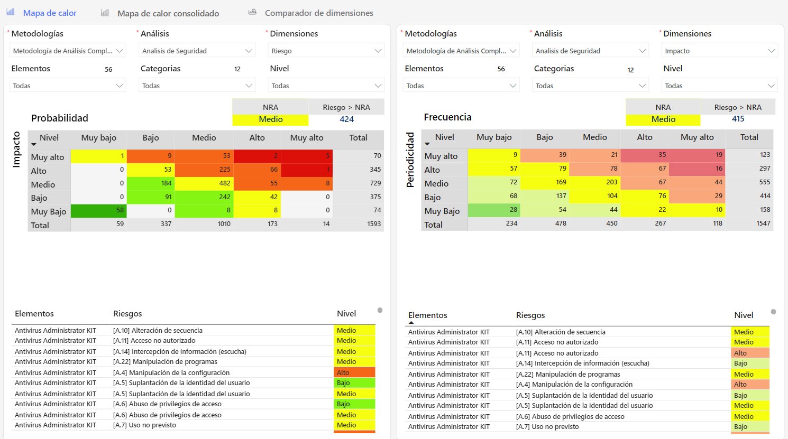

# Dashboard Evaluación de Riesgos


Herramienta esencial para los responsables de la gestión de riesgos, proporcionando la información necesaria para tomar decisiones informadas, optimizar la gestión de riesgos y reforzar la estrategia de seguridad corporativa


### Características Principales

* **Visión global de riesgos**: Visualiza de manera comparativa los riesgos clasificados por su nivel de gravedad (bajo, medio, alto), ofreciendo una perspectiva integral de la exposición al riesgo en la organización.
* **Detalles por nivel de riesgo**: Profundiza en cada nivel de riesgo, proporcionando información detallada sobre la naturaleza y el impacto potencial de los riesgos identificados, lo que permite priorizar acciones y recursos.
* **Evaluación de controles implementados**: Analiza la efectividad de los controles ya aplicados a los distintos niveles de riesgo, ofreciendo insights sobre el estado de madurez y la resiliencia de la organización frente a los riesgos.
* **Gestión y seguimiento**: Facilita el seguimiento de las acciones de mitigación y los planes de respuesta.
* Filtrado avanzado: Utiliza filtros avanzados para examinar la evolución de los riesgos y la efectividad de las estrategias de mitigación a lo largo del tiempo.

## Explorando el Tablero **🔍**

## Vídeos


Tablero Evaluación de Riesgos.mp4

