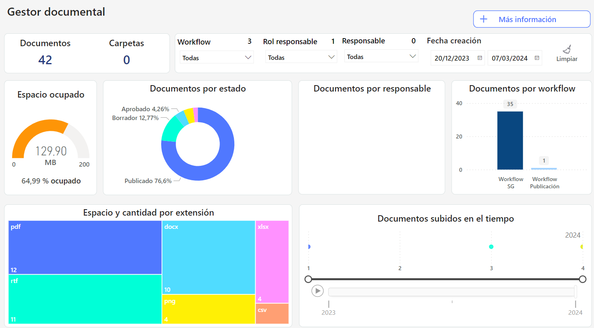

# Dashboard Gestor Documental


Este cuadro de mando transforma la forma en que se gestionan los documentos, proporcionando visibilidad, control y eficiencia en la administración documental, y apoyando la toma de decisiones estratégicas para la mejora continua del sistema


### Características principales

* **Uso del espacio**: Obtén una vista detallada del espacio utilizado en el sistema, permitiendo identificar oportunidades de optimización y necesidades de ampliación.
* **Documentos por tamaño y tipo**: Analiza la distribución de documentos según su tamaño y tipo de archivo. Esta característica es esencial para gestionar la capacidad de almacenamiento y priorizar la organización de los archivos.
* **Responsables de los documentos:** Visualiza la asignación de documentos por responsable, facilitando la trazabilidad y la gestión de la información.
* **Gestión de workflows**: Para aquellos con workflows de aprobación activados, el dashboard muestra los documentos pendientes de aprobación, asegurando un seguimiento eficiente de los procesos internos.
* **Filtrado por fechas:** La funcionalidad de filtrado avanzado por fechas permite segmentar y analizar la información en periodos específicos, mejorando la precisión del análisis y la toma de decisiones basada en datos temporales relevantes.
