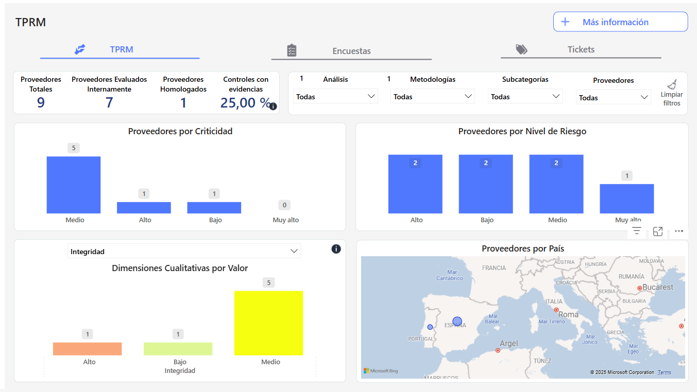
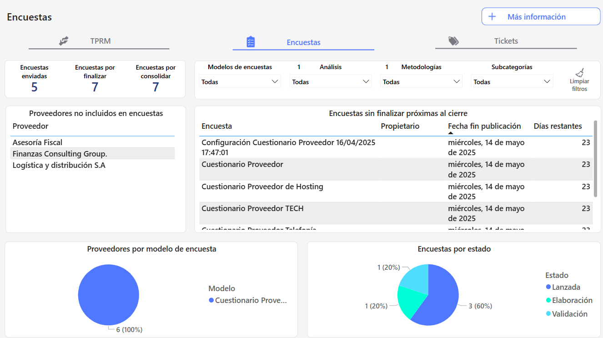
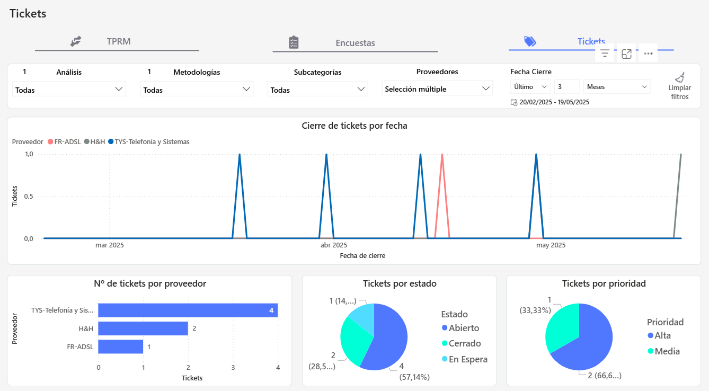

# Dashboard TPRM


Esta funcionalidad introduce un nuevo dashboard específico para la gestión de proveedores dentro de GlobalSuite®, con el objetivo de centralizar la visualización de métricas clave relacionadas con proveedores, encuestas y tickets. A través de indicadores visuales, tablas detalladas y filtros avanzados, este dashboard permite realizar un seguimiento completo y dinámico del estado de la relación con terceros, facilitando la toma de decisiones y el control operativo.


## Pestaña TPRM – Datos de Proveedores

### Indicadores clave

* **Proveedores totales**: Muestra la cantidad total de proveedores registrados en el sistema, independientemente de su estado de evaluación o de si se han creado como elementos asociados o no.
* **Proveedores evaluados internamente**: Indica el número de proveedores que han sido sometidos a una evaluación de criticidad en la [Tabla de Elementos](https://help.globalsuitesolutions.com/es/globalsuite/v1/tabla-de-elementos).
* **Proveedores homologados**: Refleja la cantidad de proveedores que cuentan con una valoración de riesgo asociada a un servicio específico. Es decir, proveedores que tengan servicios asociados, en Inicio > [Proveedores](https://help.globalsuitesolutions.com/es/globalsuite/v1/proveedores), cuyos servicios tengan calculado el RGE.
* **Controles con evidencia**: Indicador que muestra el porcentaje de controles asociados a proveedores que cuentan con evidencias documentadas.

### Visualizaciones

* **Proveedores por criticidad**: Gráfica de barras que muestra la distribución de proveedores según su nivel de criticidad.
* **Proveedores por país**: Mapa interactivo que visualiza la ubicación geográfica de los proveedores, con indicadores de volumen.
* **Dimensiones cualitativas por valor**: Visualización que presenta la distribución de dimensiones cualitativas asignadas a los proveedores, utilizando la valoración del inventario.
* **Proveedores por nivel de riesgo**: Gráfica de barras que clasifica a los proveedores según su nivel de riesgo, utilizando la valoración del RGE del análisis de riesgo.

#### Tablas Más información

* **Controles con evidencia**: tabla con Proveedor, Criticidad, Control, Tipo y Evidencia.
* **Detalles datos proveedores**: Tabla que incluye información detallada como país, subcategoría, criticidad, nivel de riesgo, evidencias asociadas y fecha de la última evaluación.

### Filtros avanzados

* Permite aplicar filtros por metodologías, análisis, subcategorías, modelos de encuestas y proveedores, ofreciendo una personalización completa de la visualización de datos.

## Pestaña Encuestas

### Visualizaciones

* **Indicadores**: Muestra métricas como el número de cuestionarios enviados, pendientes por finalizar y pendientes por consolidar.
* **Gráficas**: Incluye representaciones visuales como "Proveedores por modelo de encuesta" y "Encuestas por estado".

### Tablas detalladas

* **Datos de encuestas**: Incluye información como proveedor, país, encuesta, responsable, propietario, fecha de lanzamiento, fecha de fin de publicación y estado.
* **Encuestas sin finalizar próximas al cierre**: Lista de cuestionarios que están próximos a su fecha de finalización y aún no han sido completados.
* **Proveedores sin encuestas asignadas**: Identifica a los proveedores que no tienen encuestas asociadas.

### Filtros avanzados

* Permite aplicar filtros por encuestas, configuración, fecha de lanzamiento, fecha de fin de publicación y proveedor, ofreciendo una personalización completa de la visualización de datos.

## Pestaña Tickets

### Visualizaciones

**Gráficas**: En las siguientes visualizaciones se incluirán los tickets que tengan un proveedores asociados(Campo SUPPLIER:)

* **Cierre de tickets por fecha**: Se mostrarán los tickets que tenga una fecha de cierre definida en el ticket (Campo DATE, tipo fecha de cierre prevista).
* **Nº de tickets por proveedor**. Se incluyen los tickets que tengan incluido el campo SUPPLIER y un proveedor asociado en el mismo.
* **Tickets por estado**: Se incluyen los tickets que tengan incluido el campo STATUS y un estado seleccionado en el mismo.
* **Tickets por prioridad**: Se incluyen los tickets que tengan incluido el campo PRIORITY y una prioridad seleccionada en el mismo.

### Filtros avanzados

* Permite aplicar filtros por tickets, fecha de cierre prevista y prioridad, ofreciendo una personalización completa de la visualización de datos.

---
