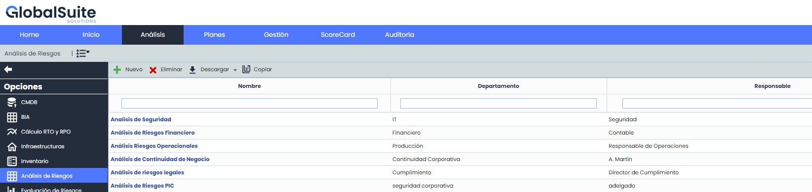

# Análisis Riesgos

Esta opción permite realizar un análisis de riesgos sobre aquellos elementos que se han identificado previamente en el apartado de [Inventario](https://help.globalsuitesolutions.com/es/globalsuite/v1/inventario) de elementos.

* [Información General](informacion-general.md)
* [Análisis de Riesgos](analisis-de-riesgos.md)
* [Riesgos Múltiples](riesgos-multiples.md)
* [Análisis de Costes](analisis-de-costes.md)
* [Consolidación de Análisis de Riesgos](consolidacion-de-analisis-de-riesgos.md)
* [Agente IA en Riesgos](agente-ia-en-riesgos.md)

Al acceder a la opción la herramienta ofrece las siguientes opciones:

* **Nuevo**: Permite crear un nuevo análisis de riesgos. Para ello se ha de pulsar el botón ‘Nuevo’ y se creará una nueva línea de análisis.

* **Eliminar:** Permite eliminar un análisis de riesgos del listado. Para ello se ha de seleccionar la fila o filas deseadas y pulsar el botón ‘Eliminar’.

* **Descarga:** Ofrece la posibilidad de descargar el listado de análisis de riesgos en formato editable (.xlsx) o en formato .PDF
