# Agente IA en Riesgos

## Agente IA en Evaluación y Análisis de Riesgos

GlobalSuite® incorpora en Evaluación de Riesgos y en Análisis de Riesgos un **Agente IA**: un asistente conversacional con el que puedes consultar en lenguaje natural el análisis que tienes abierto. El agente revisa los elementos, los riesgos, las valoraciones, los controles y los planes de tratamiento del análisis y responde con tablas, conclusiones y recomendaciones apoyadas en esos datos.

Preguntas que antes exigían cambiar de vista, aplicar filtros sucesivos y exportar —qué riesgos superan el nivel aceptable, cuáles no tienen responsable, qué controles siguen solo planificados, qué acciones conviene priorizar— se resuelven con una sola consulta y sin salir de la pantalla del análisis. También puedes adjuntar documentos, como un informe de auditoría, para que el agente los relacione con los riesgos y controles del análisis.

### ¿Para qué sirve?

El Agente IA apoya la interpretación de los resultados y la toma de decisiones de quienes trabajan con el análisis de riesgos:

* **Responsables del análisis y de seguridad**: obtienen en segundos una lectura de los riesgos prioritarios, de su nivel residual y de su situación de tratamiento.
* **Equipos de riesgos y cumplimiento**: localizan huecos de información, como riesgos sin responsable o controles sin valoración de efectividad, antes de presentar o cerrar el análisis.
* **Dirección y comités**: disponen de resúmenes ejecutivos y de propuestas de actuación redactadas a partir de los datos reales del análisis.
* **Auditoría**: puede cruzar los hallazgos de un informe con los riesgos y los controles del análisis para decidir qué tratar primero.

### Características principales

* Acceso desde la cabecera de **Evaluación de Riesgos** («Agente IA»), disponible en todas sus pestañas, y desde el botón **«IA»** en los listados y en la valoración de un análisis.
* Contexto automático: el agente trabaja siempre sobre el análisis abierto, sin que tengas que indicarlo.
* Consultas sugeridas para empezar con un clic y consultas libres en lenguaje natural.
* Respuestas con tablas, listas y conclusiones que puedes copiar, y vista ampliada para leerlas cómodamente.
* Posibilidad de añadir documentos a la consulta desde tu equipo.
* Propuestas de cambios en el análisis —por ejemplo, crear un plan de tratamiento y asociarlo a un riesgo— que solo se aplican cuando las apruebas.
* Avisa cuando no dispone de un dato, por ejemplo una valoración de efectividad o una dimensión económica, en lugar de suponerlo.
* Mismos permisos que en la web: el agente solo trabaja con la información que tu usuario puede ver.

### ¿Dónde se encuentra?

Abre un análisis en **Análisis ▸ Evaluación de Riesgos**. En la cabecera de la evaluación, a la derecha, aparece la acción **«Agente IA»**. Está disponible en las cuatro pestañas de la evaluación —Listado, Agrupaciones, Mapa y Resumen— y el panel se mantiene abierto al cambiar de pestaña.

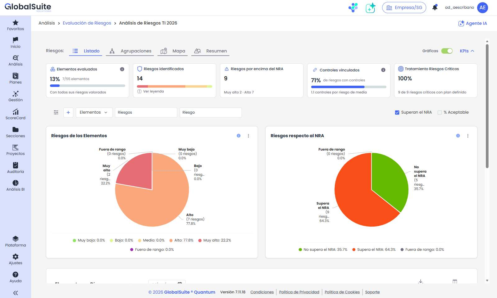

*Evaluación de Riesgos de un análisis, con la acción «Agente IA» en la esquina superior derecha.*

El mismo agente, con la misma conversación, también se abre desde el botón **«IA»** de la barra de herramientas en:

* el listado de análisis de **Evaluación de Riesgos** y de **Análisis de Riesgos**;
* la pestaña **«Valoración de riesgos»** del detalle de un análisis.

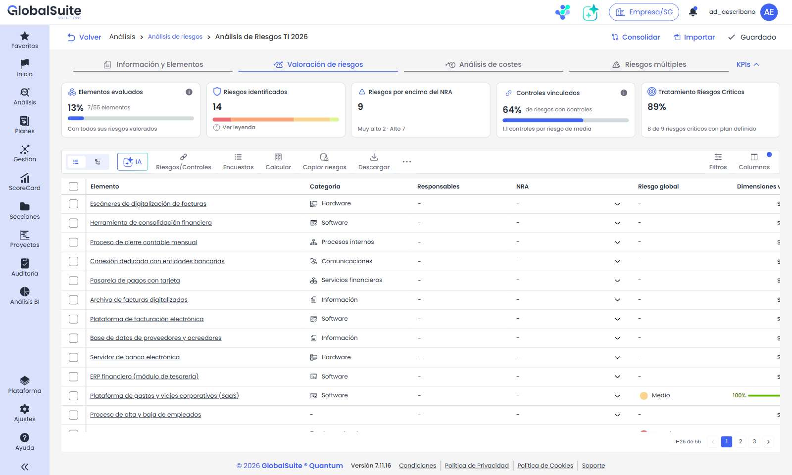

*Botón «IA» en la barra de herramientas de la pestaña «Valoración de riesgos».*

### ¿Cómo funciona?

El proceso consiste en abrir el agente, lanzar una consulta —sugerida o propia, con documentos si lo necesitas— y revisar la respuesta. Puedes encadenar varias preguntas en la misma conversación: el agente tiene en cuenta lo que ya se ha hablado.

#### 1. Abrir el agente

Pulsa **«Agente IA»**. El panel se abre a la derecha y la vista del análisis se ajusta al espacio disponible, sin perder la pestaña, los filtros ni la posición en la que estabas.

Al empezar, el panel muestra el título **«¿En qué puedo ayudarte con este análisis de riesgos?»** y cuatro consultas sugeridas:

* Identificar los riesgos más críticos del análisis.
* Revisar los riesgos que superan el NRA.
* Analizar la cobertura de controles del análisis.
* Priorizar acciones para reducir el nivel de riesgo.

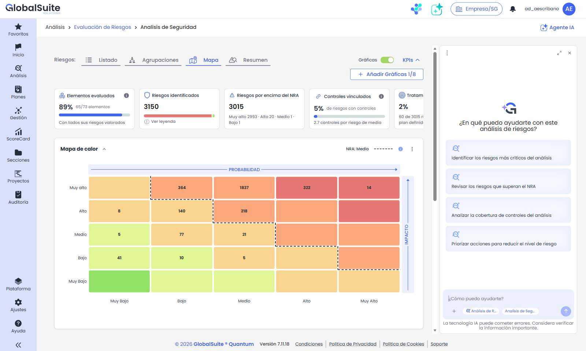

*Panel del Agente IA abierto sobre el mapa de calor de la evaluación, con las consultas sugeridas.*

#### 2. Contexto de la consulta

Bajo el campo de escritura se muestran de forma fija dos etiquetas de contexto: el módulo, **«Análisis de Riesgos»**, y el **nombre del análisis abierto**. Indican sobre qué datos va a trabajar el agente y no se pueden retirar. Si cambias de análisis, la etiqueta se actualiza y las nuevas preguntas se responden sobre el análisis nuevo.

#### 3. Lanzar una consulta

Pulsa una consulta sugerida para enviarla directamente o escribe tu pregunta en el campo **«¿Cómo puedo ayudarte?»** y pulsa Intro o el botón de envío. Las sugerencias desaparecen en cuanto empieza la conversación.

Mientras se prepara la respuesta, el panel indica que está analizando la información y el botón de envío pasa a ser un botón para detener la respuesta. El agente consulta los datos del análisis antes de contestar, así que la respuesta suele tardar **entre 30 y 90 segundos**; las consultas que recorren todo el análisis o que incluyen documentos pueden tardar varios minutos.

#### 4. Revisar la respuesta

El agente responde sobre el análisis abierto y cita los elementos, los riesgos y los controles por su nombre. Las respuestas suelen combinar:

* **Tablas** con los riesgos, los elementos afectados, sus niveles y la situación de los controles. Las tablas anchas se desplazan en horizontal y cada una tiene su propio botón para copiarla.
* **Conclusiones** que resumen qué requiere atención y por qué.
* **Propuestas de siguiente paso**, como ordenar los riesgos por prioridad o preparar una versión para el comité de dirección; basta con responder «sí» o pedir la variante que prefieras.

Pulsa **«Copiar»**, al pie de cada respuesta, para llevar su contenido a un informe o a un correo.

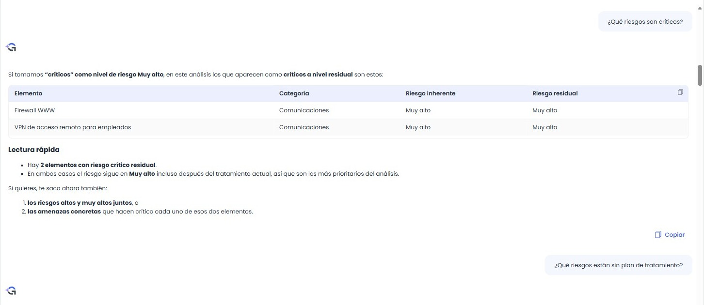

*Respuesta a «¿Qué riesgos son críticos?»: los dos elementos con riesgo residual Muy alto y una lectura rápida.*

#### 5. Añadir documentos a la consulta

El botón **«+»**, a la izquierda de las etiquetas de contexto, abre el selector de archivos de tu equipo. Puedes seleccionar uno o varios documentos; cada uno aparece como una ficha encima del campo de escritura. Para quitar un archivo antes de enviar, pasa el ratón por su ficha y pulsa el aspa.

Los documentos se usan en la consulta que envíes a continuación. Es útil, por ejemplo, para relacionar los hallazgos de un informe de auditoría, un análisis de vulnerabilidades o una política interna con los riesgos y controles del análisis.

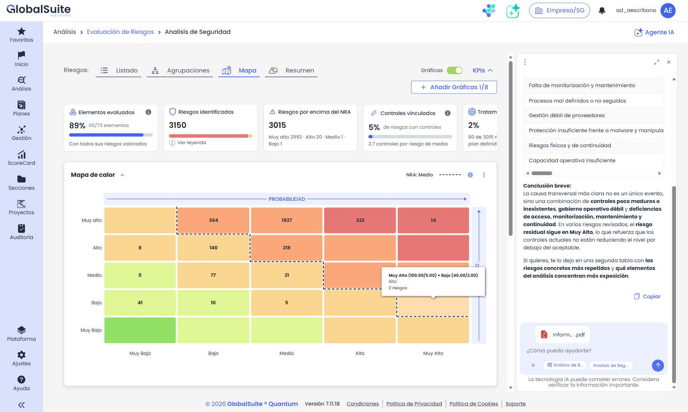

*Informe de auditoría en PDF añadido a la consulta, junto a las etiquetas de contexto.*

*Respuesta que relaciona cada hallazgo del informe con los riesgos del análisis y prioriza los controles.*

#### 6. Aplicar cambios en el análisis con tu aprobación

Además de consultar, puedes pedir al agente que haga cambios en el análisis; por ejemplo, *«Crea un plan de tratamiento para el riesgo de robo de cuentas del portal de nóminas, con responsable Dirección de RRHH y plazo 31/03/2027, y asócialo al riesgo»*. El agente no modifica nada por su cuenta: muestra una tarjeta por cada operación, con lo que va a hacer, y espera a que decidas.

* Pulsa **«Detalles»** para ver los datos que se van a guardar.
* Pulsa **«Aprobar»** para aplicar la operación o **«Rechazar»** para descartarla.
* Si la petición implica varias operaciones, como crear el plan y después asociarlo al riesgo, se muestran en orden («1 de 2», «2 de 2») y cada una se aprueba por separado. Las ya aplicadas se marcan como **«Hecho»**.

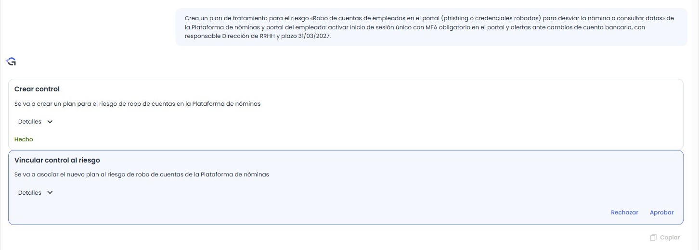

*Creación de un plan de tratamiento en dos pasos: el primero ya aplicado («Hecho») y el segundo pendiente de aprobar.*

El agente puede valorar elementos, crear riesgos, planes de tratamiento y acciones, y asociar controles a riesgos, con las mismas acciones de escritura que el MCP GlobalSuite. Trabaja con tus permisos, igual que si hicieras el cambio desde la plataforma.

* **Pide primero una propuesta si quieres revisarla con calma.** Por ejemplo: *«Para el plan “Tratamiento - Revisión y depuración de reglas del cortafuegos perimetral”, propón dos acciones con responsable y plazo para completarlo antes de marzo de 2027. No las crees todavía.»* Cuando estés conforme, pídele que las cree y aprueba las tarjetas.
* **Comprueba el resultado en el análisis.** El agente puede completar campos que no le has indicado, como los recursos, la descripción o la fecha de seguimiento.

#### 7. Ampliar, cerrar y consultar el saldo

| **Acción** | **Qué hace** |
| --- | --- |
| **Maximizar panel** | Amplía el agente a todo el ancho del área de trabajo, sin salir del análisis. Recomendable para leer respuestas con tablas extensas. Con el panel ampliado, el mismo botón pasa a «Restaurar panel». |
| **Cerrar panel** | Oculta el agente y devuelve el espacio a la vista del análisis. La conversación se conserva: al volver a abrir el panel encontrarás las preguntas y respuestas anteriores. |
| **Opciones (⋮)** | Muestra el saldo de **tokens** disponible para el asistente de IA en el mes. Con el panel ampliado, el saldo aparece directamente en la cabecera. |

### Ejemplos de consultas

Estas consultas funcionan bien sobre cualquier análisis. Puedes copiarlas tal cual: no hace falta nombrar el análisis, porque el agente ya sabe cuál tienes abierto.

| **Consulta** | **Qué obtienes** |
| --- | --- |
| Resumen ejecutivo del Análisis de Riesgos | Ficha del análisis (responsable, metodología, alcance, nivel aceptable y objetivo), focos de exposición, situación del tratamiento y una conclusión para dirección. |
| ¿Qué riesgos son críticos? | Los elementos y riesgos con nivel residual más alto, con su riesgo inherente y residual. |
| ¿Qué evolución tiene el Riesgo Residual? | La distribución actual del riesgo residual y la comparación entre riesgo inherente y residual; el agente avisa si no hay histórico con el que comparar. |
| Identifica los riesgos sin responsable asignado | Los riesgos sin responsable, con su elemento y su nivel residual, para priorizar la asignación. |
| ¿Qué controles tienen poca efectividad? | Los controles con valoración baja o, si no están valorados, el aviso de que falta ese dato y su situación (implantado o plan de tratamiento). |
| ¿Qué riesgos tendrían un impacto económico mayor? | Una priorización por impacto potencial; si el análisis no tiene dimensión económica, el agente lo indica y aproxima con la importancia y el riesgo residual. |
| Riesgos por unidad de negocio o Servicio | La distribución de los riesgos por área propietaria de los elementos y por servicio. |
| ¿Qué tres acciones me recomiendas para bajar el riesgo residual de este análisis por debajo del nivel aceptable? | Tres acciones priorizadas, apoyadas en los riesgos que superan el nivel aceptable y en los planes de tratamiento existentes, con una hoja de ruta. |
| Con el informe de auditoría adjunto, ¿qué riesgos de este análisis se ven reforzados por los hallazgos y qué controles conviene priorizar? | Un cruce entre los hallazgos del documento, los riesgos del análisis y los controles existentes, con una propuesta de prioridades. |

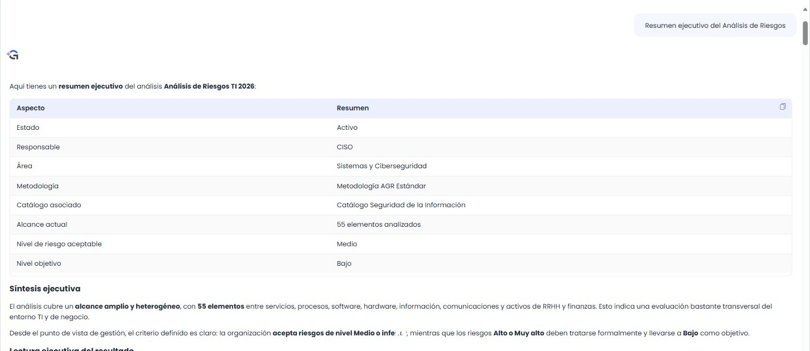

*Resumen ejecutivo del análisis: ficha, síntesis y lectura para dirección.*

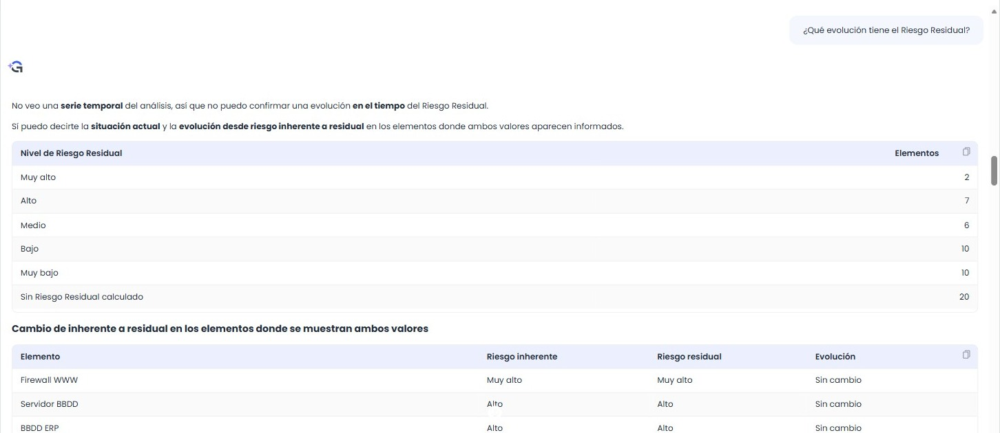

*Evolución del riesgo residual: el agente avisa de que no hay serie temporal y compara riesgo inherente y residual.*

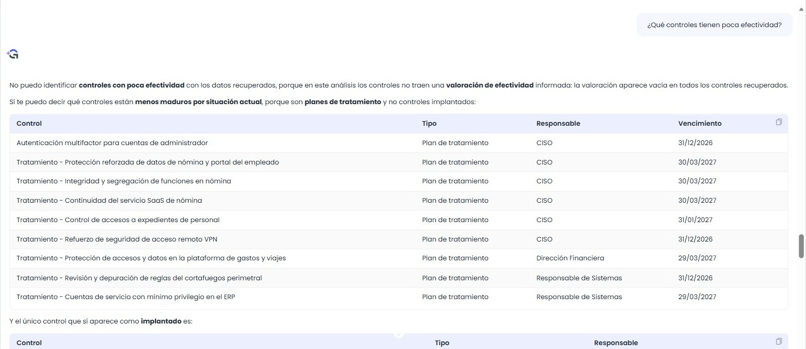

*Cuando los controles no tienen valoración de efectividad, el agente lo indica y propone una alternativa útil.*

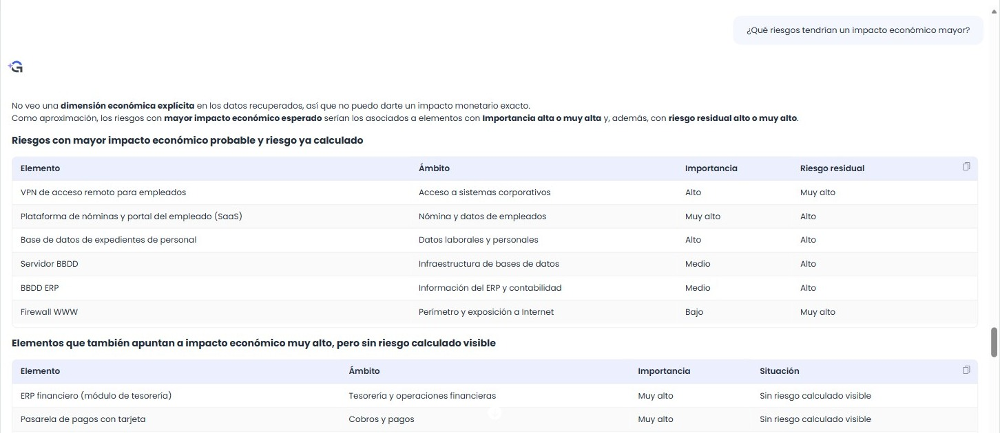

*Impacto económico: sin una dimensión económica en el análisis, el agente explica su aproximación.*

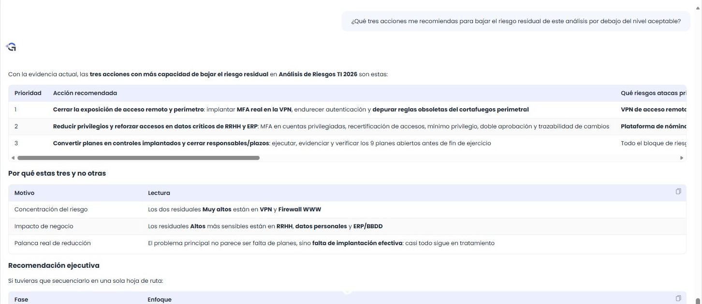

*Tres acciones priorizadas para situar el riesgo residual por debajo del nivel aceptable.*

### Prompts del MCP GlobalSuite

El Agente IA usa las mismas capacidades que el **MCP GlobalSuite**, el conector que permite trabajar con GlobalSuite® desde asistentes como Claude o ChatGPT, pero integrado en la plataforma y sin configurar nada. Por eso, los prompts publicados para el MCP sobre análisis de riesgos, controles y planes de tratamiento también sirven aquí. Al usarlos en el agente:

* Sustituye el nombre del análisis entre [corchetes] por «este análisis»: el agente ya trabaja sobre el análisis abierto.
* Las respuestas se presentan como texto y tablas dentro del panel; copia el contenido con «Copiar» si necesitas llevarlo a otro documento.
* Los prompts que modifican datos (alta de riesgos, planes de tratamiento, asociación de controles) se aplican también con aprobación previa, tarjeta a tarjeta.

Encontrarás ejemplos listos para copiar en estos apartados de la guía de prompts del MCP:

* [3. Análisis de riesgos](../../general/mcp-de-globalsuite-para-conexion-a-sistemas-ia/casos-de-uso-y-ejemplos-de-prompts-del-mcp-globalsuite.md#3.-Análisis-de-riesgos): riesgos de un elemento, riesgos críticos, elementos por encima del riesgo aceptable, cómo se calcula el riesgo y dónde no están actuando los controles.
* [4. Controles y planes de tratamiento](../../general/mcp-de-globalsuite-para-conexion-a-sistemas-ia/casos-de-uso-y-ejemplos-de-prompts-del-mcp-globalsuite.md#4.-Controles-y-planes-de-tratamiento): controles de un riesgo, controles que cubren más riesgos críticos, planes pendientes, controles más débiles y madurez.
* [9. Acciones de escritura](../../general/mcp-de-globalsuite-para-conexion-a-sistemas-ia/casos-de-uso-y-ejemplos-de-prompts-del-mcp-globalsuite.md#9.-Acciones-de-escritura): crear riesgos valorados, crear un plan de tratamiento y asociarlo a los riesgos, registrar acciones y pasar del diagnóstico a la acción.
* [Consejos para obtener mejores respuestas](../../general/mcp-de-globalsuite-para-conexion-a-sistemas-ia/casos-de-uso-y-ejemplos-de-prompts-del-mcp-globalsuite.md#Consejos-para-obtener-mejores-respuestas), aplicables también al agente.

### Tokens y disponibilidad

* Cada consulta consume **tokens** del cupo mensual de IA de la empresa. Las consultas que recorren todo el análisis o incluyen documentos consumen más.
* Puedes consultar el saldo disponible en **Opciones (⋮) ▸ Tokens**, o en la cabecera del panel ampliado.
* Si se agota el cupo, el agente muestra el aviso *«Ha superado los 1.500.000 tokens disponibles este mes. No podrá hacer uso hasta el siguiente mes. Contacte con soporte para más información.»* y vuelve a estar disponible al mes siguiente.
* Cuando el asistente de IA no está habilitado para la empresa, la acción «Agente IA» aparece deshabilitada con el aviso «Funcionalidad disponible en licenciamiento superior».

**PENDIENTE DE CONFIRMAR CON DESARROLLO: SI EL CUPO DEL AGENTE DE RIESGOS ES PROPIO O COMPARTIDO CON EL ASISTENTE GENERAL (EN LAB-PO3 7.11.18 ES COMPARTIDO), EL CUPO POR DEFECTO, DÓNDE SE CONFIGURA Y EL COMPORTAMIENTO SIN LICENCIA DE IA (LA RAMA DE LICENCIAMIENTO AÚN NO ESTÁ DESPLEGADA EN PO3).**

### Recomendaciones de uso

* **Abre el análisis sobre el que quieres preguntar.** El agente toma como contexto el análisis abierto; para consultar otro, ábrelo antes.
* **Una pregunta por mensaje.** Las preguntas concretas (un elemento, un nivel de riesgo, un tipo de control) dan respuestas más precisas y más rápidas.
* **Amplía el panel** para leer las respuestas con tablas.
* **Espera a que termine la respuesta** antes de enviar otra pregunta.
* **Contrasta las cifras con los indicadores.** Comprueba los totales de la respuesta con los indicadores de la cabecera antes de llevarlos a un informe.
* **Revisa cada tarjeta antes de aprobarla.** Abre «Detalles» y comprueba el nombre, el responsable y el plazo antes de aplicar un cambio.
* **Usa las recomendaciones como punto de partida.** Las propuestas del agente son una ayuda a la decisión; decide tú qué cambios hacer en la evaluación.

### Preguntas frecuentes

**¿El agente puede modificar mi análisis sin que me dé cuenta?**  
No. Cualquier cambio se presenta en una tarjeta con «Aprobar» y «Rechazar», y solo se aplica si lo apruebas.

**¿Qué información usa para responder?**  
Los datos del análisis abierto —elementos, riesgos, valoraciones, controles, planes y metodología— a los que tiene acceso tu usuario, y los documentos que adjuntes a la consulta.

**¿Se guarda la conversación?**  
Sí. Al cerrar el panel o cambiar de pantalla, la conversación se conserva y la encontrarás al volver a abrir el agente.

**¿Qué documentos puedo adjuntar?**  
Documentos de tu equipo, como informes en PDF. Los archivos se usan en la consulta que envías a continuación.

**¿Por qué tarda en responder?**  
Antes de contestar, el agente consulta los datos del análisis; cuanto más amplia es la pregunta o mayor es el análisis, más datos revisa. Si la respuesta tarda, espera a que termine antes de enviar otra consulta.

**¿El agente usa mis datos para entrenar el modelo?**  
El agente no proporciona información sobre el modelo de IA. Para el tratamiento de los datos, consulta las condiciones de uso de los servicios de IA de GlobalSuite®.


\*\*Ten en cuenta:\*\* el Agente IA es una ayuda para interpretar el análisis y no sustituye la revisión del usuario. Como indica el aviso fijo del panel, «La tecnología IA puede cometer errores. Considera verificar la información importante.».


Para más información, puedes consultar:

* [Casos de uso y ejemplos de prompts del MCP GlobalSuite](../../general/mcp-de-globalsuite-para-conexion-a-sistemas-ia/casos-de-uso-y-ejemplos-de-prompts-del-mcp-globalsuite.md)
* [MCP de GlobalSuite para conexión a Sistemas IA](../../general/mcp-de-globalsuite-para-conexion-a-sistemas-ia/README.md)
* [Preguntas frecuentes del MCP GlobalSuite](../../general/mcp-de-globalsuite-para-conexion-a-sistemas-ia/preguntas-frecuentes-del-mcp-globalsuite.md)
