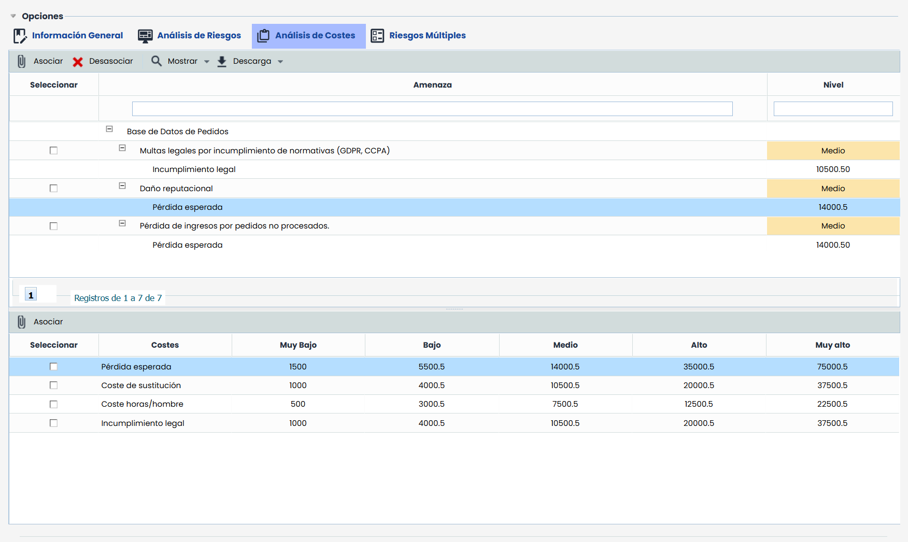
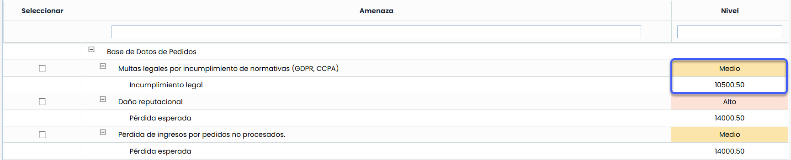

# Análisis de Costes

La opción de Análisis de Costes ofrece la posibilidad al usuario de asociar diferentes costes económicos a las amenazas que se han valorado en la pestaña de análisis de riesgos.

La tabla de abajo muestra el listado de costes y pérdida económica por cada uno de los niveles de riesgo y la tabla de arriba muestra el listado de activos y amenazas asociadas.

La plataforma permite gestionar la opción análisis de costes de la siguiente manera:

* **Asociar:** Permite asociar los costes a las amenazas de cada uno de los activos. Para ello se ha de seleccionar el coste deseado de la tabla de abajo, seleccionar la amenaza en la tabla de arriba y pulsar el botón ‘Asociar’. La herramienta calcula de manera automática el coste económico asociado.

* **Desasociar:** Posibilita al usuario eliminar una asociación ya fijada entre coste/amenaza. Para ello se ha de seleccionar la fila o filas con los costes asociados en la tabla de arriba y pulsar el botón ‘Desasociar’.

* **Mostrar:** Permite realizar un filtro sobre el listado de activos y amenazas, bien mostrando todo el listado (Mostrar Todos) o mostrando únicamente aquellos activos cuyas amenazas superan el Nivel de Riesgo Aceptable (Superan NRA)

* **Descarga:** Permite la descarga del listado de amenazas y costes a un archivo editable (.docx)


\*\*NOTA:\*\* El listado de costes se define en el apartado ‘Ajustes /Metodologías de Riesgos’.

