# Análisis de Riesgos

## Tabla Análisis de Riesgos

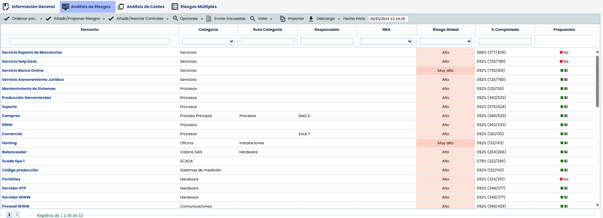

El análisis de riesgos permite evaluar las amenazas que afectan a cada uno de los activos. Al acceder a la opción se muestra una tabla con la siguiente información:

* **Activo:** Indica el nombre del activo. Estos activos se han registrado previamente en el apartado ‘Análisis/Inventario de Activos’ y seleccionados en el punto explicado anteriormente.
* **Categoría:** Muestra la categoría asignada al activo.
* **Riesgo Global:** Muestra el resultado del cálculo del Riesgo Global para cada elemento. El criterio que se utiliza para obtener el Riesgo Global por Elemento se define en el apartado 'Análisis de Riesgos - Información General' explicado en la sección anterior.
* **% Completado:** Muestra el grado de completitud del análisis de riesgos de cada activo. Entre paréntesis se indica el número de dimensiones valoradas para ese activo y el número total de dimensiones a valorar.
* **Propuestas:** Indica si el activo tiene incluido el conjunto de amenazas propuestas en función de los catálogos de amenazas asociados al análisis de riesgos. Si se requiere volver a proponer amenazas de los catálogos para uno o varios activos, se puede pulsar sobre la etiqueta 'Sí' de cada activo y cambiar el valor a 'No'. De esta forma, la herramienta vuelve a proponer o añadir amenazas para los activos que tienen la columna con el valor 'No' cuando se pulsa el botón 'Añadir/Proponer Amenazas'.

Las acciones que GlobalSuite® permite realizar sobre el listado de activos es el siguiente:

* **Ordenar por:** Permite ordenar el listado de activos en función del valor de una dimensión (Mayor a Menor).
* **Añadir/Proponer Amenazas:** Permite cargar de manera automática un listado de amenazas y vulnerabilidades a los activos en función de la categoría que se ha definido.

  * **Añadir Amenazas:**Al pulsar el botón la herramienta incluye en los activos con la columna 'Propuestas' a No, las nuevas amenazas y vulnerabilidades que no tenga ya aplicadas en el análisis.
  * **Proponer Amenazas:**Al pulsar el botón la herramienta vuelve a incluir a los activos con la columna 'Propuestas' a No todas las amenazas del catálogo de análisis que le correspondan según su categoría.
* **Añadir/Asociar Controles:** Permite cargar de manera automática en el análisis un listado de controles y aplicarlos a las amenazas según la configuración del catálogo de análisis.

  * **Proponer y Asociar Controles:**Al pulsar el botón la herramienta permite incluir en el análisis los nuevos controles del catálogo que no estén ya aplicados, y los asocia a las amenazas existentes según la correspondencia de dicho catálogo.
  * **Asociar Controles:**Al pulsar el botón la herramienta asocia los controles ya existentes en el análisis a las amenazas de los activos en función de la relación en el catálogo.


\*\*NOTA:\*\* El listado de amenazas y vulnerabilidades se puede definir en el apartado ‘Ajustes/Catálogos Análisis’.


## Opciones

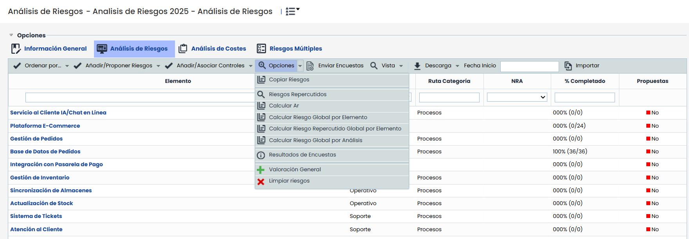

* **Opciones - Copiar Riesgos:**   
  Permite copiar las amenazas, vulnerabilidades y valoraciones de un activo a otros activos.

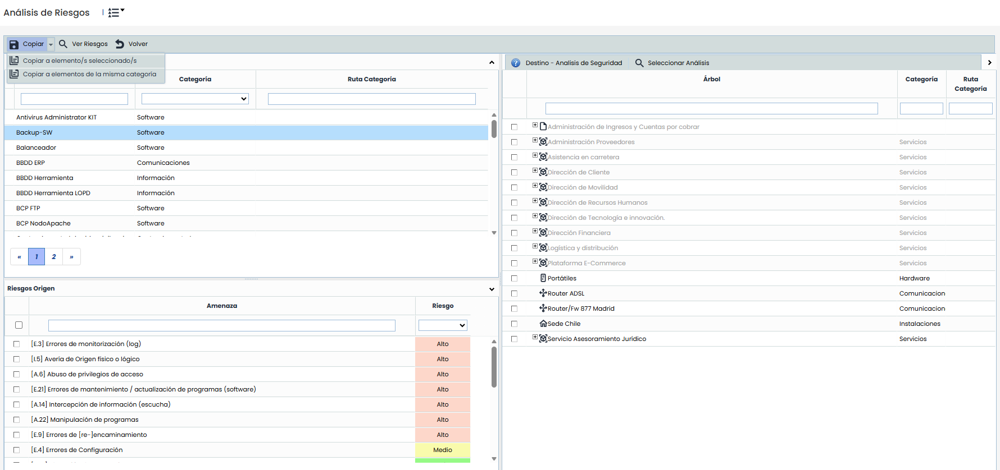

**- Copiar a elemento(s) seleccionado(s)** mantiene el funcionamiento actual: se deben seleccionar el elemento origen, los riesgos y los elementos destino en el árbol.

**- Copiar a elementos de la misma categoría** permite copiar los riesgos del elemento origen a todos los elementos del análisis que compartan su categoría, sin necesidad de seleccionar destinos manualmente.

* **Opciones - Riesgos Repercutidos:** Permite visualizar las amenazas repercutidas de un activo concreto. Las amenazas repercutidas están formadas por las amenazas del propio activo más las amenazas de los activos dependientes (en función de las dependencias establecidas en el apartado 'Inventario de Activos').

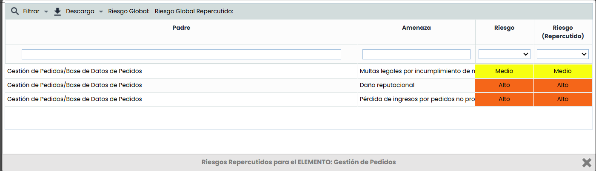

* **Opciones - Calcular AR:** Realiza el cálculo de todas las valoraciones y modificaciones que se han realizado sobre el análisis de riesgos. Si se ha realizado una modificación en la metodología de análisis de riesgos, esta opción permite calcular los nuevos valores aplicando la nueva metodología.
* **Opciones - Calcular Riesgo Global por Elemento:** Realiza el cálculo del Riesgo Global para cada elemento. El criterio que se utiliza para obtener el Riesgo Global por Elemento se define en el apartado 'Análisis de Riesgos - Información General' explicado en la sección anterior.
* **Opciones - Calcular Riesgo Repercutido Global por Elemento:** Realiza el cálculo del Riesgo Repercutido Global para cada elemento. El criterio que se utiliza para obtener el Riesgo Repercutido Global por Elemento se define en el apartado Análisis de Riesgos > [Información General](https://help.globalsuite.es/pages/viewpage.action?pageId=49152825) explicado en la sección anterior.
* **Opciones - Calcular Riesgo Global por Análisis:** Realiza el cálculo del Riesgo Global para el análisis de riesgos. El criterio que se utiliza para obtener el Riesgo Global por Análisis se define en el apartado 'Análisis de Riesgos - Información General' explicado en la sección anterior.
* **Opciones - Resultados de Encuestas:** Permite acceder a una pantalla para consultar y gestionar los resultados obtenidos en las encuestas de riesgos realizadas. Para acceder a la pantalla hay que seleccionar previamente el activo que se quiere gestionar. La explicación de esta opción se encuentra detallada en la siguiente sección, tras la explicación de todas las opciones existentes en la opción de análisis de riesgos.
* **Opciones - Valoración General:** Permite acceder a una tabla para realizar la valoración general de las amenazas/riesgos en función de la categoría del activo donde se encuentran asociadas. La explicación de esta opción se encuentra detallada en el apartado [Valoración General de Riesgos](https://help.globalsuitesolutions.com/es/globalsuite/v1/analisis-de-riesgos#AnálisisdeRiesgos-ValoraciónGeneraldeRiesgos) (luego de la explicación de la pantalla de resultados de encuestas).
* **Opciones - Limpiar riesgos:** Se eliminan los riesgos que no coinciden, por nombre, con los riesgos de los catálogos incluidos actualmente en el análisis.
* **Enviar Encuestas**

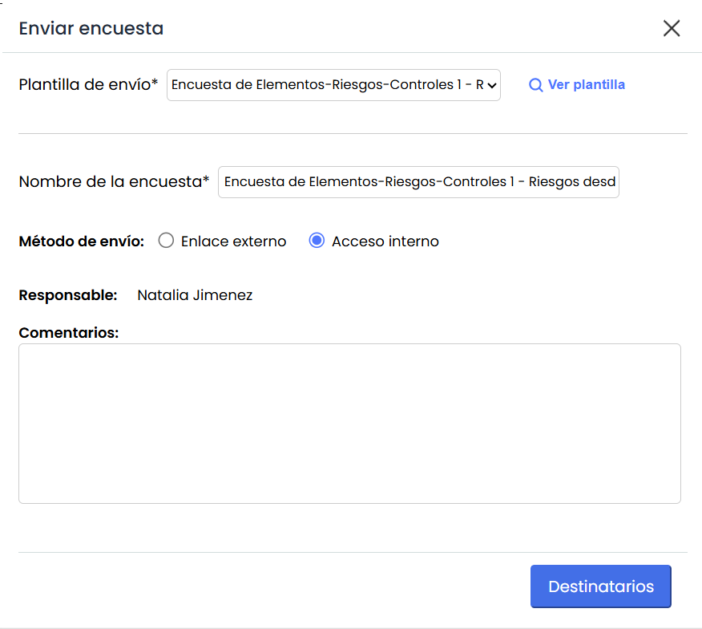

* Plantilla de Envío: Se listan todas las plantillas creadas para encuestas de Riesgos-Controles o Elementos-Riesgos-Controles. Las plantillas cuyo origen de riesgos sea "Análisis de riesgo" estarán incluidas, mientras que las de origen "Catálogo" se mostrarán únicamente si tienen el análisis asociado.
* Ver plantilla: Abre el detalle de la plantilla en [Configuración de encuestas](https://help.globalsuitesolutions.com/es/globalsuite/v1/encuestas-elementos-riesgos-y-controles-configurac)
* Nombre de encuesta: Se muestra el nombre de la plantilla. Se puede modificar, pero no modifica el nombre de la plantilla, solo el de las encuestas que se enviaran.
* Método de envío:

  * Enviar encuestas Acceso Interno: Envía la encuesta sin publicación
  * Enviar encuestas Enlace Externo: Envía la encuesta con publicación

    * En este caso, se muestran los campos Fecha de Inicio y Fecha de Fin.

      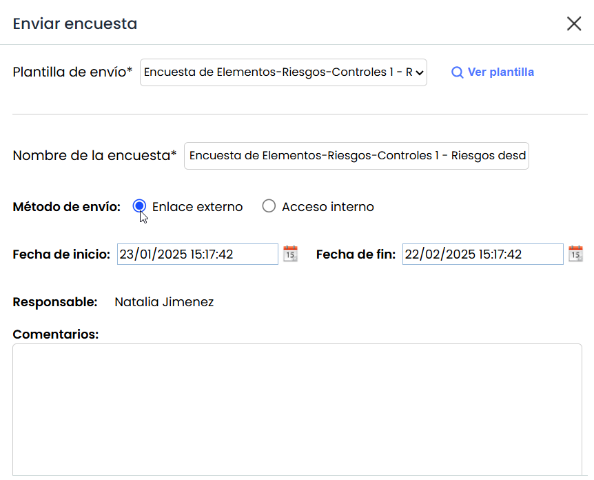
  * Responsable: El responsable configurado en la Plantilla.
  * Documentación de evidencias: Ese campo se muestra únicamente al seleccionar plantillas de tipo *Riesgos-Controles* o *Elementos-Riesgos-Controles* cuyo modelo tenga marcada la opción *“Incluir documentación de evidencias”*  
    Al seleccionar “**Asociar carpeta**” nos deja seleccionar el sitio del Gestor Documental donde se subirán las evidencias asociadas a los controles evaluados en la encuesta. La carga de documentos sigue las mismas validaciones de workflows y reglas de visibilidad definidas en la [configuración de encuestas](https://help.globalsuitesolutions.com/es/globalsuite/v1/encuestas-elementos-riesgos-y-controles-configurac#EncuestasElementos,RiesgosyControles(Configuraci%C3%B3n)-Documentaci%C3%B3nEvidencia)

    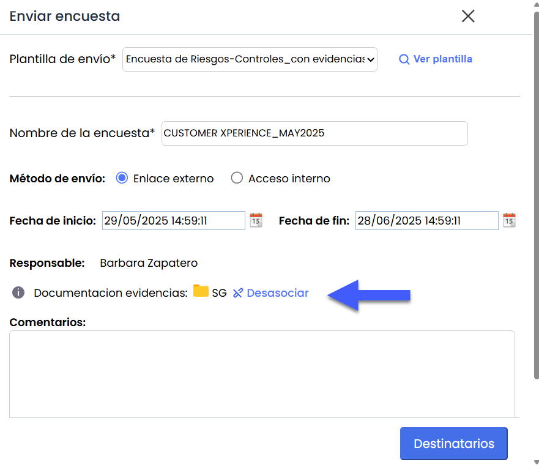
  * **Comentarios:** En este apartado se muestra el texto asociado a la plantilla, el cual se puede editar. Este texto será el que se visualice en la landing de las encuestas completadas. Si el campo queda vacío, se añadirá automáticamente un texto por defecto.
  * **Destinatarios:** En este apartado se pueden seleccionar los destinatarios de la encuesta. Este campo puede estar prellenado si la plantilla lo incluye. Si el campo está vacío, se asignará automáticamente al responsable del elemento, siempre y cuando todos los elementos tengan el mismo responsable. Si no cumplen esta condición, el campo quedará vacío, y será obligatorio seleccionar al menos un destinatario para que se habilite el botón "Enviar"

    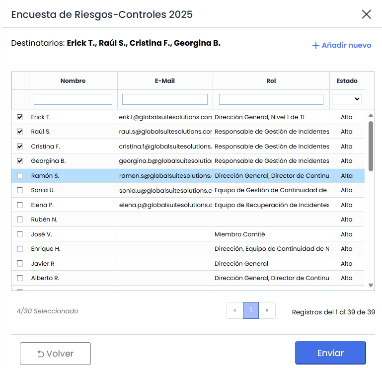
    * **Añadir nuevo:** Si es necesario incluir un destinatario que no sea empleado de la empresa, se puede ingresar su correo electrónico de forma manual para añadirlo.

      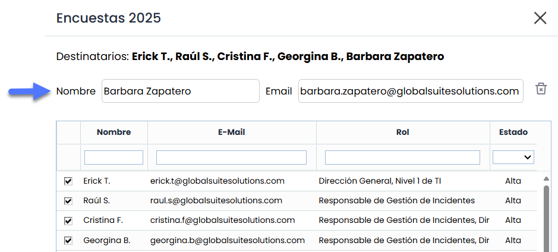
    * **Destinatario y estados:** Si la encuesta incluye estados, la tabla de destinatarios estará prellenada según la configuración de la plantilla. Si no hay destinatarios asignados para el primer estado, que es obligatorio, se tomará automáticamente al responsable del elemento, siempre que todos los elementos seleccionados tengan el mismo responsable. Si esta condición no se cumple, el campo quedará vacío, y será obligatorio seleccionar al menos un destinatario para el primer estado del flujo para que se habilite el botón "Enviar".

      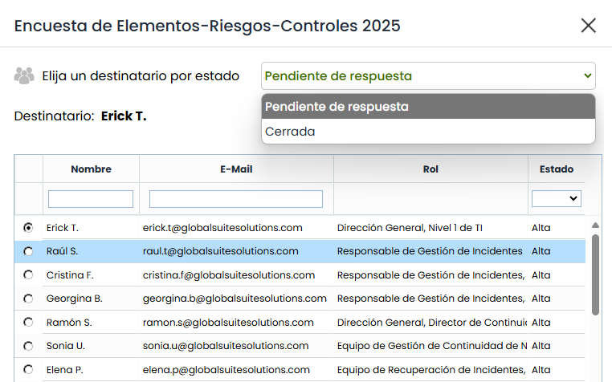

      La tabla cambia según el estado seleccionado
  * **Envío de encuestas:** Al presionar el botón "Enviar", el sistema realiza las siguientes acciones:

    * **Creación de configuración:** Se genera la configuración correspondiente a la encuesta.
    * **Generación de encuestas:** El sistema crea una encuesta para cada destinatario, vinculada a los elementos seleccionados desde el análisis.

      * **Origen "Análisis de Riesgos":** Se asociarán a cada elemento los riesgos y todos los controles que estén vinculados a esos riesgos en el análisis de riesgos.
      * **Origen "Catálogo":** Se asociarán a cada elemento únicamente los riesgos seleccionados que coincidan en categoría. Si la categoría del elemento no coincide con la del riesgo, este no será incluido.
    * **Publicación:** Si el método de envío es "Enlace externo", el sistema crea también la publicación que incluye las encuestas.
* **Descarga:** Permite la descarga del análisis de riesgos y sus atributos a un archivo editable (.xlsx) o en formato .PDF. Esta opción también permite descargar un informe específico en formato xls que contiene todos los riesgos de cada uno de los activos que se encuentran en el análisis de riesgos, incluyendo la información de qué proceso se encuentra asociado cada activo o proceso.
* **Vista:**  Esta opción permite visualizar los elementos incluidos en el alcance en vista de Tabla o de Árbol.

  * **Tabla:**  Se muestra un listado plano de todos los elementos incluidos en el alcance.
  * **Árbol:**Esta vista permite mostrar de forma jerárquica y ordenados alfabéticamente los elementos, para tener el contexto y las dependencias con otros elementos.

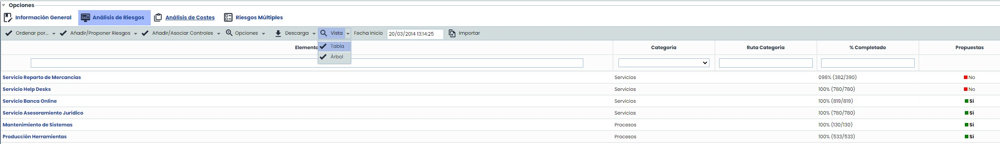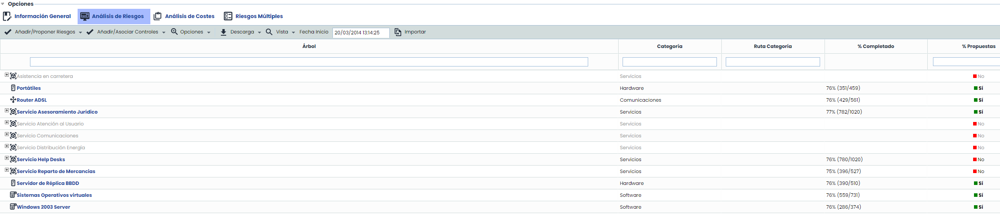

* **Fecha de Inicio:** Posibilita identificar la fecha de creación del Análisis de Riesgos.
* **Importar:** Esta opción permite realizar una carga masiva de los datos del análisis que se encuentran en un archivo Excel. Al pulsar el botón "Seleccionar archivo", la herramienta solicita un archivo en formato Excel que debe contener un conjunto de columnas con la información de los campos que se desean importar, no importa el orden de las columnas ya que permite seleccionar aquellas que se quieren importar.

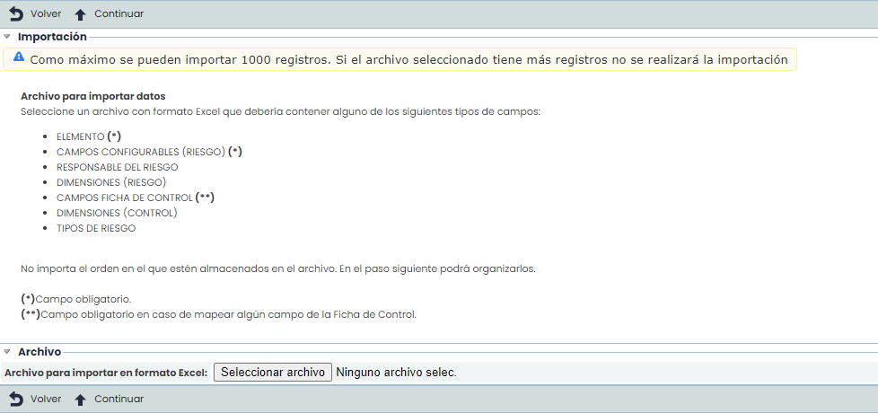


\*\*NOTA:\*\* El Modelo de Importación en Excel con la estructura se puede descargar desde la [Tabla de Elementos](https://help.globalsuite.es/display/GlobalSUITEes/.Tabla+de+Elementos+vv6.56).


Una vez que se pulsa sobre el enlace de los activos se muestra una tabla con la siguiente información:

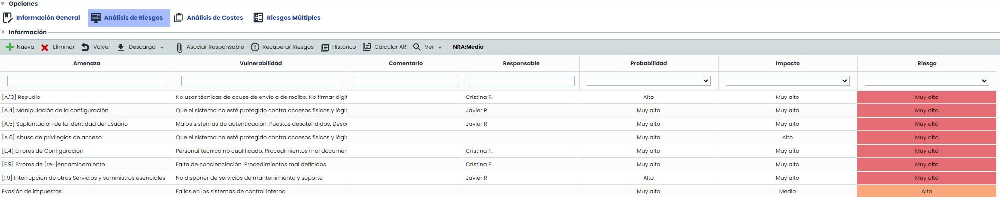

* **Amenaza:** Indica el nombre de la amenaza de activo a ser valorada. Las amenazas son eventos que pueden desencadenar un incidente en la organización, produciendo daños materiales o pérdidas inmateriales en sus activos. El campo es modificable pulsando dos veces sobre la celda.
* **Vulnerabilidad:** Indica la debilidad que tiene el activo para que la amenaza pueda materializarse. El campo es modificable pulsando dos veces sobre la celda.
* **Comentario:** Permite documentar cualquier anotación adicional sobre la amenaza valorada.
* **Responsable:** Permite definir el responsable del riesgo, de entre el conjunto de Empleados de alta.
* **Dimensiones:** En función de la metodología asociada al análisis de riesgos (Análisis de Riesgos/Información General), se cargarán las dimensiones asociadas al mismo y que se han definido en el apartado 'Ajustes/Metodologías Análisis'.


\*\*NOTA\*\* Se puede optar por visualizar todo el listado de dimensiones o seleccionar aquellas que mas información pueden aportar al usuario. Para ello se ha de pulsar con el botón derecho sobre la línea que muestra el nombre de las columnas y seleccionar mediante el checkbox las dimensiones deseadas.



\*\*NOTA 2:\*\* En función de la metodología definida en el apartado 'Ajustes/Metodología Análisis', las valoraciones pueden ser cualitativas o cuantitativas.


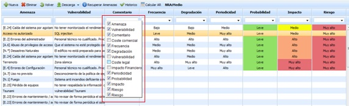

En relación a las dimensiones establecidas, GlobalSUITE ofrece información de utilidad a la hora de establecer valoraciones en función de la dimensión.

La información que aporta es la siguiente:

* **Ayuda:** Aporta al usuario una ayuda adicional a la hora de valorar una amenazas, ampliando la descripción de la misma. Este texto de ayuda se puede definir en el apartado de 'Aministración/Catálogos Análisis'.
* **Dimensión:** Permite seleccionar en el desplegable la dimensión deseada.
* **Nivel:** En función de la dimensión seleccionada, ofrece la posibilidad de seleccionar los niveles asociados, la cuales se definen en el apartado de 'Ajustes/Metodologías de Análisis'
* **Descripción:** En función de la dimensión y nivel seleccionado en los apartados anteriores, la herramienta informa al usuario de los criterios establecidos para el nivel seleccionado. La descripción se puede parametrizar en la opción 'Ajustes/Metodologías Análisis de Riesgos'

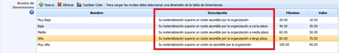


\*\*NOTA:\*\* La descripción de las dimensiones también se puede visualizar pulsando sobre la celda deseada en el análisis de riesgos, y en función de la dimensión y nivel asociado, la herramienta mostrará la descripción pertinente.


Las opciones que permite realizar la herramienta sobre la tabla de amenazas son:

* **Nueva:** Permite insertar una nueva línea en la tabla, sobre la que poder definir el nombre de la amenaza, vulnerabilidades, etc.
* **Eliminar:** Permite eliminar una o varias amenazas definidas. Para ello se ha de seleccionar la fila o filas deseadas y pulsar el botón ‘Eliminar’.
* **Volver:** Al pulsar sobre el botón la herramienta regresa a la pantalla anterior con el listado de activos.
* **Descarga:** Permite descargar el listado de amenazas en formato editable (.xls) o en PDF
* **Asociar Responsable:** Permite definir el responsable del riesgo, de entre el conjunto de Empleados de alta. Para definir un responsable, es necesario seleccionar la amenaza que se quiera asignar, y pulsar el botón. Al hacerlo, se mostrará el listado de Empleados y se podrá definir el que se desee, o en su caso, para eliminar el responsable, se deberá pulsar el botón "Limpiar Empleado".
* **Recuperar Riesgos:** Permite ver todos los elementos del catálogo y seleccionar uno o varios riesgos del listado según se requiera. Los riesgos seleccionados se añadirán al análisis.

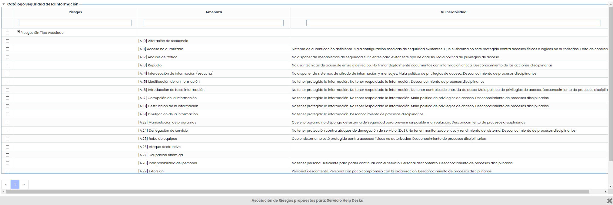

* **Histórico:** Permite visualizar un histórico del riesgo seleccionado.
* **Calcular AR:** Permite recalcular todas las valoraciones y modificaciones que se han realizado sobre el análisis de riesgos.


\*\*NOTA:\*\* El cálculo puede tardar más o menos tiempo en función del número de elementos y variables del árbol de dependencias. El estado de progreso de Cálculo podrá consultarse dentro del apartado [Progreso de Trabajos](https://help.globalsuite.es/display/GlobalSUITEes/.Descargas+Pendientes+vv5.1)


* **Ver:**  Esta opción permite visualizar los riesgos incluidos en el análisis en vista de Árbol o Datos BIA.
* **Árbol:** En caso de tener activado el uso de [Dependencias](https://help.globalsuite.es/pages/viewpage.action?pageId=52529148) en el Inventario, es posible consultar en una ventana emergente dónde se sitúa el elemento actual en la estructura jerárquica, filtrando el árbol y resaltando en negrita su ubicación, para tener la información sin necesidad de acceder a otro apartado.

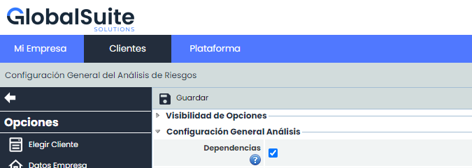

* **Datos BIA:** Esta vista permite mostrar de forma jerárquica los elementos, incluyendo la información de Continuidad de Negocio resultante de los BIAs Consolidados para los procesos: Criticidad, RTO, MTPD, RT.

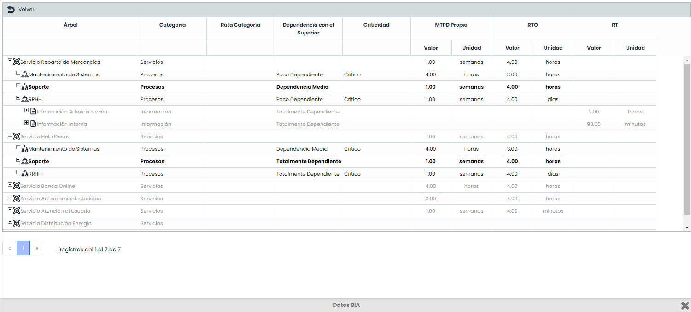

En la parte inferior del presente apartado, se muestra un resumen del activo y amenaza seleccionada en la tabla superior, pudiendo visualizar los siguientes apartados:

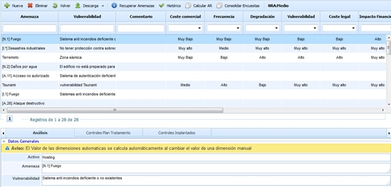

## Análisis

El presente apartado permite visualizar y establecer las valoraciones de una amenazas para el elemento seleccionado. Esta valoración es la misma que figura en la tabla pero visualizada en forma de formulario.

Adicionalmente, cuenta con un apartado para poder agrupar los Riesgos. Estos Riesgos son los especificados en el apartado de Ajustes en Metodologías > [Riesgos](https://help.globalsuite.es/pages/viewpage.action?pageId=99975652). Se podrá agrupar el riesgo en uno o más riesgos.

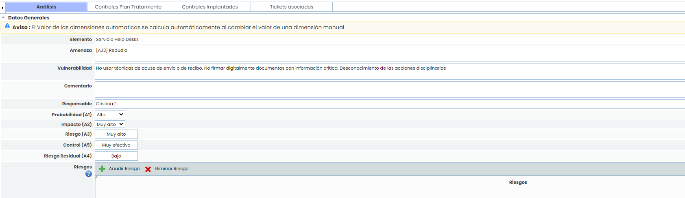

Al pulsar el botón "Añadir Riesgo" se abrirá una ventana con el árbol de tipos de riesgo que se pueden asociar. Solo se podrán asociar los tipos de riesgo asociados a los catálogos incluidos en el análisis de riesgos que se esté realizando. Esta opción se configura en Ajustes > Plantillas > [Catálogos Análisis](https://help.globalsuite.es/pages/viewpage.action?pageId=78808054) > Tipos de Riesgo.

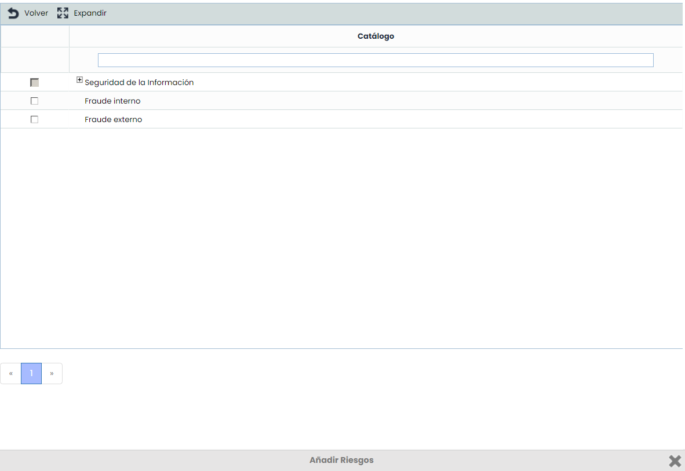

## Controles Plan de Tratamiento

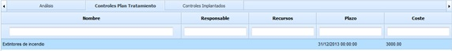

Ofrece la posibilidad de visualizar los controles del Plan de Tratamiento (Análisis/Gestión de Riesgos) que han sido asociados a esta amenaza concreta. Entre los datos que se pueden visualizar del control son el Nombre del mismo, el responsable de su implantación, los recursos (técnicos y humanos) con los que ha contado, costes y el plazo de implantación.

## Controles Implantados

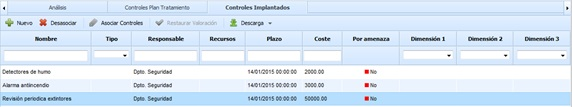

El apartado de controles implantados, permite asociar los controles que ya están implantados en la organización a una amenaza concreta. La información que ofrece la tabla por cada uno de los controles es la siguiente:

* **Nombre:** Identifica el nombre del control implantado. Para modificar el mismo, se ha de pulsar dos veces sobre la celda.
* **Tipo:** Permite visualizar la tipología del control.
* **Responsable:** Identifica el responsable de la implantación del control.
* **Recursos:** Ofrece la posibilidad de definir los recursos (técnico y/o humanos) con los que ha contado para la implantación del control
* **Plazo:** Identifica la fecha en la cual el control ha quedado implantado en la organización
* **Coste:** Permite identificar la cuantía económica que ha supuesto la implantación del control en la organización.
* **Por amenaza:** Ofrece la posibilidad de visualizar si la valoración de las dimensiones es global para todas las amenazas (Estado 'No') o si la valoración del control se ha modificado de manera específica para la amenaza seleccionada en la tabla superior (Estado 'Si')
* **Dimensiones:** En función de la 'Metodología de controles' establecida, permite la valoración de las diferentes dimensiones definidas sobre un control.

Entre las acciones que permite realizar la tabla están las siguientes:

* **Nuevo:** Ofrece la posibilidad de insertar una nueva entrada en la tabla, que permite definir nuevos controles a una amenaza concreta.
* **Desasociar:** Permite al usuarios eliminar un control asociado a una amenaza concreta. Para ello se ha de seleccionar la fila deseada y pulsar sobre el botón 'Desasociar'.
* **Asociar controles:** Ofrece la posibilidad de asociar a una amenaza un control ya implementado en la organización. Al pulsar sobre el botón se muestra el listado de lo controles definidos en el apartado 'Análisis/Gestión de controles' para asociarlos a la amenaza seleccionada.
* **Restaurar valoración:** En el caso que el control haya sido valorado de manera especifica para la amenaza seleccionada, al presente opción permite al usuario restaurar la valoración del control según los datos definidos en el apartado 'Análisis/Gestión de controles'.
* **Descarga:** Ofrece la posibilidad de descargar el listado de controles en formato editable (.xlsx) o en formato .PDF.
* **Mostrar:** Ofrece la posibilidad de cambiar la vista que permite únicamente visualizar los controles, a una vista que permite ver los indicadores asociados a cada uno de los controles.

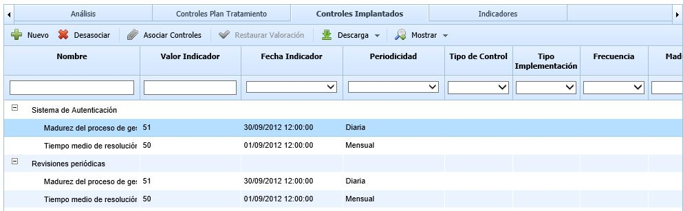

## Indicadores

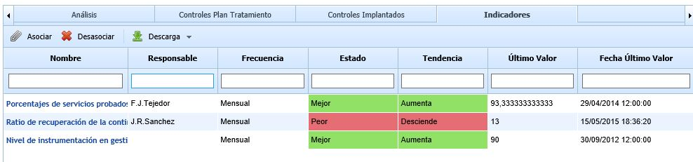

Esta pestaña permite fijar los Indicadores Clave de Riesgos o KRIs a cada uno de los riesgos del Análisis de Riesgos. Al igual que en las opciones anteriores, se debe pulsar primero el riesgo para posteriormente poder asociar en este pestaña los indicadores clave de riesgo. La información que ofrece la tabla por cada uno de los indicadores es la siguiente:

* **Nombre:** Identifica el nombre del indicador. Se podrá acceder a la información completa del indicador, pulsando sobre el nombre del mismo.
* **Responsable:** Identifica el responsable asociado al indicador.
* **Frecuencia:** Identifica la frecuencia de evaluación del indicador.
* **Estado:** Identifica el estado en el que se encuentra el indicador en base a la metodología Balanced ScoreCard definida. (Solo disponible en GlobalSUITE® Balanced ScoreCard).
* **Tendencia:** Identifica la tendencia del indicador en base a la metodología Balanced ScoreCard definida. (Solo disponible en GlobalSUITE® Balanced ScoreCard).
* **Último Valor:** Identifica el último valor que se obtuvo de la evaluación del indicador.
* **Fecha Último Valor:** Identifica la fecha en la que se obtuvo la última evaluación del indicador.

Entre las acciones que permite realizar la tabla están las siguientes:

* **Asociar:** Ofrece la posibilidad de asociar uno o varios indicadores registrado previamente en la opción "Indicadores" de la pestaña "ScoreCard" de GlobalSUITE®. Al pulsar sobre el botón se muestra el listado de lo indicadores. Debe seleccionar los que desea asociar para acto seguido pulsar en el botón "Asociar Indicadores".

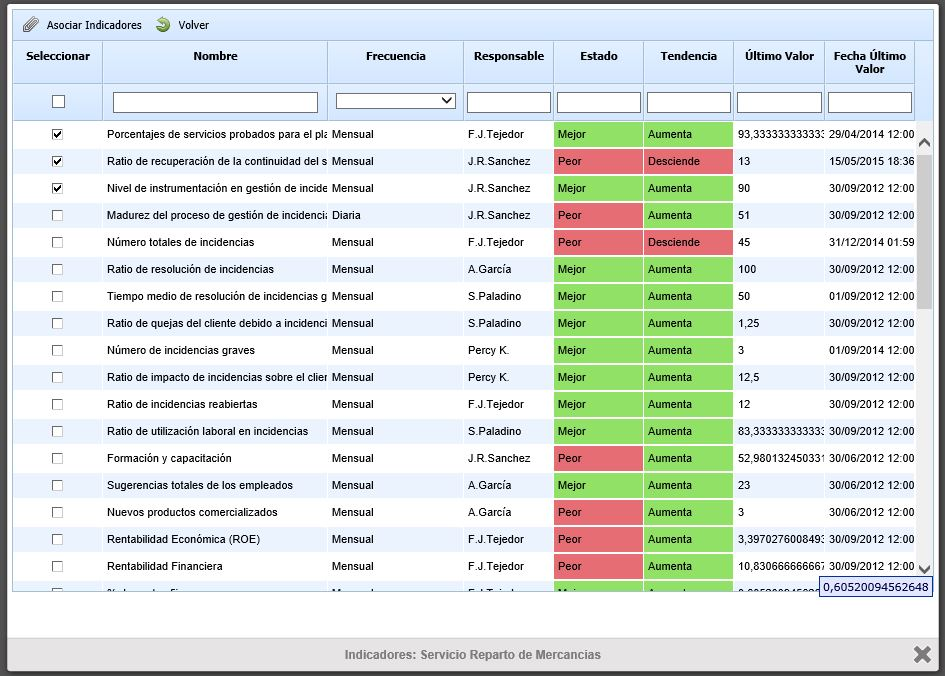

* **Desasociar:** Permite al usuarios eliminar el vinculo entre el indicador y el riesgo. Para ello se ha de seleccionar la fila deseada del indicador y pulsar sobre el botón 'Desasociar'.
* **Descarga:** Ofrece la posibilidad de descargar el listado de indicadores clave de riesgo en formato editable (.xlsx) o en formato .PDF.

### Resultados de Encuestas

La presente opción permite visualizar la valoración de los riesgos que se han realizado en las diferentes encuestas de tipo 'Activos, Riesgos y Controles'. Para acceder a la opción es necesario seleccionar previamente un activo de la tabla.

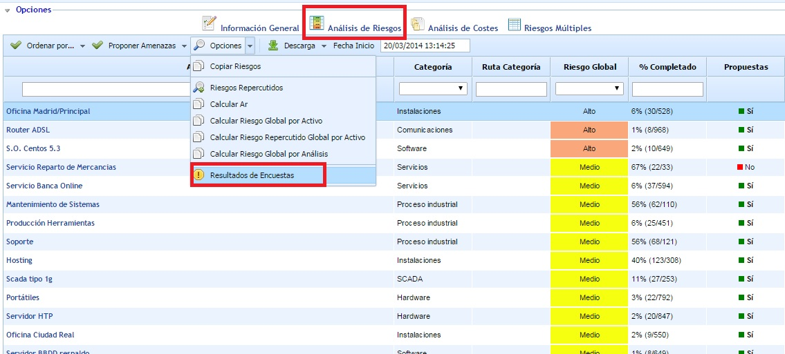

Una vez se ha accedido a la opción, se muestra la siguiente tabla, que ofrece la siguiente información:

* **Amenaza:** Indica el nombre de la amenaza valorada.
* **Vulnerabilidad:** Indica la vulnerabilidad asociada a la amenaza.
* **Comentario:** Permite registrar texto libre que complemente el análisis de la amenaza.


\*\*NOTA:\*\* Las columnas anteriores son propuestas que se pueden considerar, en función de las columnas que la herramienta propone por defecto. Las columnas son configurables en la metodología de análisis de riesgos.


* **Estado:** Indica el estado de la encuesta.
* **Consolidada:** Muestra si la encuesta ha sido consolidada o no. Por defecto se muestran las encuestas que no han sido consolidadas.
* **Dimensiones:** Indica el valor registrado para cada una de las dimensiones o variables consideradas en la metodología de análisis de riesgos.

Las opciones que permite la herramienta sobre la tabla son las siguientes:

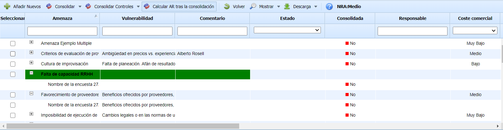

* **Añadir Nuevos:** Permite insertar las amenazas nuevas que se han identificado en las encuestas dentro del análisis de riesgos del activo. Las amenazas nuevas identificadas se muestran resaltadas en verde, y la herramienta permite seleccionar qué amenazas añadir y qué amenazas no añadir.
* **Consolidar:** Permite la consolidación de las distintas valoraciones efectuadas sobre una misma amenaza en diferentes encuestas, pudiendo utilizar varias opciones de consolidación: Máximo (registro de la valoración más alta), Mínimo (registro de la valoración más baja) y Media Aritmética (registro del promedio entre las diferentes valoraciones). Esta opción modifica las valoraciones de las amenazas del activo.
* **Consolidar Controles:** Permite la consolidación de los controles registrados y evaluados, y que se encuentran asociados a una amenaza. Se pueden utilizar varias opciones de consolidación: Máximo (registro de la valoración más alta), Mínimo (registro de la valoración más baja) y Media Aritmética (registro del promedio entre las diferentes valoraciones). Esta opción modifica las valoraciones de los controles asociados a cada amenaza.
* **Calcular AR tras consolidación**: Este campo sirve para seleccionar si se quiere que, tras la consolidación de las encuestas seleccionadas, se recalculen todas las dimensiones automáticas del análisis, por defecto aparece marcado. Como este proceso puede tardar varios minutos, es posible desmarcarlo para realizar varias consolidaciones y recalcular los riesgos al final.
* **Volver:** Permite regresar al listado de activos del análisis de riesgos.
* **Mostrar**: Permite mostrar todas las encuestas de riesgos del elemento seleccionado, o únicamente las que están pendiente de consolidación.
* **Descarga:** Permite la descarga de la información que se muestra en la tabla de gestión de encuestas en un archivo editable (.xlsx) o en formato .PDF

Debajo de la tabla anterior, aparece una tabla que permite la consolidación de los controles registrados para cada una de las amenazas del activo. Para consolidar los controles de una amenaza, primero hay que seleccionar la amenaza deseada en la tabla superior.

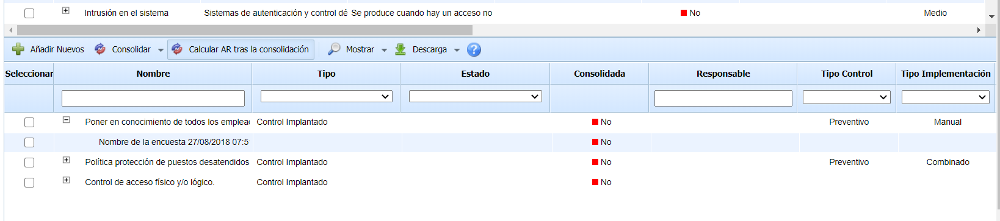

Las columnas de la tabla coinciden con las dimensiones configuradas para realizar la evaluación de los controles. Las opciones que permite la herramienta sobre la tabla son las siguientes:

* **Añadir Nuevos:** Permite insertar los controles nuevos que se han identificado en las encuestas dentro del análisis de riesgos de la amenaza. Los controles nuevos identificados se muestran resaltados en verde, y la herramienta permite seleccionar qué controles añadir y qué controles no añadir.
* **Consolidar:** Permite la consolidación de los controles registrados y evaluados, y que se encuentran asociados a una amenaza. Se pueden utilizar varias opciones de consolidación: Máximo (registro de la valoración más alta), Mínimo (registro de la valoración más baja) y Media Aritmética (registro del promedio entre las diferentes valoraciones). Esta opción modifica las valoraciones de los controles asociados a cada amenaza.
* **Calcular AR tras consolidación**: Este campo sirve para seleccionar si se quiere que, tras la consolidación de las encuestas seleccionadas, se recalculen todas las dimensiones automáticas del análisis, por defecto aparece marcado. Como este proceso puede tardar varios minutos, es posible desmarcarlo para realizar varias consolidaciones y recalcular los riesgos al final.
* **Descarga:** Permite la descarga de la información que se muestra en la tabla de gestión de encuestas en un archivo editable (.xlsx) o en formato .PDF

### Valoración General de Riesgos

Esta opción permite realizar una valoración general de las amenazas/riesgos que se encuentran en el análisis de riesgos. Para ello, se permite valorar diferentes amenazas y aplicar el resultado a los diferentes activos que poseen dicha amenaza. La selección de activos dónde aplicar la valoración de la amenaza se realiza a nivel de categoría, de forma que si asocio una amenaza a una categoría concreta, se puede aplicar a todos los activos que pertenecen a dicha categoría.

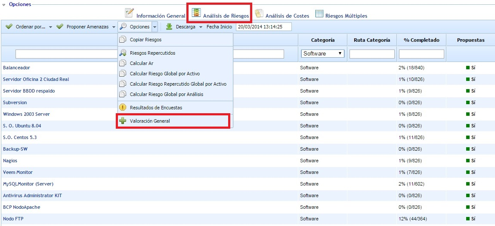

Una vez se ha accedido a la opción, se muestra una tabla con las amenazas que se quieren valorar de manera general. Para cada una de las amenazas insertadas hay que indicar la/s categoría/s relacionadas, de forma que las amenazas serán insertadas (si no existen) o actualizadas (si ya existen) en los activos de las categorías indicadas. Esta tabla muestra las diferentes dimensiones manuales configuradas en la metodología de riesgos, con el objetivo de permitir su valoración.

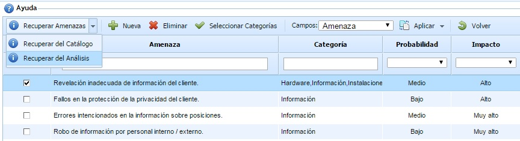

Las opciones que se permiten en esta tabla son las siguientes:

* **Recuperar Amenazas del Catálogo:** Esta opción permite seleccionar un conjunto de amenazas de los catálogos de riesgos asociados al análisis de riesgos. Todas las amenazas seleccionadas del catálogo son insertadas en la tabla principal con el objetivo de poder valorar las dimensiones de la metodología (probabilidad, impacto, etc.).
* **Recuperar Amenazas del Análisis:** Esta opción muestra aquellas amenazas que se han añadido al análisis de riesgos adicionales a los catálogos asociados. Todas las amenazas seleccionadas son insertadas en la tabla principal con el objetivo de poder valorar las dimensiones de la metodología (probabilidad, impacto, etc.).
* **Nueva:** Esta opción permite añadir amenazas en la tabla, adicionales a las amenazas que hayan sido incorporadas del catálogo o del análisis de riesgos (a través de los dos botones explicados anteriormente).
* **Eliminar:** Esta opción permite eliminar amenazas de la tabla. Para ello, hay que seleccionar en primer lugar las amenazas a través del check situado a la izquierda del nombre, y luego pulsar sobre el botón.
* **Seleccionar Categorías:** Esta opción permite asociar categorías de activos a una amenaza seleccionada en la tabla. Esto permite indicar para cada amenaza sobre qué categoría de activo queremos aplicar la valoración, de forma que los activos que tienen las categorías definidas recibirán la valoración general de la amenaza.
* **Campos:** Esta lista desplegable muestra los campos de la metodología de riesgos, con el objetivo de seleccionar sobre qué campo queremos comparar a la hora de aplicar la valoración de las amenazas. Por defecto, siempre se selecciona el campo principal de la metodología (normalmente, los campos amenaza o riesgo).
* **Aplicar - Todas las amenazas:** Esta opción permite aplicar la valoración de las amenazas en todos los activos que tienen alguna de las categorías asociadas a la amenaza. Para ello, hay que seleccionar las amenazas que se quieran aplicar (a través del check que se encuentra a la izquierda del nombre de la categoría) y pulsar sobre el botón. La herramienta mostrará una ventana de confirmación para que el usuario decida si quiere generar un histórico del análisis de riesgos antes de aplicar la nueva valoración. También se muestra una ventana de confirmación para que el usuario decida si quiere crear las amenazas en aquellos activos que no la tengan asociada.
* **Aplicar - Todos los activos sin valoración:** Esta opción permite aplicar la valoración de las amenazas en todos los activos que tienen alguna de las categorías asociadas a la amenaza. En este caso, sólo se aplicará en aquellas amenazas que se encuentren sin valorar previamente. Para ello, hay que seleccionar las amenazas que se quieran aplicar (a través del check que se encuentra a la izquierda del nombre de la categoría) y pulsar sobre el botón. La herramienta mostrará una ventana de confirmación para que el usuario decida si quiere generar un histórico del análisis de riesgos antes de aplicar la nueva valoración. También se muestra una ventana de confirmación para que el usuario decida si quiere crear las amenazas en aquellos activos que no la tengan asociada.
* **Volver:** Este botón permite volver a la ventana principal de análisis de riesgos.

## Recomendador de riesgos y controles

El **Recomendador de riesgos y controles** de GlobalSuite® incorpora un motor avanzado de **inteligencia artificial** diseñado para generar automáticamente posibles riesgos y controles que pueden incorporarse al análisis de riesgos.

Esta funcionalidad ofrece un enfoque dinámico y adaptativo para la identificación de riesgos y controles eliminando la dependencia de catálogos estáticos y reduciendo la necesidad de conocimientos técnicos especializados.

### Acceso al recomendador

El recomendador está disponible en la pestaña Análisis de riesgos dentro de un elemento, y se activa mediante la opción **“Sugerir IA”**, ubicada en la barra de acciones superior.

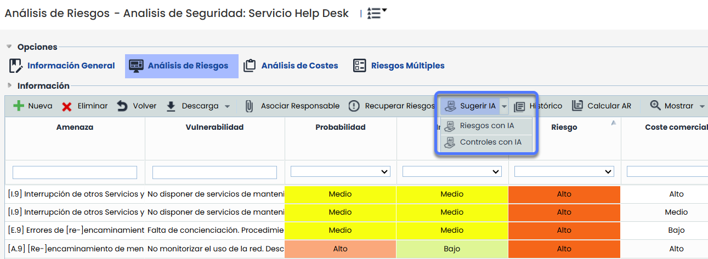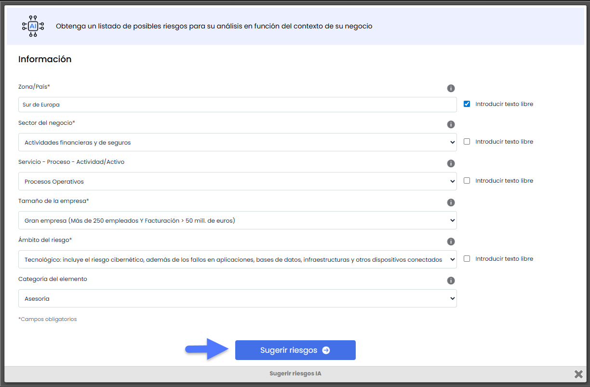


Para mas información sobre esta funcionalidad, puedes consultar el tutorial [Descubre Nuestro Recomendador de Riesgos y Controles Potenciado por Inteligencia Artificial](https://help.globalsuitesolutions.com/es/globalsuite/v1/descubre-nuestro-recomendador-de-riesgos-y-control)

