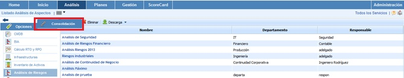
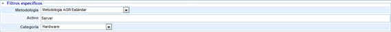
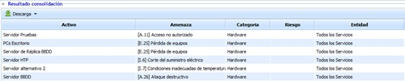

# Consolidación de Análisis de Riesgos

La presente opción permite visualizar de manera resumida los diferentes análisis de riesgos asociados a la entidad y subentidades.

A continuación se desarrolla la funcionalidad que aporta cada una de las tablas disponibles.

* **Tabla Servicios:** Permite al usuario filtrar los análisis asociados a los Servicios seleccionados.

* **Tabla Subentidades:** Ofrece la posibilidad de filtrar los análisis definidos en las subentidades seleccionadas.

* **Tabla Etiqueta/Valor:** Permite visualizar los análisis que tengan asociados una etiqueta determinada.

* **Filtros específicos:** Ofrece la posibilidad de visualizar los análisis de riesgos filtrando por la metodología de análisis deseada, el activo concreto y la categoría a la que pertenece.

Una vez se han establecido los filtros necesarios, hay que generar la consulta, para ello existen las siguientes opciones:

* **Consolidar:** Una vez se pulsa el botón y en función de los filtros establecidos, permite visualizar de manera resumida los activos en la tabla inferior.

* **Volver:** Ofrece la posibilidad de regresar al listado inicial de activos.

Los resultados se muestran en la tabla inferior 'Resultados de consolidación'

La información que aporta la tabla son las siguientes:

* **Activo:** Permite visualizar el nombre del activo
* **Amenaza:** Permite visualizar la amenaza que ha sido valorada en el análisis de riesgos.
* **Categoría:** Ofrece la posibilidad de visualizar la categoría a la que ha sido asociado el activo
* **Riesgo:** Permite visualizar el nivel de riesgo obtenido al activo
* **Entidad:** Ofrece la posibilidad de visualizar la entidad o subentidad a la que está asociado el activo.
