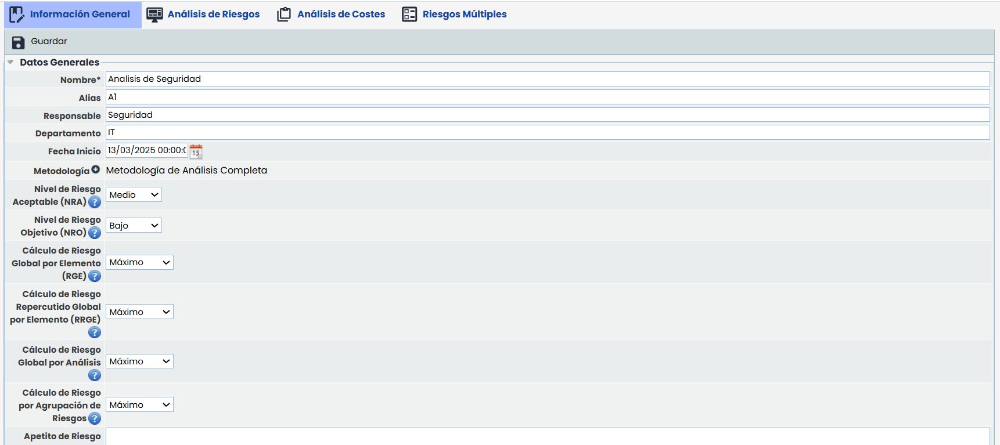
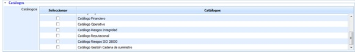
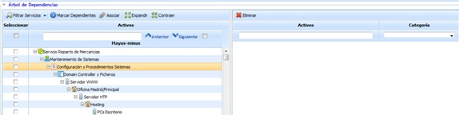
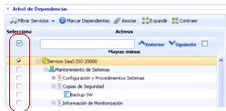
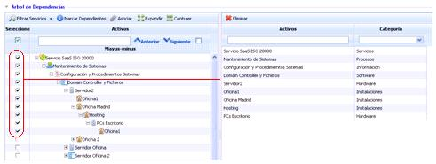

# Información General

Al crear un nuevo análisis de riesgos accedemos a un formulario, que permite definir una serie de parámetros con los que poder configurar el análisis de riesgos.

# Datos Generales

* **Nombre:** Identifica el nombre del análisis de riesgos que se mostrará en el listado visto anteriormente.
* **Alias:** Permite asignar un identificador al análisis de riesgos. Este valor es utilizado en la generación de Informes, para poder identificar y mostrar correctamente la información del análisis de riesgos.  
  Este campo esvisible únicamente si se dispone de la licencia de [Reportes](https://help.globalsuitesolutions.com/es/globalsuite/v1/plantillas-de-informes).
* **Responsable:** Permite identificar el responsable del análisis de riesgos.
* **Departamento:** Identifica el/los departamentos implicados en la gestión del análisis de riesgos.
* **Fecha de Inicio:** Permite indicar la fecha de inicio del análisis de riesgos.
* **Metodología:** Permite asociar al análisis de riesgos una metodología definida entre las existentes en el apartado Ajustes > Metodologías > [Riesgos](https://help.globalsuitesolutions.com/es/globalsuite/v1/metodologia-riesgos).
* **Nivel de Riesgo Aceptable (NRA):** Permite establecer el Nivel de Riesgo Aceptable (NRA) del análisis de riesgos. El nivel definido es utilizado por la herramienta en diferentes opciones para resaltar aquellos riesgos que superen el nivel definido.


\*\*NOTA:\*\* Dependiendo de la metodología de análisis de riesgos y la dimensión seleccionada para el cálculo del riesgo, los niveles pueden ser cualitativos o cuantitativos.


* **Nivel de Riesgo Objetivo (NRO):** Permite establecer el Nivel de Riesgo Objetivo (NRO) del análisis de riesgos. El nivel definido es utilizado por la herramienta en la opción Evaluación de Riesgos - Resumen de Riesgos para mostrar el nivel junto al NRA.
* **Cálculo de Riesgo Global por Elemento (RGE):** Permite seleccionar un criterio para calcular el nivel de Riesgo Global de cada Elemento (RGE). El valor de RGE de un elemento se calcula en función de los valores obtenidos para cada uno de los riesgos que tiene el elemento. Los criterios disponibles son 'Mínimo', 'Máximo', 'Media' y 'Acumulado'.
* **Cálculo de Riesgo Repercutido Global por Elemento (RRGE):** Permite seleccionar un criterio para calcular el nivel de Riesgo Repercutido Global de cada Elemento (RRGE). El valor de RRGE de un elemento se calcula en función de los valores obtenidos para cada uno de los riesgos que tiene el elemento y sus elementos dependientes. Los criterios disponibles son 'Mínimo', 'Máximo', 'Media' y 'Acumulado'.
* **Cálculo de Riesgo Global por Análisis:** Permite seleccionar un criterio para calcular el nivel de Riesgo Global para el Análisis de Riesgos. El valor de Riesgo Global por Análisis se calcula en función de los valores de RGA de cada activo que están asociados al análisis de riesgos. Los criterios disponibles son 'Mínimo', 'Máximo', 'Media' y 'Acumulado'.
* **Apetito de riesgo:** Permite determinar la cantidad de riesgo que se desea asumir en la consecución de los objetivos.

## Catálogos

La opción permite al usuario seleccionar aquellos catálogos previamente definidos en ‘Ajustes/Catálogos Análisis’ que van a apoyar la realización del análisis de riesgos.

Dependiendo de la tipología de análisis a realizar se podrán seleccionar tantos catálogos como sean necesarios para el usuario encargado de realizar el análisis de riesgos.

## Árbol de Dependencias

Permite identificar qué activos definidos en el Inventario de Activos van a ser incluidos en el Análisis de Riesgos. Para ello la herramienta permite realizar las siguientes acciones:

* **Filtrar Servicios:** Permite realizar diferentes filtros sobre el listado de riesgos mostrado.
* **Marcar Dependientes:** En caso de seleccionar un servicio o activo determinado, permite asociar automáticamente todos los activos que se encuentran por debajo de él.

* **Asociar:** Posibilita asociar qué activos van a formar parte del análisis de riesgos, pasando los mismos de la columna izquierda a la columna derecha.

* **Expandir Siguiente Nivel:** Expande el listado de servicios, procesos y activos nivel a nivel. Se debe ir pulsando este botón tantas veces como profundidad del árbol de dependencias se quiera consultar.
* **Contraer:** Contrae el listado de dependencias de todos los servicios y activos.
