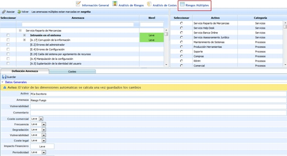
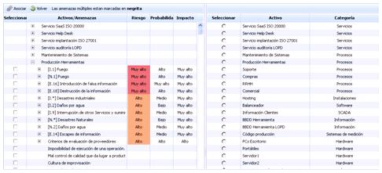
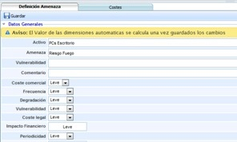
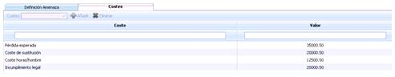

# Riesgos Múltiples

La opción de riesgos múltiples ofrece la posibilidad de generar una amenaza específica que englobe varias amenazas definidas en el aparato de ‘Análisis de Riesgos’.

Al acceder al apartado se muestran las siguientes tablas sobre la que se pueden realizar las siguientes acciones:

* *Tabla izquierda:* Muestra el árbol de todos los activos definidos y las amenazas asociadas a estos, con las valoraciones generadas en el apartado de ‘Análisis de riesgos’.
* *Tabla derecha:* Muestra el listado de todos los activos definidos en el apartado de ‘Inventario de activos’.

Para poder generar una amenaza global se ha de seleccionar el checkbox de la/s amenaza/s deseadas en la tabla izquierda, seleccionar el activo que se va a ver afectado en la tabla situada a la derecha y pulsar el botón ‘Asociar’.

Esta acción generar el siguiente apartado sobre el que se pueden realizar las siguientes acciones:

**Definición Amenaza**

* **Activo:** Identifica el nombre del activo afectado por la amenaza.

* **Amenaza:** Permite definir el nombre de la amenaza.

* **Vulnerabilidad:** Posibilita indicar la vulnerabilidad asociada a la amenaza generada.

* **Comentario:** Permite insertar cualquier anotación adicional sobre el activo

* **Dimensiones:** Muestra el listado de dimensiones definidas en la Metodología de Análisis para que sean valoradas.

**NOTA:** En función de la metodología definida en el apartado 'Ajustes/Metodología Análisis', las valoraciones pueden ser cualitativas o cuantitativas.

* **Amenazas:** Identifica mediante un listado, las amenazas individuales que componen la amenaza global.

**Costes**

Permite asociar diferentes costes a la amenaza global generada. Las acciones que se pueden realizar son:

* **Costes:** Permite desplegar el listado de costes generado en el apartado ‘Ajustes’

* **Añadir:** Una vez seleccionado el coste en el desplegable, se puede asociar pulsando sobre el botón ‘Añadir’.

* **Eliminar**: Permite eliminar diferentes costes definidos en la tabla. Para ello se ha de seleccionar la fila o filas deseadas y pulsar el botón ‘Eliminar’.
