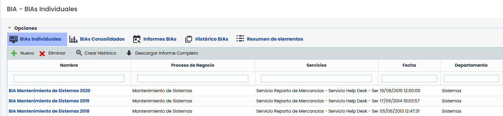
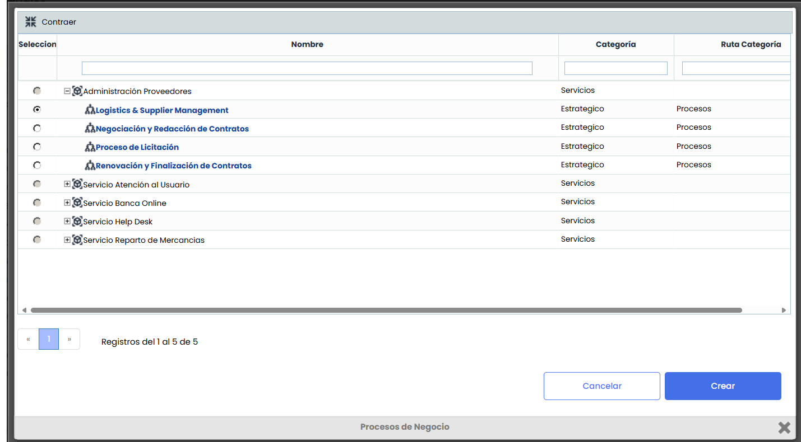

# BIA (Business Impact Analysis)

El Análisis de Impacto sobre el negocio, conocido más comúnmente como BIA, permite determinar qué procesos son esenciales para la continuidad de las operaciones de la organización.

Nada más acceder a la opción de BIA se muestra un listado con los análisis de impacto registrados. Por defecto la herramienta muestra BIAs individuales, cuya operativa se desarrolla en el siguiente punto.

Las opciones de inicio que se pueden realizar son las siguientes:

* **Nuevo:** Permite crear un nuevo registro de Análisis de Impacto en el Negocio (BIA). Al presionar el botón **“Nuevo”**, se abre un modal con una tabla que muestra los procesos de negocio disponibles para su evaluación.

Desde esta ventana, el usuario puede buscar y filtrar procesos por **nombre**, **categoría** o **ruta de categoría**, seleccionar el proceso deseado y pulsar **“Crear”**. Al hacerlo, se cierra el modal, se regresa a la tabla principal y se muestra el nuevo BIA generado.

* **Eliminar:** Permite eliminar un BIA ya registrado. Para ello se ha de seleccionar la fila o filas deseadas y pulsar el botón ‘Eliminar’.
* **Descargar Informe Completo:** Permite descargar el listado de BIAs formato CSV. En caso de que el BIA contenga preguntas personalizadas Tipo Tabla Elementos, además del Informe CSV con la información general de los BIAs, se generará un archivo CSV por pregunta personalizada de este tipo.

**NOTA:** Si se quiere convertir los informes descargados, en formato Excel, se puede realizar siguiendo los pasos explicados en la sección [Descargas Pendientes.](https://help.globalsuite.es/display/GlobalSUITEes/.Descargas+Pendientes+vv6.23)

* [BIAs Individuales](bias-individuales.md)
* [BIAs Consolidados](bias-consolidados.md)
* [Informes BIAs](informes-bias.md)
* [Históricos BIAs](historicos-bias.md)
* [Resumen de elementos](resumen-de-elementos.md)
