# BIAs Consolidados

La opción de BIAs consolidados permite fusionar los BIAs individuales realizados sobre un mismo proceso, para que el usuario pueda tener una visión global del análisis de impacto sobre un único proceso.

Cuando se consolide el BIA final de un Proceso a partir de un BIA Individual se realizará una copia de toda la información del BIA seleccionado, incluyendo la valoración de Impacto en el Negocio, MTPD, RTO y preguntas personalizadas (salvo preguntas de tipo Tabla de Elementos).

Al acceder a la opción, la herramienta muestra una gráfica que representa el MTPD y RTO consolidado de los procesos, así como el listado con los procesos definidos en el alcance. Cada proceso tiene identificado los servicios a los que presta apoyo, el número de BIAs individuales realizados sobre ese proceso, el MTPD consolidado y el RTO consolidado.

**NOTA:** El valor de MTPD y RTO consolidado sólo se muestra una vez se han fusionado los BIAs individuales.

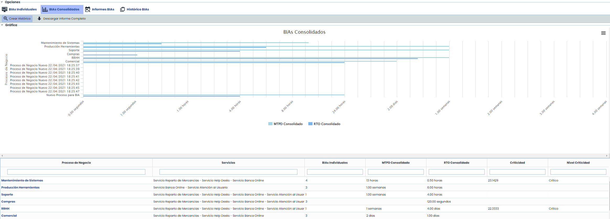

Las opciones que permite esta tabla son las siguientes:

* **Crear Histórico:** Permite crear BIAs históricos a partir de BIAs Consolidados o Individuales.  Al pulsar el botón  "Crear Histórico", se abrirá una ventana donde podremos seleccionar qué BIAs Individuales y Consolidados se incluirán en el histórico.

**NOTA**: Si selecciona un BIA Consolidado, se incluirán automáticamente en el Histórico, los BIAs Individuales utilizados en su consolidación.

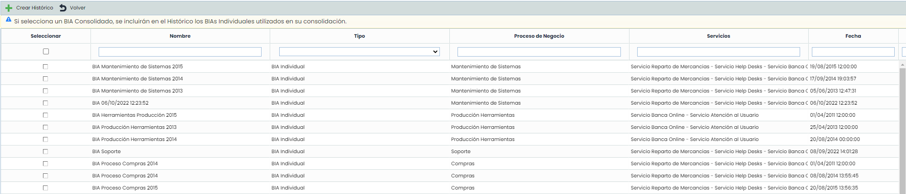

* **Descargar Informe Completo:**Permite descargar un informe con la información de los BIAs realizados, agrupado en un archivo .zip, un informe CSV para cada una de las preguntas personalizables de tipo Tabla, o Tabla Elementos (que estén configuradas en Ajustes> Continuidad de Negocio > [Configuración BIA](https://help.globalsuite.es/pages/viewpage.action?pageId=78808447)) , e incluye la información de la valoración de Impactos (cualitativos y cuantitativos) y la información de la valoración de Impactos (cualitativos y cuantitativos) para todos los BIAs.

Para consolidar BIAs individuales sobre un mismo proceso se ha de pulsar sobre el nombre del proceso, donde se accede a la siguiente pantalla:

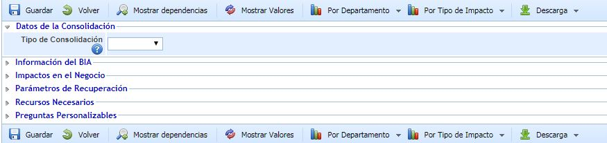

Las opciones permitidas son las siguientes:

* **Guardar:** Una vez seleccionado el tipo de Consolidación (Manual o Automático) permite guardar la selección realizada.
* **Volver:** Permite volver al listado de BIAs consolidados.
* **Mostrar Dependencias:** Muestra en una ventana emergente, el árbol de dependencias de la organización filtrando por el proceso del BIA Consolidado. En esta ventana se podrá visualizar las dependencias de procesos y que activos (software, hardware, comunicaciones, etc.) necesita cada proceso. Además, pulsando el botón Propiedades, se abrirá una nueva pestaña con la información del elemento que se necesite analizar.

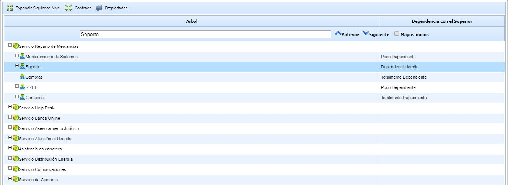

* **Mostrar Valores:** Muestra los valores por los cuales se calcula el nivel de impacto. Estos valores han sido definidos en el apartado de Ajustes> Continuidad de Negocio > [Configuración BIA](https://help.globalsuite.es/pages/viewpage.action?pageId=78808447).
* **Por Departamento:** Permite visualizar de manera gráfica las valoraciones realizadas sobre un mismo proceso por diferentes departamentos de la organización. A la hora de visualizar se puede optar entre ventana emergente o mostrar los gráficos en una pestaña individual del navegador.

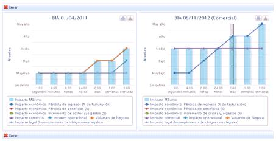

* **Por Tipo de Impacto:** Permite visualizar de manera gráfica las valoraciones realizadas sobre uno o varios impactos por diferentes departamentos de la organización. A la hora de visualizar se puede optar entre ventana emergente o mostrar los gráficos en una pestaña individual del navegador.

### Datos de consolidación

Para consolidar BIAs la herramienta nos permite optar entre dos opciones: Manual y Automático.

* **Manual:** Ofrece la posibilidad al usuario de establecer los valores de impacto de manera manual basándose en los BIAs individuales realizados por los distintos departamentos. Para ello puede apoyarse en los botones ‘Por Departamento’ y ‘Por Tipo de Impacto’ donde se muestran los valores definidos en los BIAs individuales de manera gráfica.
* **Automático:** Permite consolidar los BIAs individuales de manera automática, pudiendo optar entre dos tipos de cálculo. Además, este tipo de consolidación permite utilizar los BIA de los subprocesos del proceso que se está consolidando. Para ello, hay que marchar la casilla "Incluir subprocesos", de forma que en la lista desplegable aparecen los BIA individuales de los subprocesos.

Los tipos de consolidación automática son los siguientes:

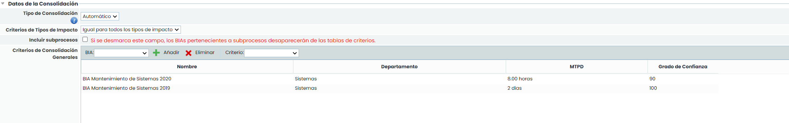

* Igual para todos los tipos de Impacto:

Realiza una consolidación automática de los BIAs individuales que se deseen. Para ello se ha de pulsar sobre el desplegable, seleccionar el BIA individual requerido y pulsar el botón ‘Añadir’. En caso de querer eliminar un BIA del listado se ha de pulsar el botón ‘Eliminar’. Una vez seleccionados los BIAs individuales se ha de definir el criterio de consolidación deseado, que puede ser:

* Media: Realiza una media entre los valores definidos.
* Media Ponderada: Permite realizar una media ponderada de los valores estableciendo los pesos de importancia sobre los BIAs Individuales

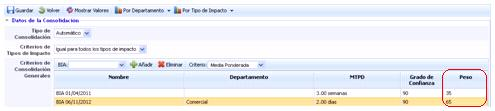

* Máximo: Consolida los valores definidos en los BIAs individuales seleccionando el valor máximo de los valores a consolidar.

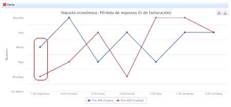

Según el gráfico de impacto económico, la consolidación sobre el valor máximo en 1.00 segundos mostraría el nivel Medio.

* Mínimo: Consolida los valores definidos en los BIAs individuales seleccionando el valor mínimo de los valores a consolidar.

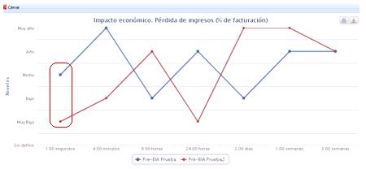

Según el gráfico de impacto económico, la consolidación sobre el valor mínimo en 1.00 segundos mostraría el nivel Muy Bajo.

Una vez se definen los valores de consolidación, se ha de gestionar y definir el BIA consolidado como se ha desarrollado en el apartado de BIAs individuales, obteniendo el MTPD, definiendo los niveles mínimos de operación, etc.

* Distinto para cada tipo de impacto:

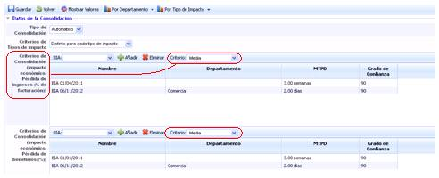

Permite definir criterios de consolidación particulares para cada impacto evaluado. Estos criterios se han desarrollado en el punto anterior.

Una vez se definen los criterios de consolidación, se ha de gestionar y definir el BIA consolidado como se ha desarrollado en el apartado de BIAs individuales, obteniendo el MTPD, definiendo los niveles mínimos de operación, etc.

**NOTA:** En caso de seleccionar un único BIA Individual, para realizar la consolidación, lo que se hará será copiar la información que tenga el BIA original, excepto las Tablas de Elementos que hubiera configuradas.

### Información del BIA

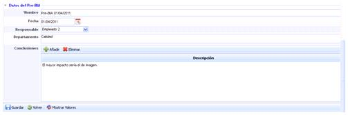

* **Nombre:** Se refiere a un nombre descriptivo del BIA que se mostrará en la tabla de inicio.
* **Fecha:** Posibilita establecer la fecha de realización del BIA.
* **Fecha Modificación:** Permite establecer la fecha de modificación ó actualización del BIA.
* **Responsable:** Permite identificar el responsable de realización del BIA.
* **Departamento:** Identifica el/los departamentos implicados en la realización y evaluación del BIA.
* **Conclusiones:** Permite identificar las conclusiones relativas a los resultados obtenidos en el análisis de impacto pulsando el botón ‘Añadir’. En caso de querer eliminar una conclusión se ha de seleccionar la fila o filas deseadas y pulsar el botón ‘Eliminar’.

### Impactos en el Negocio

Cuando se consolide el BIA final de un Proceso a partir de un BIA Individual se realizará una copia de toda la información del BIA seleccionado, incluyendo la valoración de Impacto en el Negocio. Las dimensiones valoradas para el Proceso de Negocio se aplicarán al mismo en el Inventario de forma definitiva.

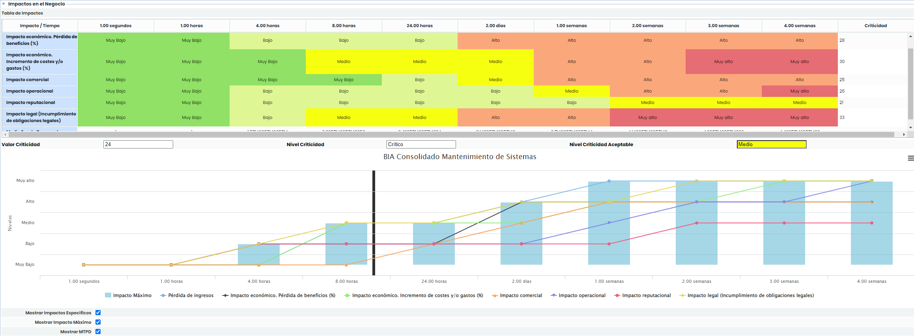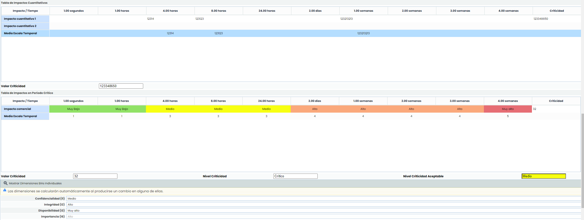

### Recursos necesarios

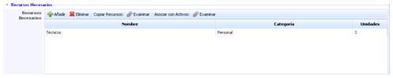

Permite identificar los recursos necesarios para recuperar un proceso de negocio determinado dentro del MTPD. Las acciones que permite la herramienta son:

* **Añadir:** Permite insertar una nueva entrada en la tabla.
* **Eliminar:** Posibilita suprimir un recurso definido en la tabla. Para ello se ha de seleccionar la fila o filas deseadas y pulsar el botón ‘Eliminar’.
* **Copiar Recursos:** Permite asociar los recursos necesarios identificados en los BIA’s individuales. Al pulsar sobre el botón ‘Examinar’ se muestra un listado con todos los recursos identificados. Para asociarlos se ha de seleccionar el checkbox deseado y pulsar el botón ‘Asociar Registros’.
* **Asociar con Activos:** Ofrece la posibilidad de asociar un recurso definido a un activo pulsando sobre el botón ‘Examinar’. Para realizar la asociación se ha de arrastrar el recurso de la tabla derecha al activo deseado de la tabla izquierda. En caso de querer eliminar una asociación, se ha de arrastrar el recurso de la tabla izquierda a la tabla derecha.

### Reanudación de los niveles normales de operación

* **Plazo de reanudación:** Permite establecer el tiempo máximo en el cual la organización debe volver a la normalidad.
* **Justificación:** Permite realizar cualquier anotación que justifique el tiempo definido en el punto anterior.

### RTO

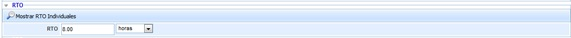

Permite definir el RTO particular del proceso evaluado y consolidado. Para ello se ha de definir un número (campo texto) y la escala temporal (desplegable).

### RPO

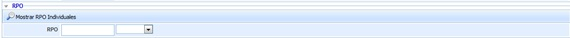

Permite definir el RPO particular del proceso evaluado y consolidado. Para ello se ha de definir un número (campo texto) y la escala temporal (desplegable).

**NOTA:** Cuando se consolide el BIA final de un Proceso a partir de un BIA Individual se realizará una copia de toda la información del BIA seleccionado, incluyendo la valoración de  MTPD y RTO.

### Valoración del Inventario

Este apartado permite valorar el proceso en función de las dimensiones definidas en el apartado 'Admininstración/Metodologías de Análisis'.

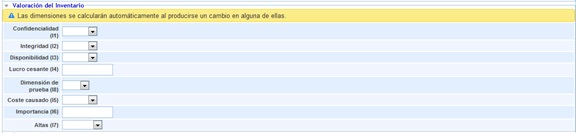

**NOTA:** En función de la metodología definida en el apartado 'Ajustes /Metodología Análisis', las valoraciones pueden ser cualitativas o cuantitativas.

### Preguntas personalizables

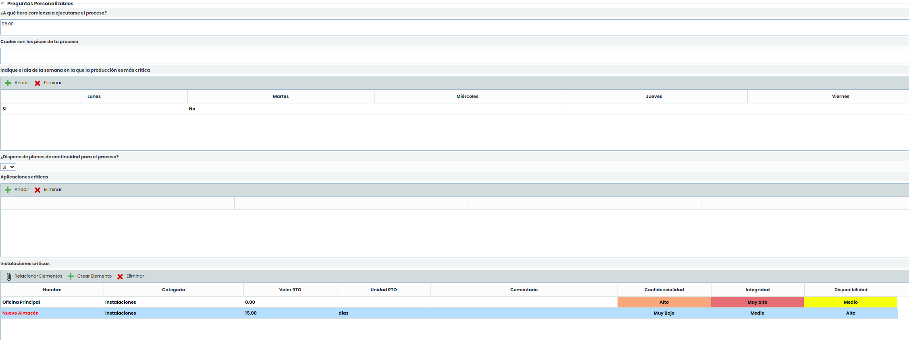

En el formulario del BIA aparecerán las preguntas configuradas en el apartado de Ajustes> Continuidad de Negocio > [Configuración BIA](https://help.globalsuite.es/pages/viewpage.action?pageId=78808447). Estas preguntas pueden ser de distintos tipos: 'Texto', 'Select', 'Tabla' o 'Tabla de Elementos'.

En las preguntas tipo 'Tabla' se pueden añadir registros pulsando el botón 'Nuevo' y con el botón 'Eliminar' quitar los que se deseen, además de editar cada una de los campos haciendo doble click.

**Preguntas Tipo "Tabla Elementos"**

Las opciones de esta tabla son las siguientes:

* Relacionar Elementos

  * Asociar Elementos:  Para este tipo de preguntas es posible incluir elementos del Inventario (Análisis > [Inventario](https://help.globalsuite.es/display/GlobalSUITEes/.Inventario+vv5.1)), con el botón "Relacionar Elementos". Al pulsarlo, se abre una ventana emergente donde aparecerá el listado de los elementos con las categorías configuradas para la pregunta, permitiéndose la selección de aquellos elementos que se quieran incorporar a la misma, y añadiéndolos a través del botón "Asociar Elementos".
  * Mostrar: A través de esta opción se permite visualizar todos los elementos del inventario > opción "Todos" o sólo los elementos asociados al proceso > opción "Por Proceso".

Además de los campos por defecto como Nombre, Categoría, Valor o Unidad RTO y Comentario, se pueden añadir dimensiones manuales del inventario como por ejemplo la Confidencialidad, Integridad y disponibilidad de un elemento.

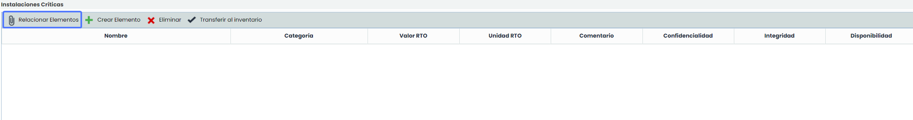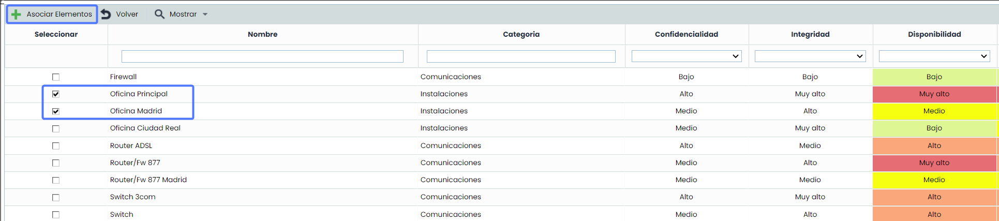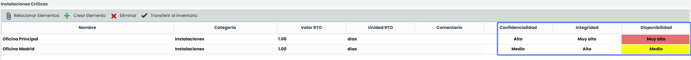

* Crear Elemento

También se pueden incorporar nuevos elementos pulsando el botón "Crear Elemento". Estos elementos aparecerán en color rojo para indicar que no se trata de elementos del Inventario, y también podrán Transferirse al inventario al pulsar en la opción.

Para todos los elementos incorporados en la pregunta tipo "Tabla de Elementos" se permite especificar el instante de recuperación en caso de desastre, utilizando los campos "Valor RTO" y "Unidad RTO", y la "Categoría", además de poder añadir un comentario para cada elemento. Además se podrán valorar las dimensiones añadidas de los elementos del inventario.

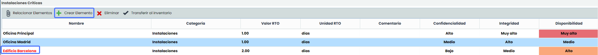

* Transferencia al inventario de nuevos elementos

A las capacidades de la consolidación automática de BIAs individuales al BIA Consolidado, se incluye la posibilidad de Transferir al Inventario nuevos elementos identificados durante el Análisis de Impacto en el Negocio. 

Para realizar esta transferencia,  añada o modifique el BIA individual del que se quiera hacer la Consolidación en el apartado "Datos de la Consolidación" y haga click en "Guardar". Luego, en el apartado "Preguntas Tipo Tabla Elementos", se mostrará el nuevo elemento que ha añadido en el BIA individual, el cual se mostrará en rojo. Por último, seleccione el nuevo elemento y haga click en "Transferir al Inventario". El nuevo elemento se transferirá automáticamente al inventario.

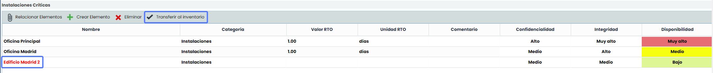

Una vez añadido al inventario, el elemento aparecerá en negro. Además, los elementos incluidos en las preguntas de tipo Tabla Elementos, se consolidarán en el Inventario > [Tabla de Elementos](https://help.globalsuite.es/display/GlobalSUITEes/.Tabla+de+Elementos+vv6.56)  junto con la valoración indicada en el BIA Consolidado, y se incluirán bajo el Proceso de Negocio en el [Árbol de Elementos](https://help.globalsuite.es/pages/viewpage.action?pageId=78808387).

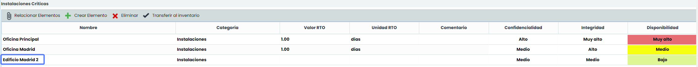

**NOTA:** Si algún elemento coincidente ya existe en el Inventario no se volcará, y se podrá consultar los resultados de la consolidación en un informe generado.

Si el proceso se encuentra en el árbol de dependencias con elementos asociados, en la tabla de elementos aparecen por defecto los elementos que se encuentren asociados en dicho árbol de dependencias. Si, por el contrario, el proceso no se encuentra en el árbol de dependencias, en la tabla de activos se muestran todos los elementos del inventario.
