# BIAs Individuales

## Información del BIA

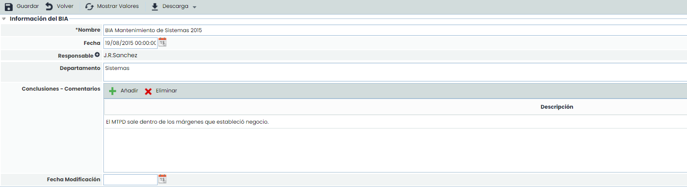

* **Nombre:** Se refiere a un nombre descriptivo del BIA que se mostrará en la tabla de inicio.
* **Fecha:** Posibilita establecer la fecha de realización del BIA.
* **Responsable:** Permite identificar el responsable de realización del BIA.
* **Departamento:** Identifica el/los departamentos implicados en la realización y evaluación del BIA.
* **Conclusiones:** Permite identificar las conclusiones relativas a los resultados obtenidos en el análisis de impacto pulsando el botón ‘Añadir’. En caso de querer eliminar una conclusión se ha de seleccionar la fila o filas deseadas y pulsar el botón ‘Eliminar’.
* **Fecha Modificación:** Permite establecer la fecha de modificación ó actualización del BIA.

Para cada registro de BIA se permite la descarga del detalle de la encuesta en formato .docx. Para ello, se debe pulsar en él botón "Descarga" y acto seguido sobre "Informe Docx".

## Tabla de Impactos

Permite evaluar sobre un proceso determinado como le afectan diferentes impactos en una escala temporal.

Dependiendo de cómo se hayan definido los Tipos de Impacto en el apartado Ajustes > Continuidad de Negocio > [Configuración BIA](../../ajustes/continuidad-de-negocio/configuracion-bia.md), aparecerán varias tablas para valorar los impactos cualitativos (por niveles de Impacto):

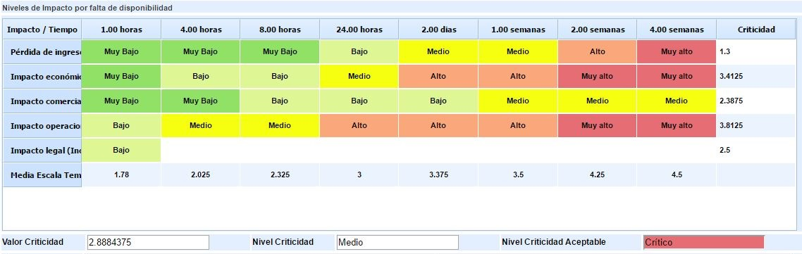

O los impactos cuantitativos (introduciendo valores numéricos):

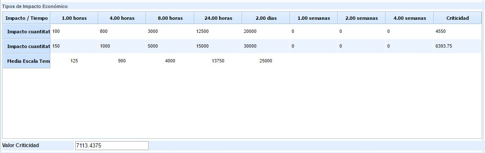

Estas tablas permiten valorar el impacto de la interrupción del proceso en una situación normal. También se pueden añadir tablas para valorar el impacto en un período crítico para el negocio, en caso de que esa valoración difiera.

Para cada tabla de impacto se obtiene un valor de criticidad del proceso, en función de la valoración introducida en la tabla, y el criterio definido (Acumulado, Máximo, Mínimo, Media, Media Ponderada) en el apartado 'Ajustes/Continuidad de Negocio'.

Para el caso de las tablas de impacto cualitativas, además del valor de criticidad se obtiene un nivel de criticidad a partir del mismo, y según la escala configurada.

## Gráfica

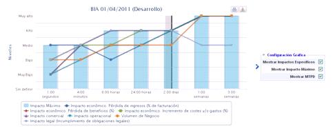

Permite visualizar de manera gráfica los valores introducidos en la tabla de impactos. Las opciones de visualización son las siguientes:

* Mostrar impactos específicos:**Posibilita visualizar de manera global cada una de las valoraciones de impacto realizadas en el apartado anterior.**
* **Mostrar Impacto máximo:** Permite visualizar por cada escala temporal el nivel de impacto máximo.
* **Mostrar MTPD:** Permite visualizar el tiempo máximo tolerable de interrupción (Maximum Tolerable Period of Disruption). El cálculo del MTPD se desarrolla en el siguiente apartado.

Si el usuario desea ver el gráfico concreto de un impacto, puede seleccionar su visualización en el cuadro situado debajo del gráfico.

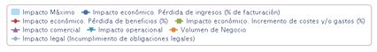

## Cálculo MTPD y RTO

El cálculo del **MTPD Y RTO** depende de la configuración establecida en **Ajustes > Continuidad >** [**BIAs**](../../ajustes/continuidad-de-negocio/configuracion-bia.md)**.**

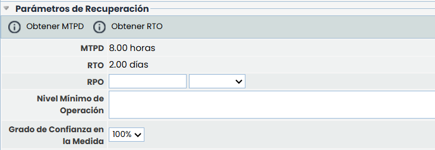

### Cálculo del MTPD

El MTPD Muestra el tiempo máximo tolerable de interrupción de servicio evaluado.

Las opciones que permite el apartado para calcular y definir el MTPD son las siguientes:

#### Tipo de cálculo

* **Manual**: el usuario encargado de la gestión introduce directamente el valor numérico y la unidad de tiempo (segundos, minutos, horas, días, semanas).
* **Automático**: la plataforma calcula el MTPD en función de los impactos registrados y según el criterio configurado.
* **Configurado en cada BIA**: se permite decidir desde este mismo formulario si el cálculo es manual o automático.

Esto dependerá de lo configurado en **Ajustes > Continuidad >** [**BIAs**](../../ajustes/continuidad-de-negocio/configuracion-bia.md)**.**

En función del Tipo de MTPD seleccionado permite calcular el MTPD:

* **Manual:** El usuario encargado de la gestión fija el valor numérico y temporal de tiempo máximo de interrupción.
* **Automático***:* La plataforma calcula automáticamente el MTPD en función de los siguientes criterios:

  * Primer Impacto: Establece el MTPD cuando primer nivel de impacto encontrado coincide con la escala definida por el usuario (Muy Alto-Muy Bajo).
  * Primera Media de Impacto: Establece el MTPD cuando la media de los impactos coincide con la escala definida por el usuario (Muy Alto-Muy Bajo).
  * Primer impacto de tipo: Establece el MTPD cuando primer nivel de un impacto concreto coincide con la escala definida por el usuario (Muy Alto-Muy Bajo).

Una vez se han definido todos los criterios, se ha de pulsar el botón ‘Obtener MTPD’ y la herramienta calcula el valor automáticamente.

### Cálculo del RTO

Las opciones que permite el apartado para calcular y definir el MTPD son las siguientes:

#### Tipo de cálculo

* **Manual**: el usuario encargado de la gestión introduce directamente el valor numérico y la unidad de tiempo (segundos, minutos, horas, días, semanas).
* **Automático**: la plataforma calcula el MTPD en función de los impactos registrados y según el criterio configurado en **Ajustes > Continuidad >** [**BIAs**](../../ajustes/continuidad-de-negocio/configuracion-bia.md)**.**

En función del Tipo de RTO seleccionado permite calcular el RTO:

* **Manual:** El usuario encargado de la gestión fija el valor numérico y temporal de tiempo máximo de interrupción.

  * **Automático***:* La plataforma calcula automáticamente el RTO en función de los siguientes criterios:
  * **Primer impacto**: establece el RTO cuando el primer nivel de impacto encontrado coincide con la escala definida por el usuario (*Muy Alto – Muy Bajo*).
  * **Primera media de impacto**: establece el RTO cuando la media de los impactos coincide con la escala definida por el usuario (Muy Alto-Muy Bajo).
  * **Primer impacto de tipo**: establece el RTO cuando el primer nivel de un impacto concreto coincide con la escala definida por el usuario.(Muy Alto-Muy Bajo).
  * **Porcentaje del MTPD**: calcula el RTO aplicando un porcentaje sobre el MTPD, introducido como valor numérico entre **1 y 100**.

* **RPO:** Permite definir el RPO particular del proceso evaluado. Para ello se ha de definir un número (campo texto) y la escala temporal (desplegable).
* **Nivel mínimo de operación:** Permite identificar los recursos mínimos necesarios para prestar el servicio.
* **Grado de confianza en la medida:** Posibilita indicar el grado de confianza del usuario con respecto al MTPD obtenido.

### Recursos necesarios

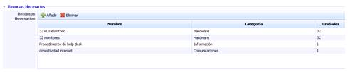

Este apartado permite desglosar de manera detallada los recursos necesarios para que el proceso de negocio se pueda prestar con normalidad.

Para añadir una nueva entrada basta con pulsar sobre el botón ‘Añadir’ y modificar cada una de las celdas de la tabla. En caso de querer eliminar uno o varios recursos definidos se ha de seleccionar la fila o filas deseadas y pulsar el botón ‘Eliminar’.

### Reanudación de los niveles normales de operación

* **Plazo de reanudación:** Permite establecer el tiempo máximo en el cual la organización debe volver a la normalidad.
* **Justificación:** Permite realizar cualquier anotación que justifique el tiempo definido en el punto anterior.

### Valoración del Inventario

Este apartado permite valorar el proceso en función de las dimensiones definidas en el apartado Ajustes > Metodologías > [Riesgos](../../ajustes/metodologias/metodologia-riesgos.md).

**NOTA:** En función de la metodología definida en el apartado 'Ajustes/Metodología Análisis', las valoraciones pueden ser cualitativas o cuantitativas.

### Preguntas personalizables

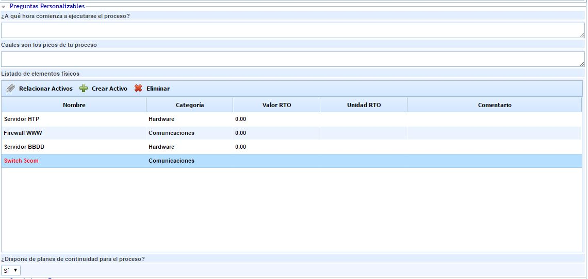

En el formulario del BIA aparecerán las preguntas configuradas en el apartado de Ajustes > Continuidad de Negocio > [Configuración BIA](../../ajustes/continuidad-de-negocio/configuracion-bia.md). Estas preguntas pueden ser de distintos tipos: 'Texto', 'Select', 'Tabla' o 'Tabla Elementos'.

En las preguntas tipo "Tabla" se pueden añadir registros pulsando el botón 'Nuevo' y con el botón 'Eliminar' quitar los que se deseen, además de editar cada una de los campos haciendo doble click.

**Preguntas Tipo "Tabla Elementos"**

Las opciones de esta tabla son las siguientes:

* Relacionar Elementos:

Para este tipo de preguntas es posible incluir elementos del Inventario (Análisis > [Inventario](../inventario/README.md)) con el botón "Relacionar Elementos". Al pulsarlo, se abrirá una ventana emergente donde aparecerá el listado de los elementos con las categorías configuradas para la pregunta, permitiéndose la selección de aquellos elementos que se quieran incorporar, y añadiéndolos a través del botón  "Asociar Elementos".

Además de los campos por defecto como Nombre, Categoría, Valor o Unidad RTO y Comentario, se pueden añadir dimensiones manuales del inventario como por ejemplo la Confidencialidad, Integridad y disponibilidad de un elemento.

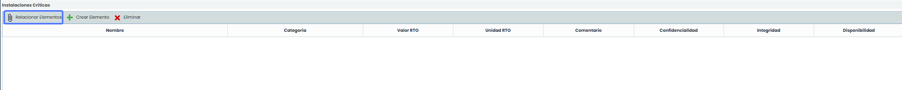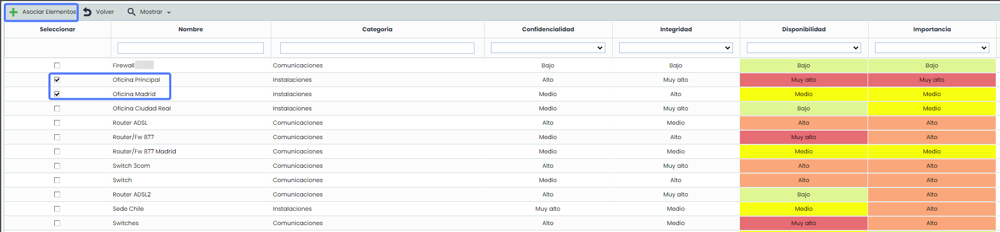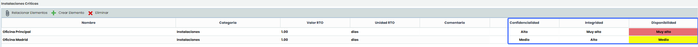

Estas dimensiones (cualitativas, cuantitativas, textuales) se podrán modificar en el propio BIA Individual y pasarse al BIA Consolidado de forma automática.  También se podrán modificar las valoraciones en las encuestas de[BIA por Tiempo](../../gestion/encuestas/gestion-encuestas/encuestas-bia-tiempo.md)o [BIA por Impacto](../../gestion/encuestas/gestion-encuestas/encuestas-bia-impactos/README.md) para valorar tanto en elementos ya existentes como en nuevos que se identifiquen.

**NOTA**: La configuración de las Tablas de Tipo Elementos se realiza en la opción Ajustes > Continuidad de Negocio > [BIAs](../../ajustes/continuidad-de-negocio/configuracion-bia.md).

Si el proceso se encuentra en el árbol de dependencias con elementos asociados, en la tabla de elementos aparecen por defecto los elementos que se encuentren asociados en dicho árbol de dependencias. Si, por el contrario, el proceso no se encuentra en el árbol de dependencias, en la tabla de elementos se muestran todos los elementos del inventario. Independientemente de los elementos mostrados en la carga inicial, a través del botón 'Mostrar' se permite visualizar todos los elementos del inventario (opción 'Todos') o sólo los elementos asociados al proceso (opción 'Por Proceso').

* Crear Elemento:

Será posible incorporar nuevos elementos pulsando el botón "Crear Elemento". Estos activos aparecerán en color rojo para indicar que no se trata de elementos del Inventario.

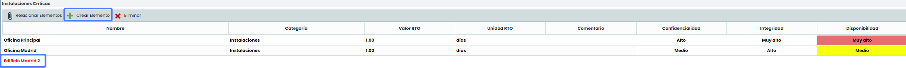

Para todos los elementos incorporados en la pregunta tipo 'Tabla de Elementos' se permite especificar el instante de recuperación en caso de desastre, utilizando los campos 'Valor RTO' y 'Unidad RTO',  la Categoría, además de poder añadir un comentario para cada elemento. Además se podrán valorar las dimensiones añadidas de los elementos del inventario.
