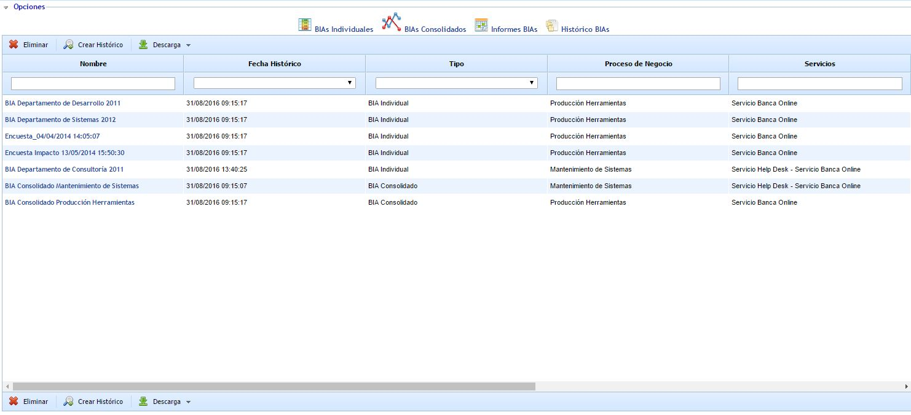
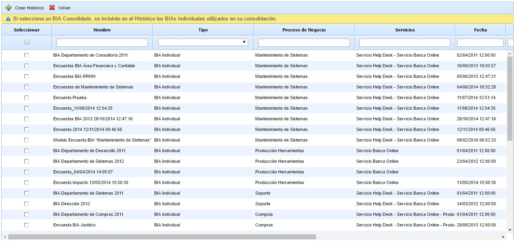
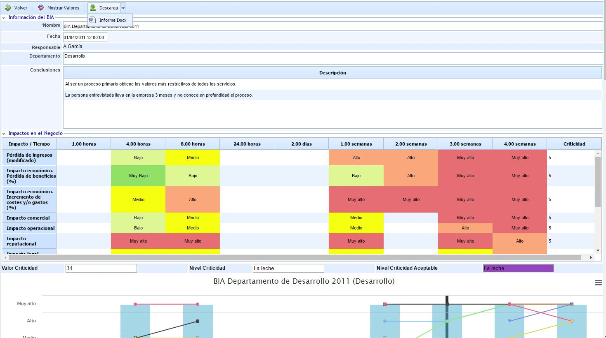

# Históricos BIAs

Esta opción permite almacenar y consultar posteriormente las evaluaciones de BIAs realizados en períodos anteriores. Para ello, mediante el botón "Crear Histórico" se abrirá una ventana donde podremos seleccionar qué BIAs Individuales y Consolidados incluiremos en el histórico.

Si incluimos BIAs Consolidados en el Histórico, se añadirán automáticamente los BIAs Individuales utiliziados en su consolidación.

Además de los datos de los BIAs, se almacenará la configuración existente en ese momento. Por lo que aunque se modifique la estructura del formulario de BIA, ó de las preguntas incluidas dentro del mismo, el histórico mantendrá la información y la estructura exacta que tenía en el momento de realizarse el histórico.

En la tabla principal de Históricos tenemos disponibles todos los registros de BIAs, pudiendo ver la fecha en que se realizó el histórico y el tipo de BIA (Individual ó Consolidado).

Si se quieren borrar registros de históricos, puede realizarse seleccionando los que se deseen y pulsando el botón "Eliminar".

Al acceder a un BIA Histórico podremos consultar toda la información del mismo, además de descargarla en formato .docx (pulsando "Descarga" y a continuación "Informe Docx").

