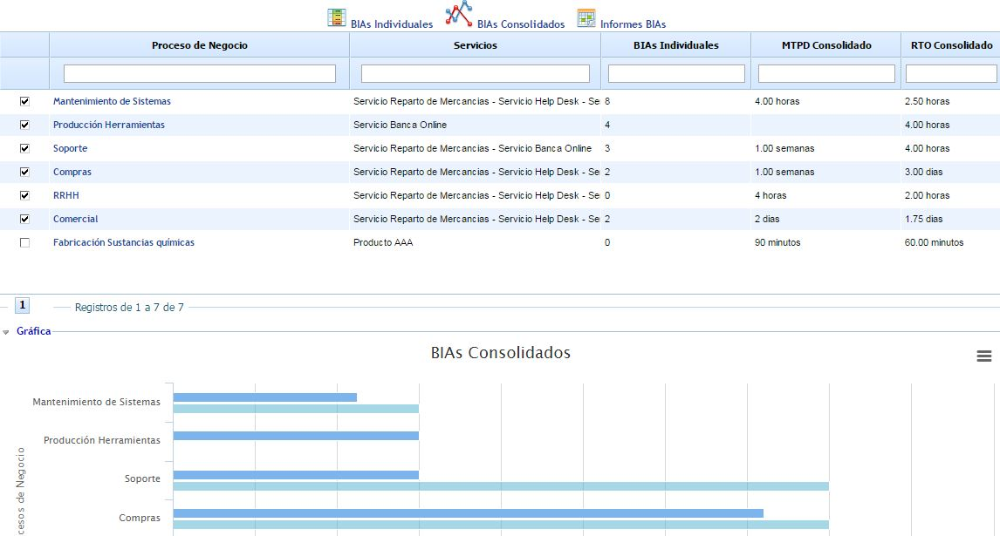

# Informes BIAs

Esta opción muestra el resultado obtenido en los BIAs consolidados de los procesos, permitiendo el filtrado de los procesos deseados.

En la tabla superior se permite seleccionar aquellos procesos que se quieren incluir en la gráfica inferior. En función de las casillas marcadas, en la gráfica se muestra tanto el MTPD como el RTO obtenido en el BIA. Además, se permite ingresar a la información del BIA de un proceso concreto pulsando sobre el nombre del proceso.
