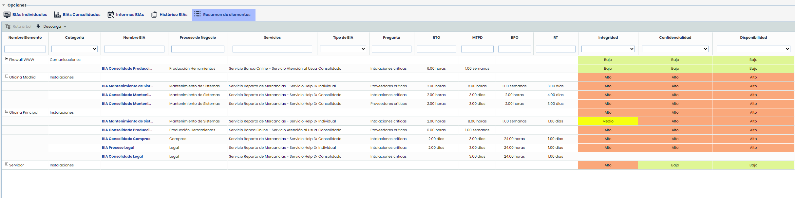
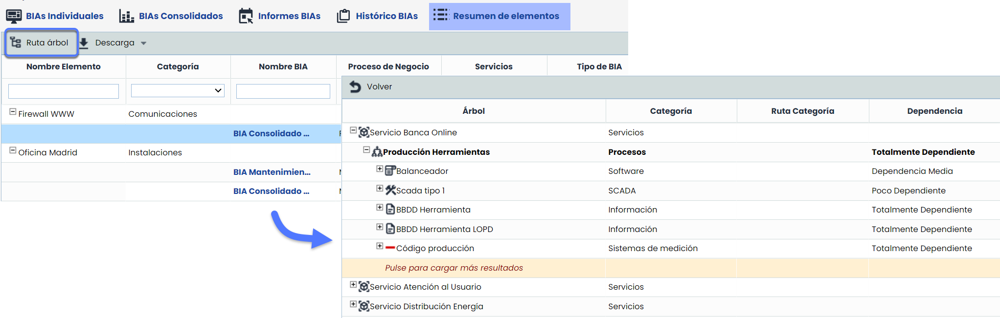

# Resumen de elementos


Este apartado proporciona una visión completa y estructurada de los elementos vinculados a los BIAs (individuales y consolidados). Su objetivo principal es centralizar la información clave, como parámetros de recuperación, dimensiones, y servicios, para facilitar el análisis y la toma de decisiones.
Esta funcionalidad permite:
\* Consultar la relación entre los elementos y los BIAs asociados mediante preguntas tipo tabla elementos.
\* Acceder a las valoraciones de parámetros como RTO, RPO y RT de forma clara y consistente.
\* Descargar toda la información en un archivo CSV para análisis externo.


## Campos de la tabla

A continuación, se detallan los campos más relevantes que se incluyen en la tabla:

* **Ruta Árbol:** Ubicación jerárquica del elemento dentro del árbol de dependencias.

* **Pregunta:** Preguntas del formulario de tipo tabla elementos.
* **RTO y RPO**

  * **BIAs individuales y consolidados:** se muestra la valoración correspondiente al BIA.
* **RT**

  * **BIAs individuales y consolidados:** se muestra la valoración correspondiente a las preguntas tipo tabla elementos.


\*\*Nota\*\*
Si la opción “Mostrar RTO” no está habilitada en Ajustes \*\*>\*\* [Configuración BIAs](https://help.globalsuitesolutions.com/es/globalsuite/v1/configuracion-bia), el campo se mostrará vacío.


* **Dimensiones del Inventario:** se visualizarán todas las dimensiones configuradas en la [Metodología de Elementos.](https://help.globalsuitesolutions.com/es/globalsuite/v1/metodologia-elementos)

## Opciones de personalización y descarga

* **Ocultar/mostrar campos:** Haz clic derecho sobre cualquier campo para ocultarlo o mostrarlo según tus necesidades.
* **Ordenación y filtros:** Todos los campos admiten filtros y ordenación avanzada para localizar información de manera eficiente.
* **Descarga informe CSV**: La información de la tabla puede descargarse en un archivo CSV, que incluirá todos los campos visibles y los filtros aplicados.


## Recursos relacionados
\* [¿Cómo configurar y utilizar las Tablas de Elementos en los BIAs de GlobalSuite®?](https://help.globalsuitesolutions.com/es/globalsuite/v1/como-configurar-y-utilizar-las-tablas-de-elementos)
\* [BIAs- Preguntas personalizables](https://help.globalsuitesolutions.com/es/globalsuite/v1/bias-consolidados#BIAsConsolidados-Preguntaspersonalizables)

