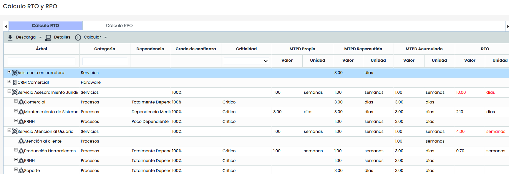
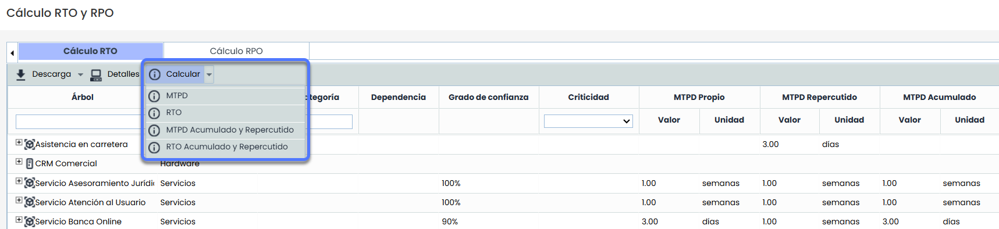
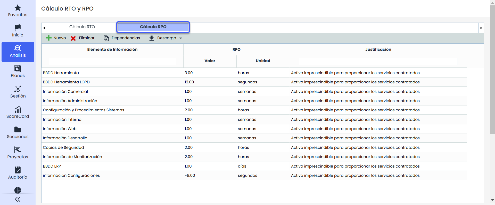
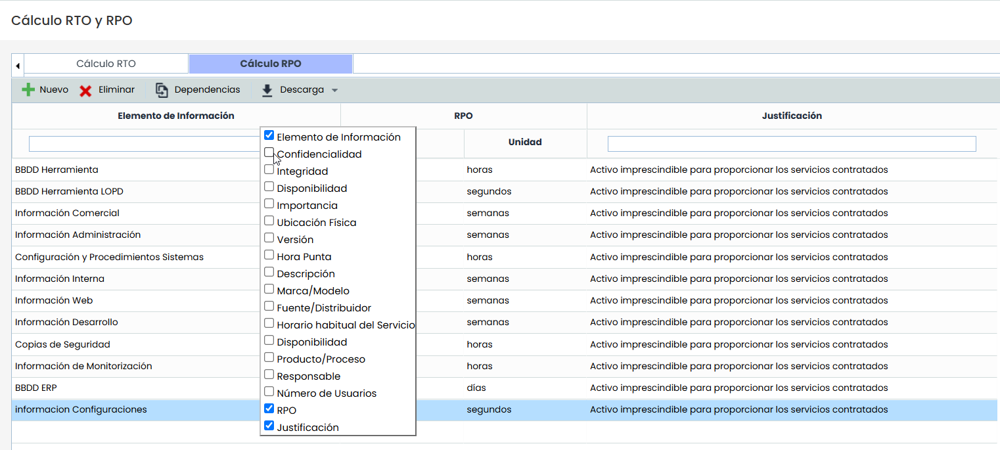

# Cálculo RTO y RPO

## Cálculo RTO

La pestaña de RTO (Recovery Time Object) permite identificar el tiempo máximo en el cual los recursos (técnicos y humanos) necesarios para soportar los servicios y procesos deben estar a un nivel mínimo de recuperación.

El cálculo RTO se muestra en forma tabla ofreciendo la siguiente información:

* **Árbol:** Muestra el listado de Servicios y Procesos dependientes que han sido definidos.


Los Servicios se definen en el apartado Inicio > [Catálogo de Servicios](https://help.globalsuitesolutions.com/es/globalsuite/v1/catalogo-de-servicios) y los procesos en Inicio > [Procesos](https://help.globalsuitesolutions.com/es/globalsuite/v1/procesos).


* **Categoría:** Indica la categoría o subcategoría a la que pertenece el elemento,
* **Ruta categoría:** Indica la categoría principal da la que pertenece el elemento, aparece vacía si tiene el mismo valor que el campo anterior.
* **Dependencia**  Muestra el grado de dependencia entre los procesos de negocio y el servicio.

El grado de dependencia se establece en el árbol de procesos del apartado Inicio > [Procesos](https://help.globalsuitesolutions.com/es/globalsuite/v1/procesos).

* **Grado de Confianza:** Indica el grado de confianza otorgado al MTPD propio obtenido automáticamente.
* **Criticidad:** se refiere al nivel de criticidad o importancia de un proceso o servicio para el negocio en función de su impacto al estar inactivo
* **MTPD Propio:** Muestra el valor del MTPD propio del servicio o proceso. Este valor podrá definirse manualmente o calculado automáticamente según el criterio configurado en Ajustes > Continuidad > [BIAs](https://help.globalsuitesolutions.com/es/globalsuite/v1/configuracion-bia).


El MTPD propio de los servicios viene heredado del apartado Inicio > [Pre-BIAs Consolidados](https://help.globalsuitesolutions.com/es/globalsuite/v1/pre-bia#Pre-BIA-Pre-BIAsConsolidados) y el MTPD propio de los procesos del apartado Análisis > [BIAs Consolidados](https://help.globalsuitesolutions.com/es/globalsuite/v1/bias-consolidados).


* **MTPD Repercutido:** Campo automático que calcula el MAYOR MTPD de todos los procesos inferiores al actual en el árbol.
* **MTPD Acumulado**: Campo automático que muestra el MENOR MTPD de todos los productos/servicios y procesos superiores al actual en el árbol.
* **RTO:** Permite definir la escala temporal de recuperación de los recursos necesarios para soportar el servicio o proceso de negocio. Este valor podrá definirse manualmente o calculado automáticamente según el criterio configurado en Ajustes > Continuidad > [BIAs](https://help.globalsuitesolutions.com/es/globalsuite/v1/configuracion-bia).


Para que el RTO sea válido la escala temporal debe ser menor o igual al valor del MTPD Propio.


* **RTO Repercutido:** Campo automático que calcula el MAYOR RTO o RT de todos los elementos inferiores al actual en el árbol.
* **RTO Acumulado**: Campo automático que muestra el MENOR RTO de todos los productos/servicios y procesos superiores al actual en el árbol.
* **RT:** Permite definir la escala temporal de recuperación de los recursos tecnológicos que soportan el servicio o proceso de negocio. Para ello se ha de pulsar dos veces sobre la celda y definir los valores deseados.

### Cálculos automáticos

En la barra de acciones se muestra un botón **Calcular**, que incluye diferentes opciones según los criterios configurados.

* **MTPD**: disponible si el cálculo del MTPD es automático.
* **RTO**: disponible si el cálculo del RTO es automático.
* **MTPD Acumulado y Repercutido**: actualiza y guarda los valores automáticos de estos campos en todos los elementos.
* **RTO Acumulado y Repercutido**: actualiza y guarda los valores automáticos de estos campos en todos los elementos.

### Validaciones

Al introducir o calcular valores se realizan las siguientes comprobaciones:

* El **RTO** debe ser menor o igual al MTPD si el grado de confianza es del 100%.
* El **RTO** debe ser menor al MTPD si el grado de confianza es inferior al 100%.
* Se mostrarán en rojo los valores incoherentes, incluyendo:

  * RTO Propio > MTPD Propio/Repercutido
  * RTO Repercutido > MTPD Propio/Repercutido
  * RTO Acumulado > MTPD Propio/Repercutido
  * RT > MTPD Propio/Repercutido
  * MTPD Acumulado < RT

### Consulta de elementos

Cada elemento dispone de un botón **Detalles**, que abre el formulario completo del elemento en la opción [Inventario](https://help.globalsuitesolutions.com/es/globalsuite/v1/inventario), permitiendo consultar y editar.

## Cálculo RPO

La pestaña de RPO (Recovery Point Objetive) permite definir la escala temporal de información que puede permitirse perder la organización sin que afecte negativamente al negocio. Dicho de otro modo, el RPO determina la periodicidad con la que deben salvaguardarse los datos para todos aquellos procesos de negocio.

La tabla de Cálculo RPO sólo muestra los activos de categoría información que han sido valorados en el apartado ‘Análisis/Inventario de Activos’, permitiendo realizar las siguientes acciones:

* **Nuevo:** Permite incluir un nuevo activo en la tabla. Ese activo aparecerá en el apartado ‘Análisis/Inventario de Activos’.

* **Eliminar:** Permite eliminar un activo de información ya definido. Para ello se ha de seleccionar la fila o filas deseadas y pulsa el botón ‘Eliminar’.


Al eliminar un activo de información de la pestaña Cálculo RPO, se eliminará automáticamente del Inventario de Activos y se perderán sus valoraciones.


* **Dependencias:** Muestra el árbol de dependencias del activo seleccionado.

El árbol de dependencias se puede definir en el apartado ‘Análisis/Inventario de Activos’.

* **Descarga:** Posibilita la descarga del listado de activos y el cálculo del RPO en un formato editable (.xlsx) o en formato .PDF  
  La pestaña de cálculo del RPO muestra por defecto la siguiente información de cada uno de los activos:
* **Activo de Información:** Muestra el nombre con el cual se he identificado un activo de la categoría información.
* **Dimensiones:** Muestra las dimensiones definidas en el apartado de 'Análisis/Inventario de Activos' y la valoración que se ha establecido por cada una de ellas.
* **RPO:** Permite definir la escala temporal que puede permitirse perder la organización de ese activo de información. Para ello se ha de pulsar dos veces sobre las celdas y definir los valores deseados.
* **Justificación:** Campo de texto que posibilita justificar detalladamente el RPO definido para cada uno de los activos de información.


\*\*NOTA:\*\*De manera adicional el usuario puede definir la información que quiere visualizar en la pestaña del RPO. Para ello se ha de pulsar el botón derecho sobre la línea que muestra el titulo de las columnas. Aparece un listado que permite seleccionar que dimensiones queremos insertar el la tabla a modo informativo.


