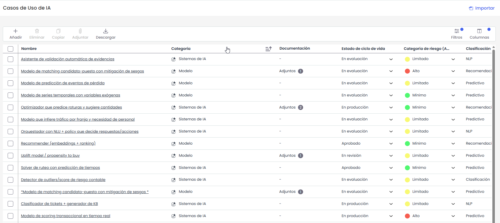
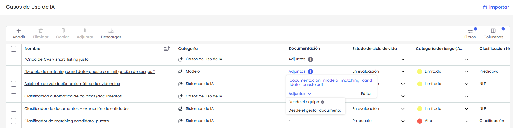
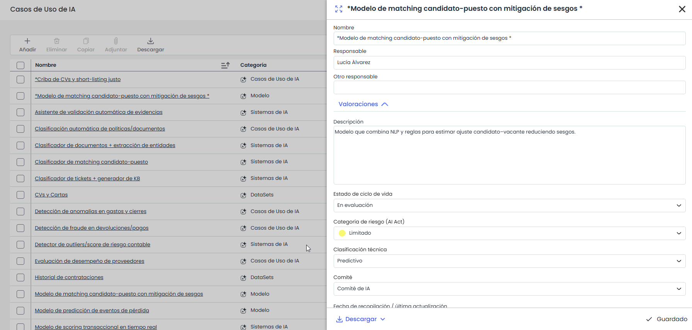

# Casos de Uso de IA


Esta opción permite al usuario definir, catalogar y valorar los activos de Inteligencia Artificial de la organización (casos de uso, sistemas de IA, datasets y modelos), facilitando su registro y gobierno conforme a marcos de referencia como ISO 42001 y el Reglamento Europeo de Inteligencia Artificial (AI Act).



La opción se encuentra en el menú lateral, dentro de \*\*Análisis\*\*. Solo está disponible para las empresas que dispongan de la licencia AI Governance.


La tabla de Casos de Uso de IA muestra los datos básicos de cada activo (**Nombre**, **Responsable**, **Categoría** y **Otro responsable**), seguidos de todas las dimensiones configuradas como visibles en 'Ajustes > Metodologías > Elementos > Visibilidad en Tablas' para esta opción. Todos los campos pueden editarse o completarse directamente desde la propia tabla, a excepción del dato 'Nombre'.

La tabla de Casos de Uso de IA permite realizar las siguientes acciones:

* **Nuevo:** Permite insertar un nuevo registro en la tabla.Para poder crear un registro deberá existir al menos una categoría configurada con este tipo especial.  
  Si existe una única categoría de este tipo, se asignará por defecto al nuevo registro; si existen varias, se asignará por defecto la primera de ellas, pudiendo modificarse posteriormente desde la tabla.  
  Este nuevo elemento también se mostrará en la opción **Análisis>** [**Inventario**](inventario/README.md)**.**
* **Eliminar:** Permite eliminar un registro de la tabla seleccionando la fila o filas deseadas y pulsando el botón 'Eliminar'.
* **Copiar:** Permite copiar un registro de la tabla seleccionando la fila o filas deseadas y pulsando el botón 'Copiar'.
* **Opciones - Importar:** GlobalSuite posibilita importar listados de casos de uso de IA en formato Excel. En el botón 'Descarga' existe un **modelo de archivo** con los campos que se pueden importar en la tabla.   
  Luego desde la opción “**Importar**” se puede realizar la importación, seleccionando el archivo se a través del botón 'Seleccionar archivo' y pulsando sobre el botón 'Continuar'.   
  El único dato obligatorio es el nombre del elemento, el resto de datos se pueden o no incluir en la importación.
* **Descarga (Informe Excel):** Permite descargar un informe en formato Excel de los registros que se hayan seleccionado en la tabla. Esta opción también permite descargar el modelo de archivo para realizar la importación de casos de uso de IA. El informe RAT no está disponible en esta opción.


Las opciones relacionadas con la importación (Importar y Descarga > Modelo de importación) solo estarán visibles si la empresa dispone de la licencia \*\*Data Import\*\*.


### Asociar y adjuntar Documentación

Al habilitar la visibilidad de la documentación en tabla será posible incorporar documentación desde dos fuentes:

* **Adjuntar Documentos desde el Equipo Local:** Será posible adjuntar documentos directamente desde el equipo local de cada usuario, simplificando la incorporación de nueva documentación relevante.
* **Asociar Documentos desde el Gestor Documental:** Se podrán asociar los documentos previamente almacenados en el [Gestor Documental](https://help.globalsuitesolutions.com/es/globalsuite/v1/gestor-documental), así como desasociarlos cuando sea necesario. Esto permite centralizar y facilitar el acceso a toda la documentación relevante.

Toda la documentación adjunta se verá reflejada en el campo "Documentación". Desde esta celda también es posible adjuntar documentación tanto desde el equipo como desde el Gestor Documental, al igual que en la opción 'Inventario'.


Para visualizar estas opciones deberás habilitar la visibilidad de la documentación en Administración > Elementos > Visibilidad de Opciones > [\*\*Documentación\*\*](https://globalsuitesolutions.atlassian.net/wiki/spaces/GlobalSUITEes/pages/266864054/Metodolog+a+Elementos#Visibilidad-de-Opciones)\*\*.\*\*


### Ficha del elemento

Al pulsar sobre el enlace del elemento se muestran los campos de la ficha, pudiendo rellenar los siguientes campos:

* 

  **Nombre:** Permite definir el nombre del caso de uso, sistema, dataset o modelo de IA.
* **Responsable:** Identifica el responsable del activo dentro de la organización. Este responsable se puede seleccionar del conjunto de Empleados (ver apartado en pestaña Gestión).
* **Otro Responsable:** Identifica el responsable del activo dentro de la organización, pudiendo definirlo de manera textual.
* **Resto de campos:** A continuación, pueden rellenarse todas las dimensiones o campos que se hayan configurado para esta opción. La herramienta muestra aquellas dimensiones marcadas como visibles en 'Ajustes > Metodologías > Elementos > **Visibilidad en Formulario**' para 'Casos de Uso de IA'.

Si la visibilidad de la documentación está habilitada, la ficha mostrará también el apartado de Documentación, desde el que se podrá adjuntar y asociar documentación.
