# CMDB

La opción de la CMDB (Configuration Management Data Base) es una funcionalidad que permite realizar una completa gestión de la configuración sobre los elementos de la organización que ayudan a prestar los servicios de la organización.

## CMDB

Al acceder al apartado de la CMDB se muestra un listado con todos los elementos de configuración que se han almacenado en la Base de Datos.

Las columnas que muestra la plataforma por defecto se pueden parametrizar pulsando con el botón derecho sobre la fila de nombres de columna.

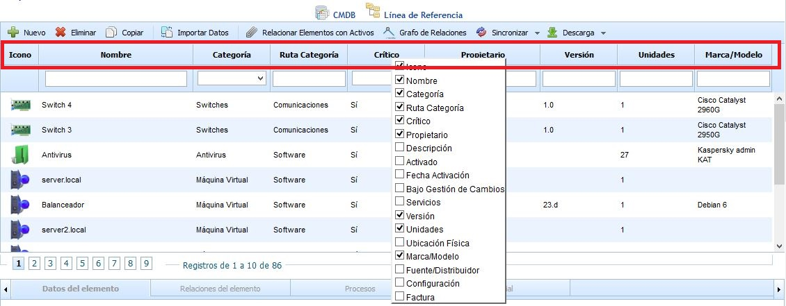

Las opciones que permite la herramienta son las siguientes:

* **Nuevo:** Permite incluir un nuevo elemento en la base de datos.

* **Eliminar:** Permite eliminar uno o varios elementos almacenados en la base de datos. Para ello se ha de seleccionar la fila o filas deseadas y pulsar el botón "Eliminar".

* **Copiar:** Posibilita crear un nuevo elemento con todos los atributos del elemento seleccionado, a excepción de los servicios y archivos que se hayan subido.

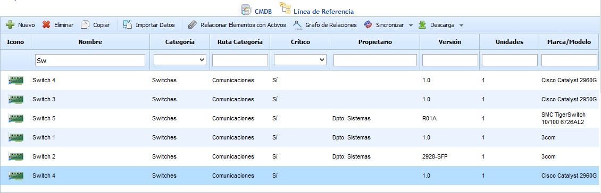

* **Importar Datos:** GlobalSuite posibilita importar bases de datos de clientes en formato CSV. Los datos necesarios son Nombre, Categoría, Crítico, Propietario, Descripción, Activado, Fecha Activación, Bajo Gestión de Cambios, Versión, Unidades, Ubicación Física, Marca/Modelo, Fuente/Distribuidor, Configuración y Factura. Estos datos son los mismos que se especifican en el formulario. Una vez preparado el archivo se debe seleccionar a través de la opción "Examinar" y posteriormente utilizar el botón "Continuar".

* **Relacionar Elementos con Activos:** Permite incorporar los elementos de configuración deseados en la opción de "Análisis/Inventario", para realizar el análisis de riesgos sobre esos activos.

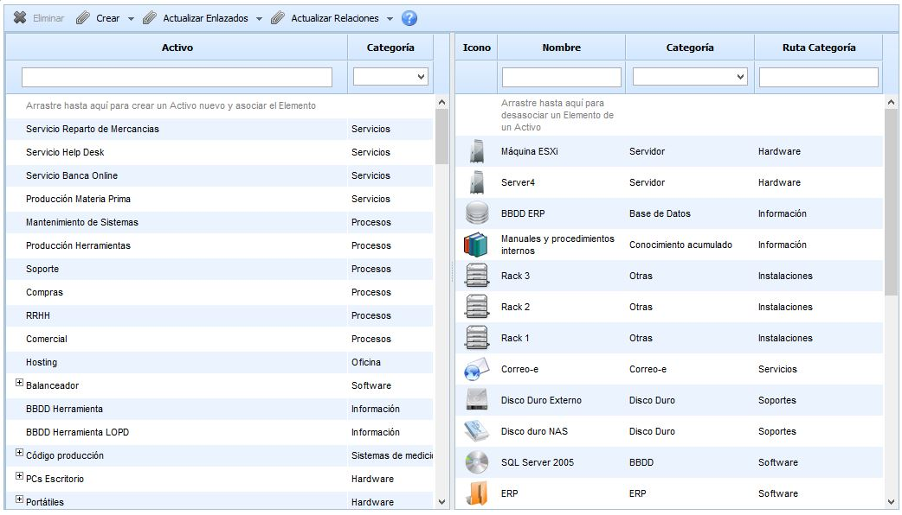

Para ello se ha de seleccionar el elemento de configuración en la columna derecha y arrastrar el elemento a la columna izquierda. El listado de activos mostrado en la columna izquierda es el mismo que va a mostrarse en el apartado "Análisis/Inventario".

En la cabecera de la ventana de "Relacionar Elementos con Activos" se permiten las siguientes opciones:

* **Crear**

  * **Activos desde CMDB:** Se crea un Activo en el Inventario por cada CI que no tenga activos enlazados (que estén solo en la CMDB).
  * **Elementos desde Inventario:** Se crea un CI en la CMDB con el nombre del activo como campo principal del CI, y la categoría del mismo.

* **Actualizar Enlazados**

  * **Elementos CMDB:** Actualiza la información del campo principal y la categoría de los CIs que tengan asociado un sólo Activo con los datos del mismo.
  * **Activos:** Actualiza el nombre y la categoría de los Activos que tengan enlazado un solo CI con los datos del mismo.

* **Actualizar Relaciones**

  * **Árbol de Dependencias desde CMDB:** Se actualizan las dependencias entre activos añadiendo y quitando dependencias en función de los CIs asociados. Si dos CIs con un Activo/s mapeado/s tienen una relación marcada como "Relación de Dependencia", se crea una dependencia entre los activos asociados. Si dos Activos con CI/s mapeado/s tienen una dependencia, y los CIs correspondientes no están relacionados entre sí, se quita la dependencia entre los activos.
  * **CMDB desde Árbol de Dependencias:** Se actualizan las relaciones entre CIs añadiendo y quitando dependencias en función de los Activos asociados. Si dos Activos con CI/s mapeado/s tienen una Dependencia, se crea una relación de tipo "Relación de Dependencia" entre los CIs asociados. Si dos CIs con Activo/s mapeado/s tienen una "Relación de Dependencia", y los Activos correspondientes no tienen ninguna dependencia entre sí, se quita la relación entre los CIs.

NOTA: No se podrán crear/actualizar activos que pertenezcan a las categorías que tengan asociado un "Tipo" en la configuración de las categorías que se encuentra en la opción de "Metodologías de Análisis".

* **Grafo de Relaciones:** Permite visualizar las relaciones del elemento seleccionado de manera gráfica.

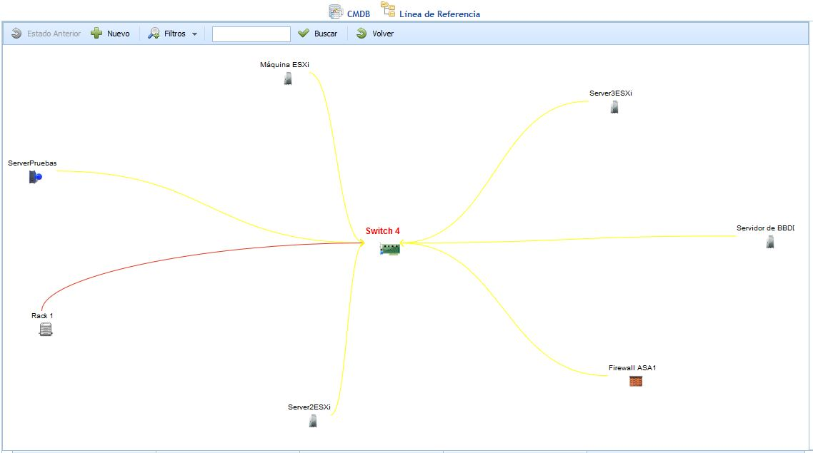

Dentro de la opción del grafo de relaciones se pueden realizar las siguientes acciones:

* *Nuevo:* Permite incluir un nuevo elemento de configuración en el gráfico.

Para relacionar el nuevo elemento con cualquiera de los elementos mostrados en el gráfico se ha de seleccionar el elemento deseado, pulsar el botón derecho, elegir Insertar Relación y pulsar sobre el elemento con el que se desea relacionar.

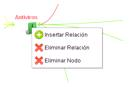

Para eliminar la relación establecida entre dos elementos, se ha de seleccionar el elemento deseado, pulsar el botón derecho, elegir Eliminar Relación y pulsar sobre el elemento con el que se desea eliminar con el botón derecho.

Si se desea eliminar el elemento de manera definitiva de la Base de Datos, se ha de seleccionar el mismo con el botón derecho y pulsar sobre Eliminar Nodo.

NOTA: Cualquier modificación realizada sobre el gráfico de relaciones quedará almacenada en el listado de elementos de la CMDB

* *Filtros:* Permite realizar filtros para visualizar las distintas relaciones del elemento seleccionado. Nivel 1 muestra las relaciones del elemento con aquellos más directos. Nivel 2, muestra las relaciones del elemento seleccionado con los más directos y las relaciones de estos últimos con los suyos propios, etc. El filtro Relacionados muestra todos los elementos de la CMDB que están relacionados entre sí y la opción de Todos muestra el listado de todos los elementos de la CMDB estén o no relacionados.

* *Buscar:* Permite realizar una búsqueda de un elemento de configuración en el grafo.

* *Volver:* Permite volver a la ventana con el listado de los elementos de configuración.

* **Descarga:** Permite descargar el listado de elementos y sus atributos en un formato editable (.xlsx)

Una vez situados en el listado de elementos de configuración, GlobalSuite permite realizar una descripción de las características del mismo seleccionando la fila deseada, pudiendo definir los siguientes puntos:

### Datos del elemento

El apartado Datos del Elemento permite detallar la información específica del elemento seleccionado en la tabla.

El formulario permite definir cada uno de los campos que se describen a continuación:

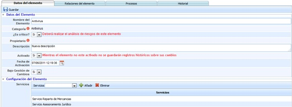

* **Nombre del Elemento:** Nombre descriptivo del elemento de configuración. Este nombre se mostrará en la tabla inicial de la CMDB.

* **Categoría:** Indica la categoría o subcategoría a la que pertenece el activo. Para definir la categoría o subcategoría se ha de pulsar dos veces sobre la celda lo que genera la siguiente pantalla:

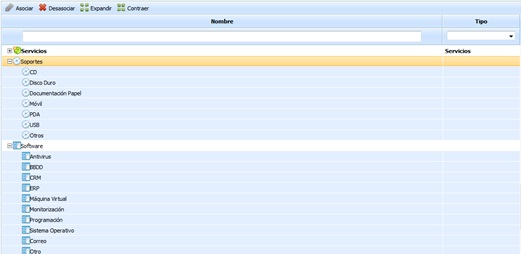

Las opciones que permite la herramienta son las siguientes:

* **Asociar:** Permite asociar una categoría/subcategoría al activo seleccionando la fila deseada y pulsando sobre el botón 'Asociar'.

* **Desasociar:** Ofrece la posibilidad de eliminar una categoría/subcategoría de una activo seleccionando la fila deseada y pulsando sobre el botón 'Desasociar'.

* **Expandir:** Permite expandir el listado de categorías/subcategorías.

* **Contraer:** Permite contraer el listado de categorías/subcategorías.

* **Es crítico**: Ofrece la posibilidad de definir si el elemento es critico para un servicio, lo que permite alertar que debe realziarse una análisis de riesgos del mismo en el apartado de 'Análisis/Análisis de Riesgos'

* **Propietario**: Indica el recurso encargado de la gestión del elemento. Para seleccionar un recurso se ha de pulsar sobre la exclamación roja, lo que muestra la siguiente pantalla:

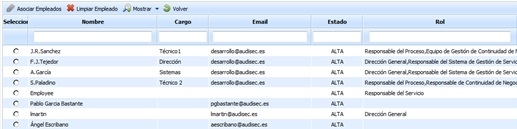

Las opciones que permite la herramienta son las siguientes:

* **Asociar empleado** Permite, una vez seleccionado el recurso deseado en la tabla inferior, asociar el empleado al elemento de la CMDB.

* **Limpiar empleado** Ofrece la posibilidad de eliminar una asociación de empleado. Para ello se ha de seleccionar el recurso deseado y pulsar sobre el botón.

* **Mostrar** Permite realizar un filtro del listado de empleados, mostrando el listado de todos los empleados registrados en la herramienta (Altas y Bajas) o unicamente aquellos empleados que se encuentran de alta en el sistema (filtro por defecto).

* **Volver** Ofrece la posibilidad de volver a la pantalla 'Datos del elemento'

* **Descripción:** Permite realizar cualquier anotación adicional sobre el elemento.

* **Activado:** Si el elemento se activa en la CMDB, cualquier cambio realizado sobre el mismo generará un histórico en el apartado ‘Historial’. En caso de no estar activado, los cambios no serán almacenados en la CMDB.
* **Fecha de Activación:** Indica la fecha en la cual el elemento se considera activado.
* **Bajo Gestión de Cambios**: Permite definir si el elemento está implicado en el proceso de Gestión de Cambios, proceso necesario en la Norma ISO20000.

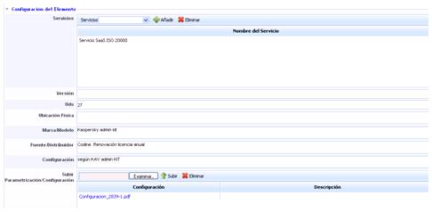

* **Servicios:** Permite identificar e/los servicios que dependen del correcto funcionamiento del elemento.

* **Versión:** Determina la versión del elemento.

* **Uds:** Indica las unidades del elemento.

* **Ubicación Física:** Determina la ubicación física en la que se encuentra el elemento.

* **Marca/Modelo:** Permite identificar la marca y modelo específico del elemento.

* **Fuente/Distribuidor:** Posibilita incluir el proveedor/distribuidor que suministra el elemento.

* **Configuración:** Permite identificar la configuración especifica del elemento y que no está incluida en los campos generales.

* **Subir Parametrización/Configuración:** Posibilita subir un archivo con la configuración específica del elemento sino se desea incluir en el campo anterior, por ejemplo las reglas establecidas del Firewall, etc.

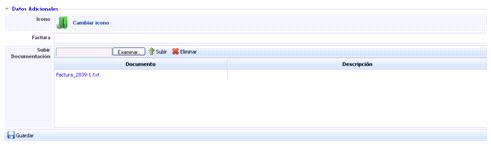

* **Icono:** Permite seleccionar un icono para identificar el elemento en la tabla de la CMDB.

* **Factura:** Determina el número de factura de compra del elemento.

* **Configuración:** Posibilita subir un archivo o factura relacionada con el elemento.

### Relaciones del elemento

La pestaña de Relaciones del Elemento permite establecer las distintas relaciones entre elementos almacenados y activados en la CMDB.

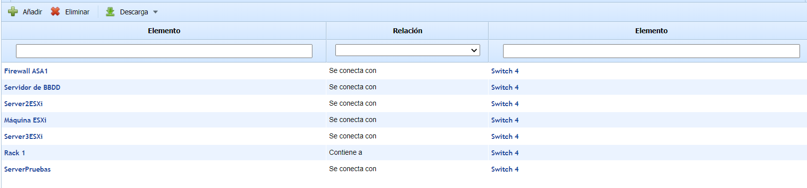

Para añadir una nueva relación, se debe pulsar el botón 'Añadir', lo cual abre una ventana emergente para seleccionar los dos elementos que se relacionarán, uno de los cuales debe ser el elemento seleccionado en la tabla.

Hay que elegir el tipo de relación que enlazará ambos elementos, y pulsar el botón "Añadir", que introducirá la nueva relación en la tabla.

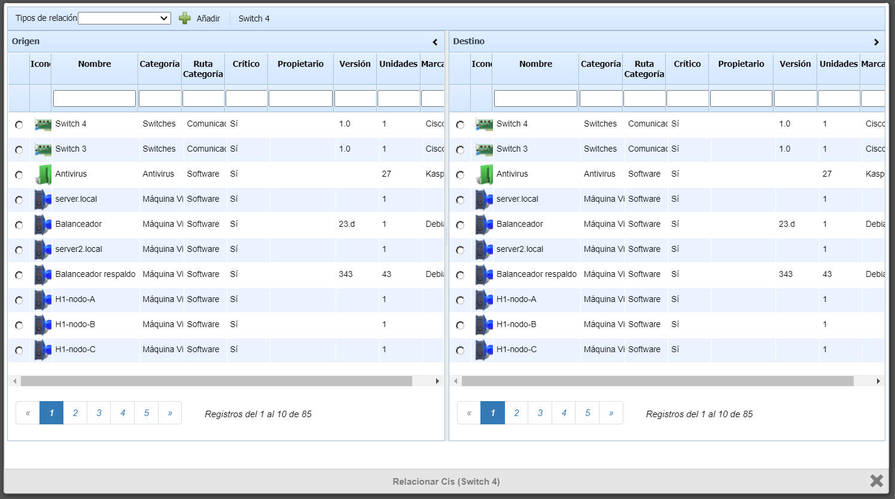

Para eliminar una relación creada, se ha de seleccionar la fila o filas deseadas y pulsar el botón ‘Eliminar’.

Si el usuario desea descargar el listado de relaciones de un mismo elemento, ha de pulsar el botón ‘Descarga’ lo que facilita un archivo en formato editable (.xlsx) o en formato .PDF

**NOTA:** Las relaciones del elemento se pueden modificar en el apartado ‘Ajustes> Configuración > CMDB’.

### Procesos

El apartado de procesos muestra de manera específica aquellos que se han producido y que tienen como recurso afectado el elemento seleccionado.

Para ello se debe establecer el control automático de los incidentes, problemas y cambios en el apartado ‘Home/Configuración’ y registrar los tickets correspondientes en GlobalSuite.

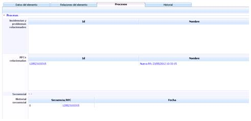

### Historial

El apartado Historial muestra un listado ordenado con las modificaciones que ha sufrido el elemento desde el momento que se ha activado, pudiendo realizar las siguientes acciones:

* **Eliminar:** Permite eliminar una modificación almacenada. Para ello se ha de seleccionar la fila o filas deseadas y pulsar el botón ‘Eliminar’.

* **Descarga:** Facilita un archivo con el historial en formato editable (.xlsx) o en formato .PDF

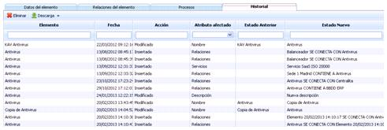

## Línea de referencia

La opción de Líneas de Referencia permite al usuario generar y almacenar un archivo con el estado de los elementos de configuración en el momento de la creación. Esto permite llevar un control de los cambios en la configuración y relaciones del elemento tras la creación de las RFC’s.

Las opciones que permite la herramienta son las siguientes:

* **Nueva:** Al pulsar el botón se accede a un formulario que permite definir los siguientes campos.

  * *Fecha:* Identifica la fecha de creación de la línea de referencia.
  * *Nombre:* Permite definir un nombre descriptivo de la línea de referencia.
  * *Descripción:* Permite realizar cualquier anotación adicional sobre la línea de referencia.
  * *Rfcs:* Permite identificar aquellas peticiones de cambio generadas en el apartado ‘Gestión/Cambios y Entregas’ que han provocado la generación de la línea de referencia.
  * *Elementos de configuración:* Esta tabla muestra todos los elementos de configuración almacenados y activados.

Para generar la línea de referencia sobre los mismos se pueden seleccionar todos seleccionando el cuadro situado más arriba de la tabla o bien, seleccionar de manera individual aquellos elementos sobre los que queremos generar la Línea de Referencia.

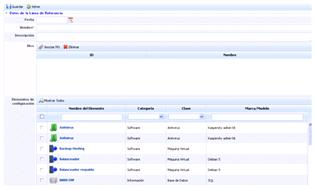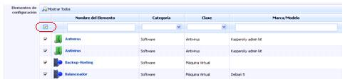

Una vez se han definido todos los valores, se pulsa el botón ‘Guardar’ lo que genera una nueva entrada en la tabla de Líneas de Referencia.

* **Eliminar:** Permite eliminar una línea o varias líneas de referencia ya creadas. Para ello se ha de seleccionar la fila o filas deseadas y pulsar el botón ‘Eliminar.’

* **Descarga:** Facilita un archivo con listado de líneas de referencia en formato editable (.xlsx) o en formato .PDF
