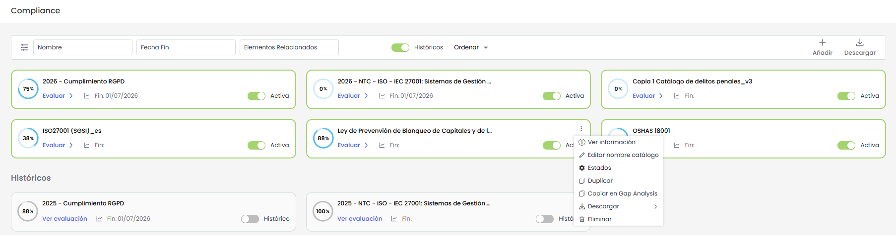
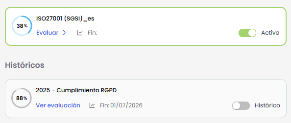
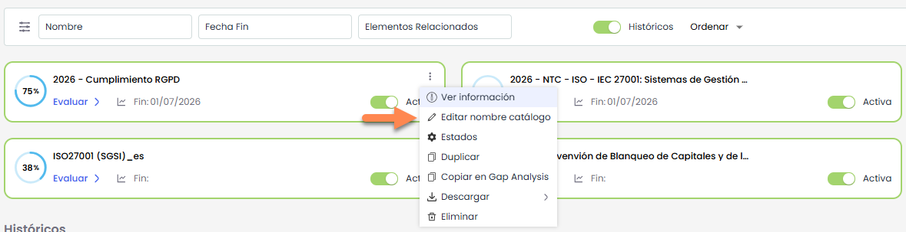
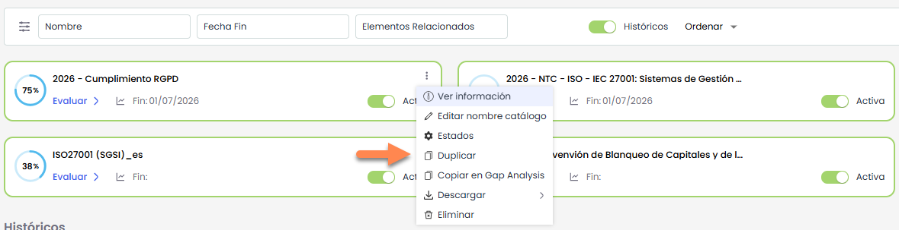
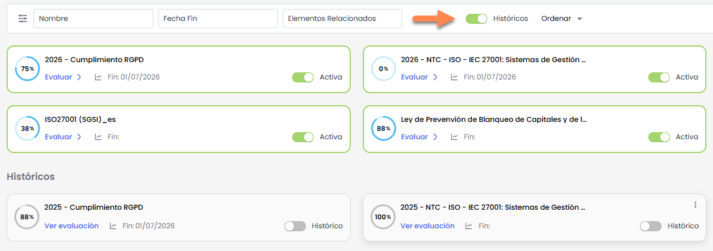

# Compliance


La opción de Compliance permite gestionar el estado de cumplimiento de los controles establecidos en los diferentes catálogos compliance, que se establecen en el apartado Ajustes> \*\*Catálogos compliance\*\*


## Catálogos de Compliance

Al acceder a la opción se muestran todos los compliance que se están gestionando, permitiendo añadir nuevos catálogos compliance para comenzar su gestión.

Desde esta vista es posible visualizar los catálogos activos, acceder a su evaluación, gestionar su configuración y consultar históricos.

La pantalla muestra un listado de **catálogos de Compliance** en formato de tarjetas.

Cada tarjeta incluye:

* Nombre del catálogo.
* Porcentaje de cumplimiento.
* Acceso a la opción **Evaluar**.
* Fecha de finalización.
* Estado (**Activa** / **Histórico**).

## Acciones

* **Crea una nueva evaluación :** Para crear un nuevo Compliance deberá pulsar el botón **Añadir**.  
  Al hacerlo, se abre una ventana modal con el listado de **catálogos disponibles** para crear la evaluación.   
  Los catálogos que aparecen con **reborde verde** indican que ya existe un Compliance creado a partir de ese catálogo. (A partir de la versión 7.2.0 se pueden tener activos varias evaluaciones de un mismo catalogo)

* **Ver información**: Permite consultar el detalle del catálogo de Compliance y asociar Elementos Relacionados. *Mas información en* [**Información de un Compliance**](informacion-de-un-compliance.md)
* **Editar nombre de un catalogo:** Permite modificar el nombre del catálogo de Compliance.  
  Al seleccionar esta opción, se habilita la edición del nombre para introducir el nuevo valor.

* **Estados:** Permite configurar los estados del catálogo. *Más información en* [**Configurar Estados**](configuracion-de-estados.md)
* **Duplicar:** Ofrece la posibilidad de generar una copia de un catálogo con toda su información. Esta acción copiará toda la información del catalogo excepto el estado de cada uno de sus requisitos.

* **Copiar en Gap Analysis:** Permite crear automáticamente un nuevo catálogo en la funcionalidad de **GAP Analysis** a partir del catálogo actual.  
  La copia se realiza de forma íntegra, manteniendo todo el contenido del catálogo original, incluyendo documentos, controles, tickets asociados, estados y demás información.  
  Los catálogos generados mediante esta opción estarán disponibles en **Inicio >** [**GAP Analysis**.](../../inicio/gap-analysis.md)
* **Eliminar:** Elimina un catalogo.

## Opciones de filtrado y visualización

* **Ver Históricos:** Existe una sección de **Históricos**, donde se visualizan catálogos ya cerrados o finalizados. Para verlos hay que presionar la opción Históricos de la barra de herramientas

* **Filtros**: Por defecto, se muestran los filtros de los campos Nombre, Fecha de Fin y Elementos relacionados. El comportamiento del filtro dependerá del tipo de campo:

  * **Nombre**: Es un filtro de lista, se pueden seleccionar uno o varios valores.
  * **Fecha de Fin**: Es un filtro de tipo fecha, se puede seleccionar una fecha en concreta o un rango de tiempo. Existen opciones predefinidas.
  * **Elementos relacionados**: Es un filtro de lista, se pueden seleccionar uno o varios valores.
  * En caso de contar con [**campos personalizados**](../../ajustes/configuracion-compliance.md), aunque estos no aparezcan en las tarjetas, se podrá filtrar por ellos.
* **Ordenar:** Permite ordenar los catálogos según los siguientes criterios:

  * **Nombre (A–Z)**
  * **Fecha fin**
  * **Fecha de inclusión**

* [Información de un compliance](informacion-de-un-compliance.md)
* [Gestión de Requisitos](gestion-de-requisitos/README.md)
* [Compliance ENS](compliance-ens.md)
* [Configuración de Estados](configuracion-de-estados.md)
* [Consolidación Compliance](consolidacion-compliance.md)
* [Gráficas y comparativas](graficas-y-comparativas.md)
* [Asistente de IA: Qué requisitos aplican](asistente-de-ia-que-requisitos-aplican.md)

## Vídeos


Compliance.mp4

