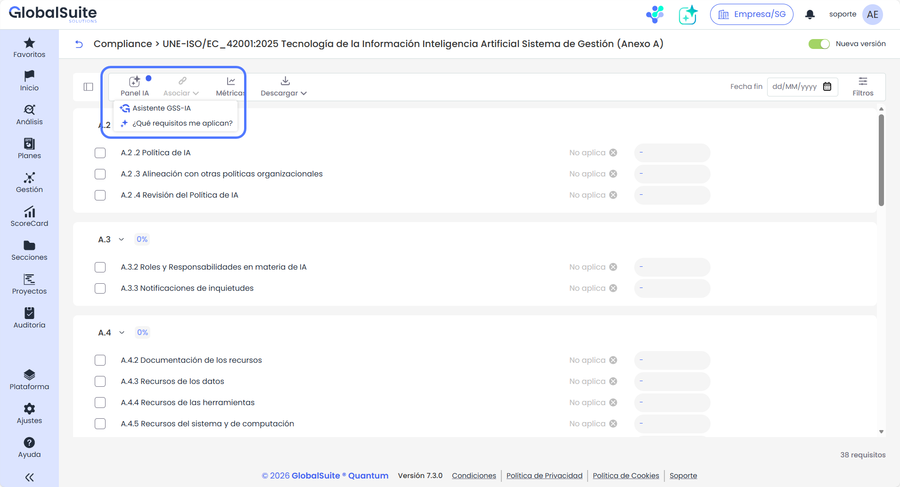
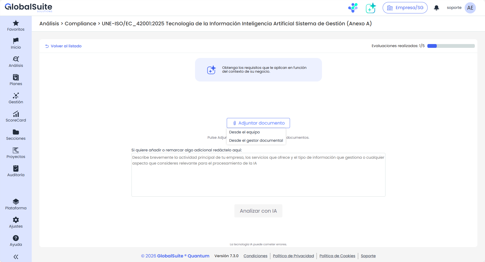
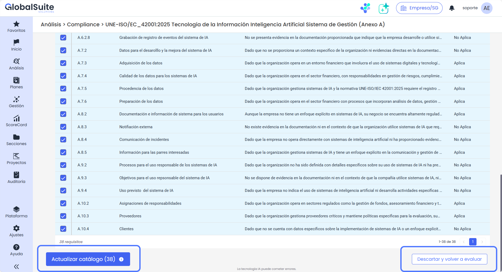
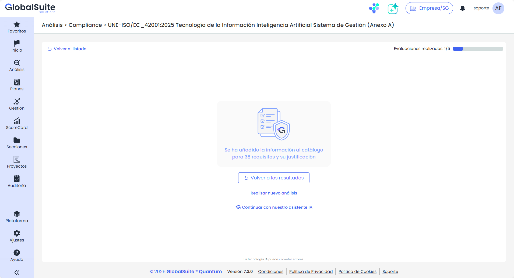

# Asistente de IA: Qué requisitos aplican

## Asistente de IA Compliance: Qué requisitos aplican


GlobalSuite® incorpora un nuevo Asistente de IA para el módulo de [Compliance](https://globalsuitesolutions.atlassian.net/wiki/spaces/GlobalSUITEes/pages/266864089/Compliance), pensado para poder realizar un gap inicial sobre una nueva normativa o regulación aplicable.
Este asistente utiliza la información proporcionada para el contexto de la compañía y poder realizar una recomendación de aplicabilidad y justificación o mecanismo para indicar el cumplimiento de cada requisito.


### ¿Cómo acceder al AI Requeriments Identifier?

El asistente IA identificador de requisitos puede accederse desde dentro de una evaluación o catálogo activo, en el **Panel IA > ¿Qué requisitos me aplican?**


Se recomienda utilizar este asistente con una normativa vacía, sin estar evaluada, aunque se puede aplicar sobre cualquiera ya que los resultados se podrán consultar sin sobrescribir la valoración previa.


Al pulsar en el botón se accederá a la vista para proporcionar información de contexto y que el asistente pueda realizar el análisis oportuno.

Esta información, se podrá introducir de varias fuentes, complementarias entre sí:

* Documentos del equipo del usuario
* Documentos del [Gestor Documental](../../secciones/gestor-documental/README.md) de GlobalSuite®
* Información textual: detalles adicionales a los documentos asociados.

El límite de archivos que se pueden proporcionar es de 5.

### Qué información se puede aportar para realizar el análisis con mayor precisión

Como principal fuente de entrada para realizar ese análisis que permita identificar qué requisitos de la normativa aplican y deben cumplirse, es conveniente proporcionar la mayor información de contexto seleccionando documentos relevantes, por ejemplo:

* Política de Seguridad de la Información
* Manual de Organización
* Catálogo de Servicios / Portfolio
* Arquitectura e Infraestructura TI
* Gestión de Proveedores y Terceros
* Procedimientos de RRHH
* Plan de Continuidad de Negocio
* Clasificación de la Información
* …

### Resultados del análisis del IA Requeriments Identifier

Una vez ha finalizado el análisis, se avisa al usuario de que los resultados están listos, y puede consultarlos.

Estos resultados son una propuesta de aplicabilidad y una justificación de por qué ese requisito debe cumplirse (y de qué manera se realiza) o de por qué no, basado en la información proporcionada.

Se pueden seleccionar varios o todos los resultados y aplicarlos en la evaluación / catálogo de cumplimiento, o descartarlos para realizar otro análisis de IA.

Una vez aplicados los requisitos a la evaluación de cumplimiento, se podrá volver a la vista de resultados para seleccionar otros requisitos a consolidar, o realizar un nuevo análisis de IA, o continuar con el asistente conversacional.

**Límite mensual**

Este asistente de AI Requeriments Identifier incorpora un límite de 5 evaluaciones o análisis mensual, tras lo cual la funcionalidad no estará disponible hasta el siguiente período.


Disponible en la versión Enterprise o versiones superiores.

