# Compliance ENS

La opción de Compliance ENS permite gestionar el estado de cumplimiento de las Medidas de Seguridad y los controles establecidos en las diferentes evaluaciones de la normativa, junto con su grado de aplicabilidad en función a la [Categorización del Sistema](https://help.globalsuite.es/pages/viewpage.action?pageId=107020361).

## Listado Evaluaciones Compliance

Al acceder a la opción, la herramienta muestra un listado las evaluaciones del ENS que se han establecido, mostrando por defecto aquellas que se encuentran activas. 

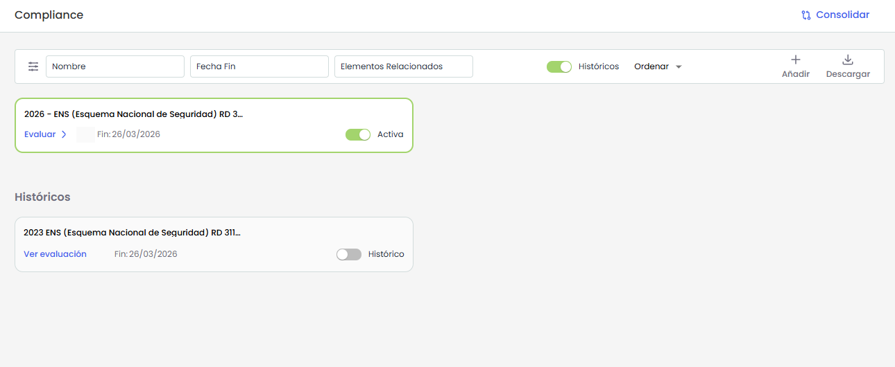

En la tabla se pueden realizar diferentes acciones, entre ellas:

* **Añadir**: Para crear un nuevo Compliance deberá pulsar el botón **Añadir**.  
  Al hacerlo, se abre una ventana modal con el listado de **catálogos disponibles** para crear la evaluación.   
  Los catálogos que aparecen con **reborde verde** indican que ya existe un Compliance creado a partir de ese catálogo.

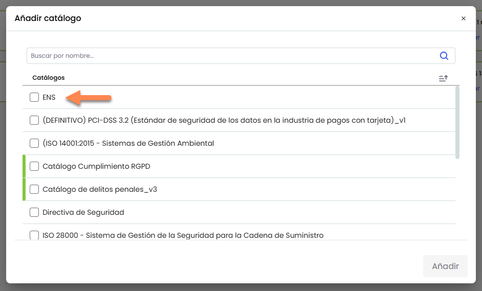


Las evaluaciones de versión 2015 se continuarán visualizando, pero solo se podrán crear nuevas de la versión 2022.


* **Ver información**: Permite consultar el detalle del catálogo de Compliance y asociar Elementos Relacionados. *Mas información en* [**Información de un Compliance**](informacion-de-un-compliance.md)
* **Editar nombre de un catalogo:** Permite modificar el nombre del catálogo de Compliance.  
  Al seleccionar esta opción, se habilita la edición del nombre para introducir el nuevo valor.
* **Eliminar**:  Permite eliminar una o varias evaluaciones del ENS, siendo posible la selección múltiple.
* **Estados:** Permite configurar los estados del catálogo. *Más información en* [**Configurar Estados**](configuracion-de-estados.md)
* **Duplicar**: Permite Copiar una evaluación del ENS con toda su información para poder reutilizarla.
* **Históricos**:

  * **Crear histórico:** al desactivar el switch **Activa**, la evaluación pasa a estado **Histórico**. En ese momento se genera una copia histórica que ya no podrá editarse, conservando el nivel de seguridad y el grado de aplicabilidad de todas las medidas de seguridad tal y como se encontraban en ese momento.
  * **Activar una evaluación:** desde un catálogo en estado **Histórico** y se vuelve a accionar el switch, la evaluación se reactiva. Esto permite recuperarla como evaluación editable y continuar realizando cambios sobre ella.
* **Descarga**:

  * **Informe CSV** : Se generará un informe con el listado de evaluaciones que coincidan con los filtros aplicados. El informe estará disponible en [Descargas Pendientes](https://help.globalsuite.es/display/GlobalSUITEes/.Descargas+Pendientes+vv6.53).

## Evaluación ENS

Desde el listado presionar, al presionar “Evaluar” se abre la vista en donde muestran todos los requisitos del ENS de acuerdo a la versión seleccionada del listado y el grado de aplicabilidad en función de la [Categorización del Sistema](https://help.globalsuite.es/pages/viewpage.action?pageId=107020361).

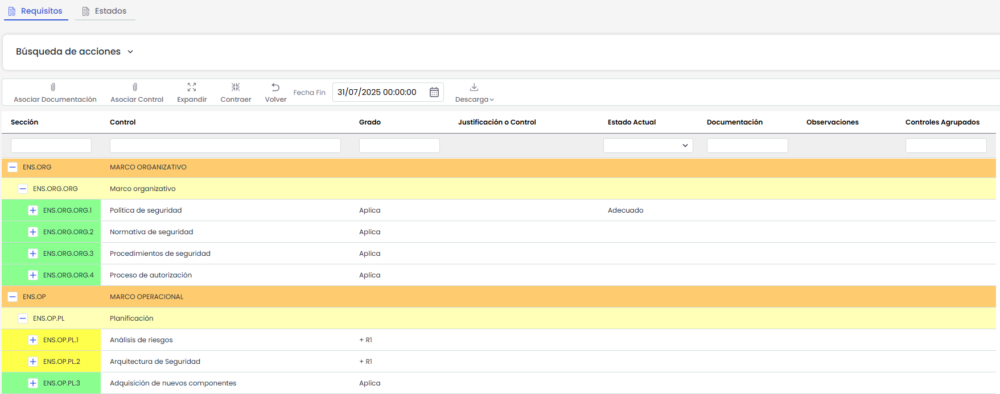

**Gestión de Requisitos**

* Grado: Campo automático que se calcula en función de la Categorización del Sistema. Es editable únicamente a nivel del controles (3er y 4to nivel en evaluaciones del 2015 y 2022 respectivamente).
* Estado Actual:

  * Campo editable únicamente a nivel de controles, mediante un desplegable, que indica el estado de los requisitos o controles.
  * Campo automático únicamente a nivel de Medidas de Seguridad (3er nivel). Se mostrará la etiqueta "Adecuado" cuando todos los controles que Aplican muestren un grado de completitud del 100%.

    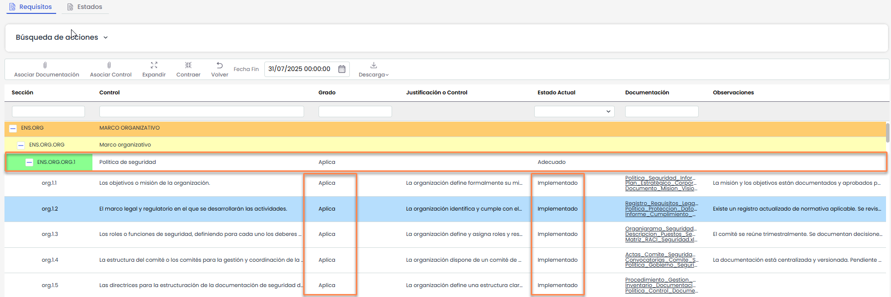


Los controles que están marcados como "No Aplica" no se tendrán en cuenta para calcular si la medida de seguridad es "Adecuado" o no.


En la tabla se pueden realizar diferentes acciones, entre ellas:

* **Asociar Documentación**: Permite asociar uno o varios documentos del gestor documental a las Medidas de Seguridad o requisitos del ENS. Para ello se debe seleccionar la fila deseada y pulsar sobre el botón "Asociar documentación" que abrirá una ventana donde se muestra el árbol de documentos que están almacenados en el [Gestor Documental](https://help.globalsuite.es/display/GlobalSUITEes/.Gestor+Documental+vv6.53). Para asociar la documentación se debe seleccionar el/los checkbox de los documentos deseados.

  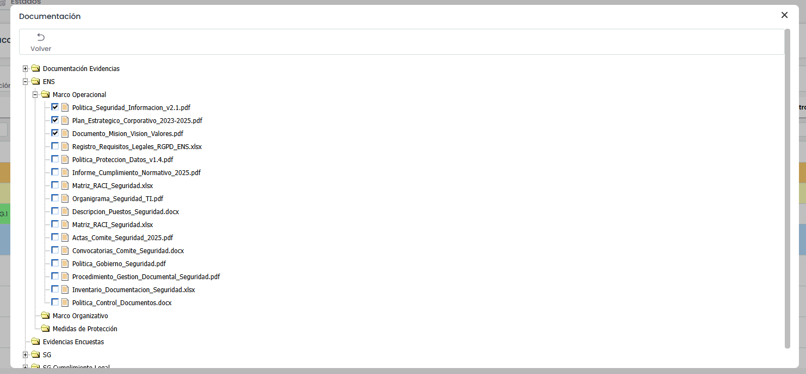

Una vez  asociados los documentos, se mostrarán en la columna correspondiente de la medida de seguridad o requisito.

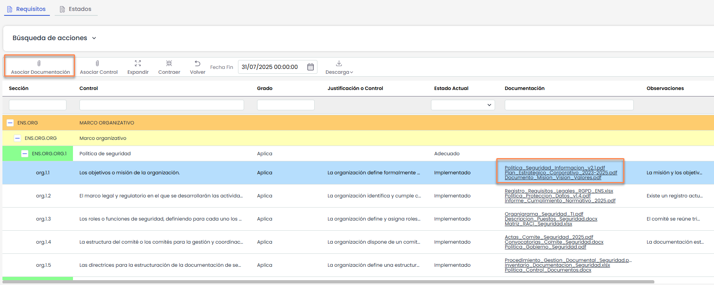

* **Asociar Control**: Permite asociar uno o varios controles registrados en [Gestión de Controles](https://help.globalsuite.es/pages/viewpage.action?pageId=78808228) o en el Plan de [Plan de Adecuación ENS](https://help.globalsuite.es/pages/viewpage.action?pageId=107020723), a los requisitos para evidenciar la implementación de los mismos. Para ello se debe seleccionar la fila deseada y pulsar sobre el botón "Asociar Control" que abrirá la siguiente pantalla:

  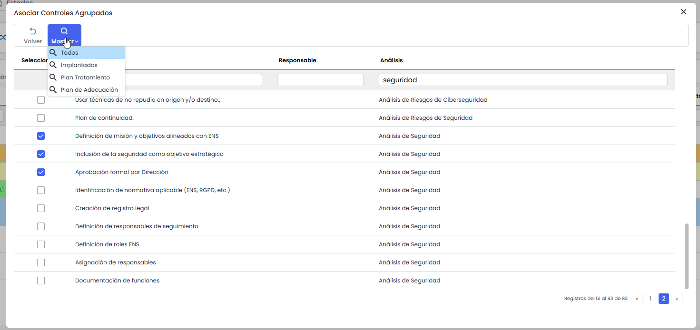

Para asociar uno o varios controles se debe seleccionar el/los checkbox de los controles deseados y pulsar el botón Volver o bien cerrar la venta.

En caso de querer eliminar una asociación, el usuario debe acceder al listado de controles, quitar la selección de el/los checkbox deseados y pulsar sobre el botón Volver o bien cerrar la venta.

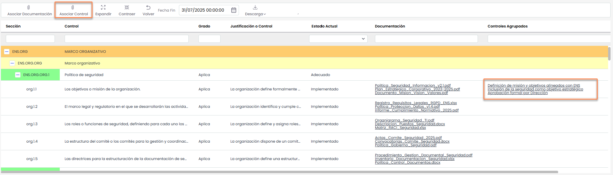

* **Expandir**: Permite desplegar el listado de las acciones.
* **Contraer**: Permite contraer el listado de acciones.
* **Volver**: Al pulsar el botón permite volver a la vista del Listado de evaluaciones Compliance.
* **Fecha Fin**: Campo para indicar fecha de revisión de las Medidas de Seguridad.
* **Descarga**

  * **Informe Docx:** Se generará un informe con toda la información de la evaluación. El informe estará disponible en [Descargas Pendientes](https://help.globalsuite.es/display/GlobalSUITEes/.Descargas+Pendientes+vv6.53).

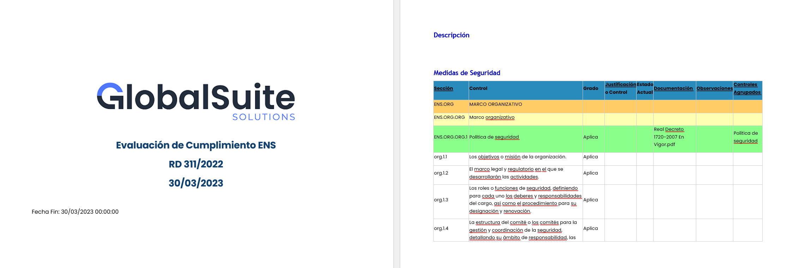

* **Filtros**:

  * Además de poder filtrar por Medidas de Seguridad, es posible realizar filtros por acciones de forma independiente en el apartado Búsqueda de acciones. 

    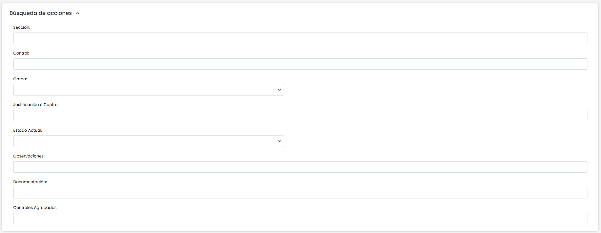
* Visibilidad de columnas:  Es posible realizar un ajuste de visibilidad de columnas pudiendo añadir u ocultar las que se deseen, haciendo click derecho en la cabecera de la tabla.

  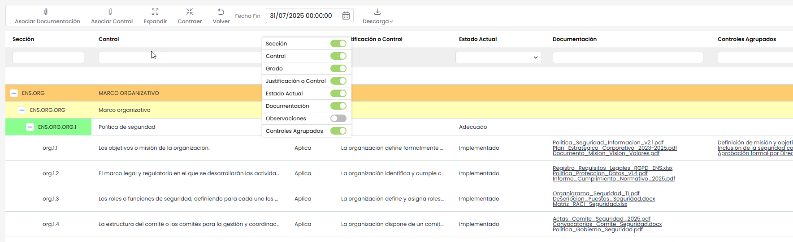
