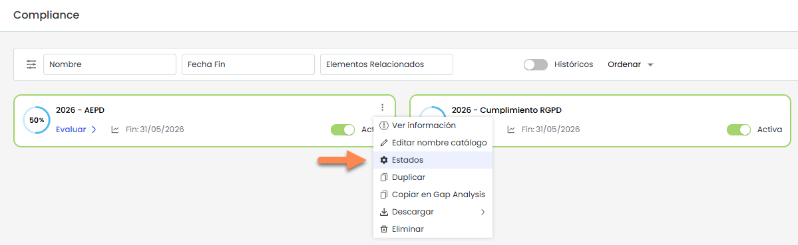
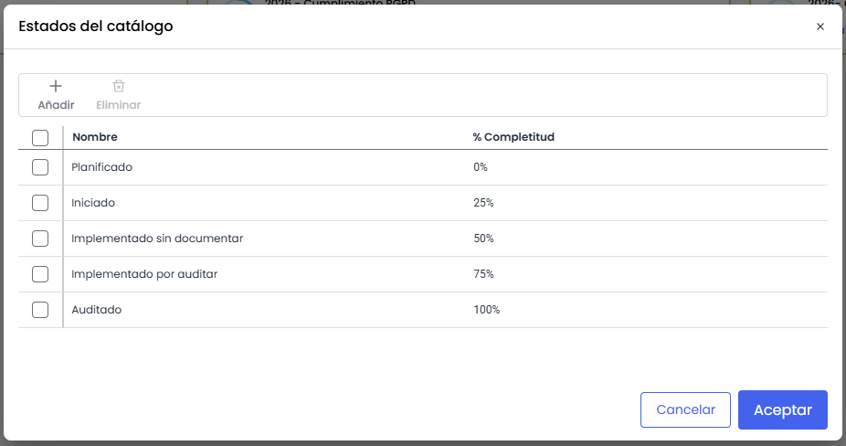
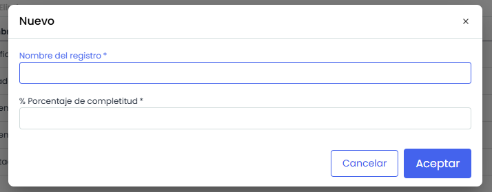

# Configuración de Estados

La opción **Estados** permite configurar los estados que se utilizarán para la evaluación de los requisitos de un catálogo de Compliance.

Por defecto, los estados corresponden a los definidos en **Ajustes >** [**Catálogos Compliance**](../../ajustes/catalogos-compliance.md). No obstante, es posible personalizarlos para la evaluación de un catálogo concreto.

Esta configuración es específica de la evaluación seleccionada. Si el mismo catálogo se utiliza en otras funcionalidades, como **GAP Analysis** o **Compliance**, se seguirán utilizando los estados definidos en **Ajustes** .

Para configurar los estados, se debe acceder al menú contextual del catálogo (icono de tres puntos) y seleccionar la opción **Estados**.

## Estados del catálogo

Se abre un modal, en donde se muestra el listado de estados disponibles junto con su **% de completitud**.

## Acciones

* **Añadir:** Permite crear un nuevo estado.  
  Al pulsarlo, se abre una ventana donde se debe indicar el **nombre del estado** y su **% de completitud**.

  
* **Eliminar:** Permite eliminar estados existentes. Para ello, es necesario seleccionarlos previamente.
* **Editar:** Permite modificar el **nombre del estado** y su **% de completitud** directamente sobre la tabla.  
  No se pueden repetir ni el **nombre del estado** ni el **porcentaje de completitud** entre los estados definidos.
