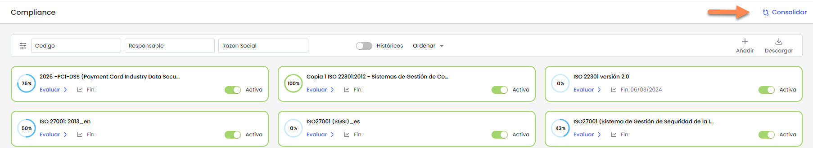
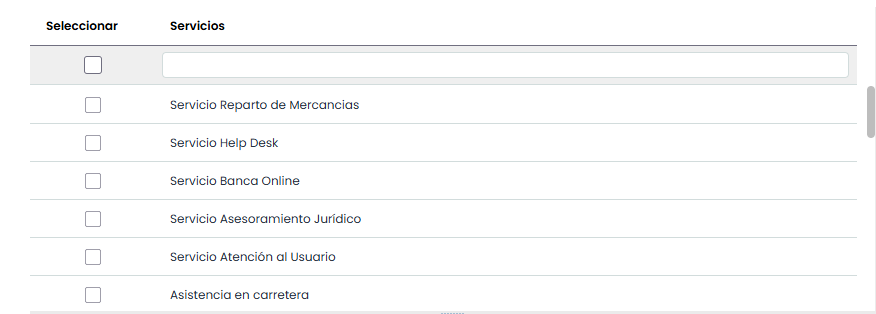
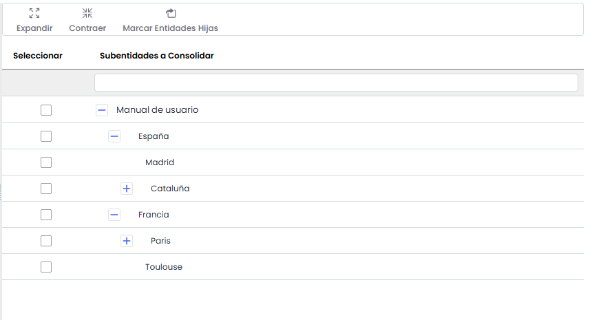
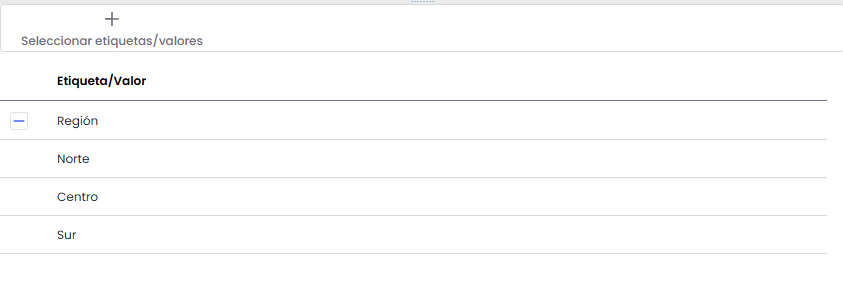
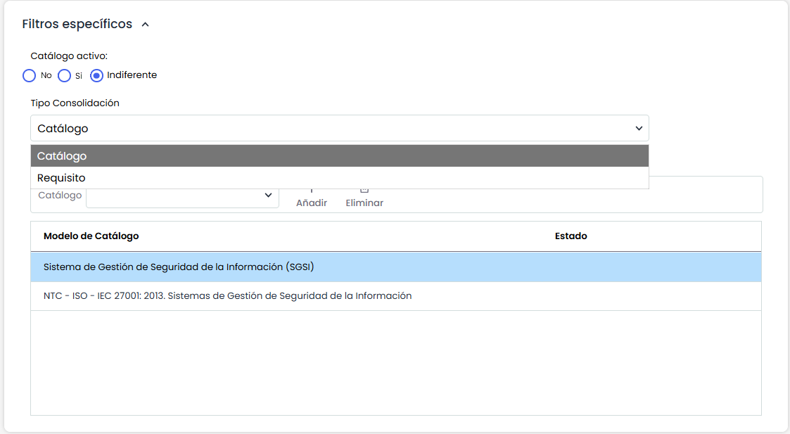
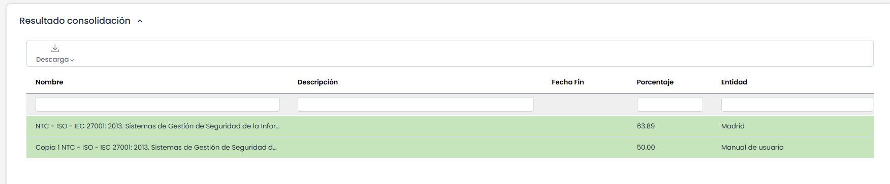

# Consolidación Compliance

La presente opción permite visualizar de manera resumida los diferentes catálogos de cumplimiento asociados a la entidad y subentidades.

A continuación se desarrolla la funcionalidad que aporta cada una de las tablas disponibles.

* **Tabla Servicios:** Permite al usuario filtrar los catálogos asociados a los Servicios seleccionados.

  
* **Tabla Subentidades:** Ofrece la posibilidad de filtrar los catálogos definidos en las subentidades seleccionadas.

  
* **Tabla Etiqueta/Valor:** Permite visualizar los catálogos que tengan asociados una etiqueta determinada.

  
* **Filtros específicos:** Ofrece la posibilidad de visualizar los catálogos de cumplimiento filtrando por el modelo del catálogo una vez seleccionado el deseado del desplegable que ofrece la opción; o filtrar por el estado del catálogo, si se encuentra activo o no.

Entre los filtros disponibles se encuentran:

* **Catálogo activo:** permite indicar si se desea consolidar únicamente catálogos **activos**, **no activos** o **indiferente**.
* **Tipo de consolidación:** define el nivel al que se realizará la consolidación.
* **Catálogo:** permite seleccionar uno o varios catálogos sobre los que se realizará la consolidación.

### Tipos de consolidación

El sistema permite realizar la consolidación de dos formas:

#### Consolidación por catálogo

Cuando se selecciona el tipo de consolidación **Catálogo**, el sistema mostrará los **catálogos existentes en las subentidades seleccionadas**, junto con el **estado en el que se encuentran en cada una de ellas**.

* Si se **selecciona un catálogo específico**, se mostrará ese catálogo indicando su estado en cada subentidad.
* Si **no se selecciona ningún catálogo**, el sistema mostrará **todos los catálogos disponibles** en las subentidades incluidas en la consolidación.

Esta vista permite **comparar rápidamente el estado de implantación de un mismo catálogo entre distintas entidades**.

#### Consolidación por requisito

Cuando se selecciona el tipo de consolidación **Requisito**, es **obligatorio seleccionar previamente un catálogo**.

En este caso, el sistema mostrará **todos los requisitos de ese catálogo** y el **estado que tiene cada uno de ellos en las distintas subentidades seleccionadas**.

Esto permite **comparar cómo se encuentra evaluado un mismo requisito en cada entidad**, facilitando el análisis de diferencias en el cumplimiento entre subentidades.

Los resultados se muestran en la tabla inferior 'Resultados de consolidación'.

La información que aporta la tabla es la siguiente:

* **Nombre:** Permite visualizar el nombre del catálogo.
* **Fecha Fin:** Permite visualizar la fecha en la que se ha finalizado el cumplimiento del catálogo.
* **Descripción:** Ofrece una descripción más detallada de la finalidad del catálogo de cumplimiento
* **Porcentaje:** Permite visualizar el grado de adecuación/completitud del catálogo de cumplimiento
* **Entidad:** Ofrece la posibilidad de visualizar la entidad o subentidad a la que está asociado el catálogo.
