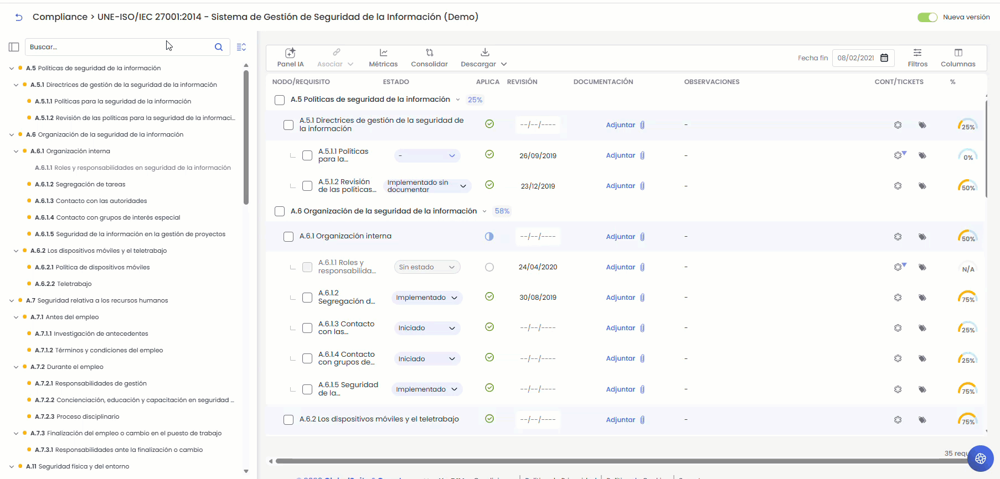
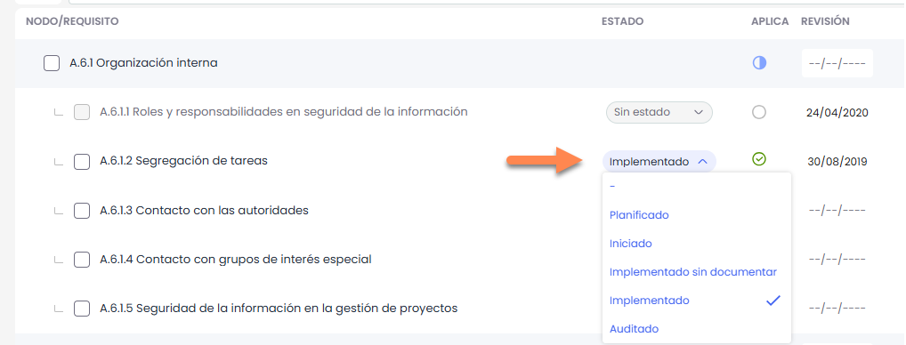
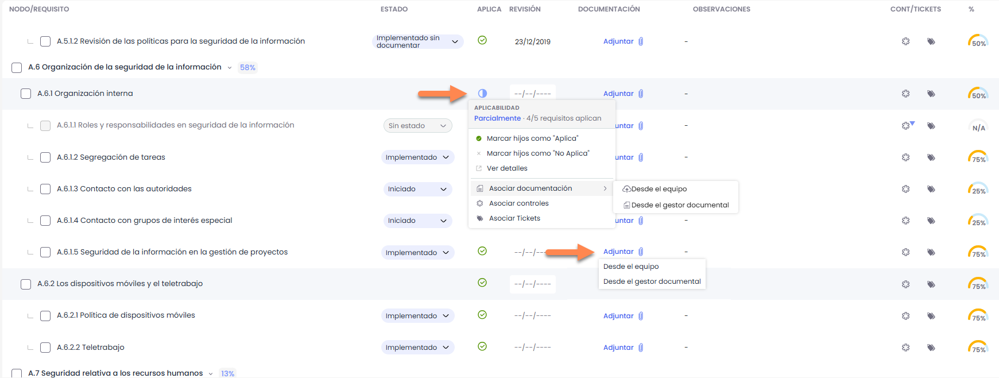
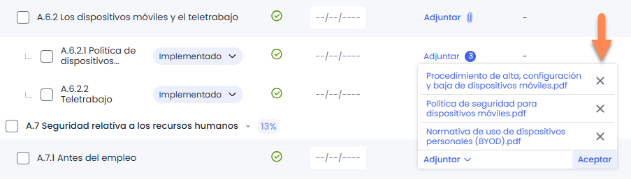
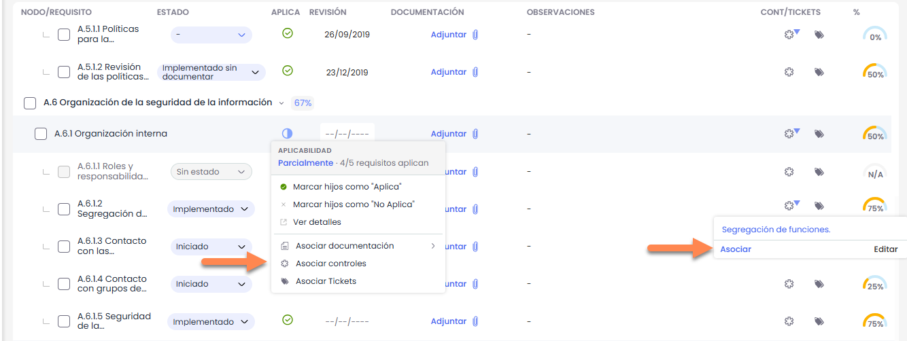
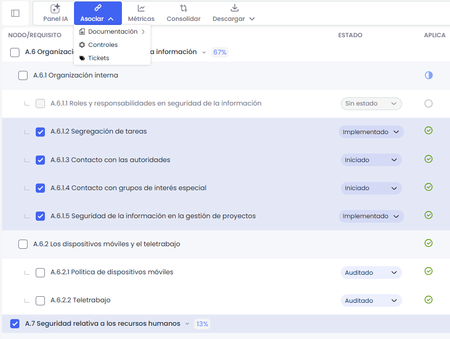

# Gestión de Requisitos

Al acceder a una evaluación, se muestra por defecto una **vista estructurada de los requisitos de compliance**, organizada en capítulos, secciones y requisitos, permitiendo gestionar la aplicabilidad y estado de cada elemento.

A la izquierda de la pantalla se dispone un **panel lateral en formato índice**, que refleja la estructura de los contenidos mostrados.

Cada elemento del índice incluye un **indicador visual de estado**, representado mediante un punto de color:

* **Verde**: el requisito o bloque está completo.
* **Amarillo**: el requisito o bloque está pendiente.
* **Sin indicador**: el requisito o bloque está marcado como no aplica.

  

Las opciones que disponemos sobre el catálogo son las siguientes:

* **Aplicabilidad:** permite identificar si un requisito o control **aplica** o **no aplica** dentro de la organización. Puede configurarse a nivel individual, sobre cada requisito o control, o a nivel de bloque, desde el encabezado del capítulo o sección. En los **bloques** (capítulos o secciones, es decir, nodos con requisitos por debajo), el selector refleja tres estados: **Aplica**, **Aplica parcialmente** y **No aplica**. Al establecer **Aplica** o **No aplica** sobre un bloque, el valor se hereda automáticamente a todos los requisitos que contiene. **Aplica parcialmente** no se asigna de forma manual: la herramienta lo muestra automáticamente cuando en la rama conviven requisitos que aplican y otros que no, e indica cuántos aplican sobre el total (X/Y), con un icono de medio relleno. En los **requisitos finales**, la aplicabilidad es directa: **aplica** o **no aplica**. Al marcar un bloque o un requisito como **No aplica** se solicita confirmación; la documentación, los controles, los tickets y las observaciones asociados se conservan.
* **Estado:** Permite indicar el estado de implantación del requisito o el control dentro de la organización. Se desplegarán las opciones disponibles para definir el estado, en función de los estados configurados para el catálogo compliance. La herramienta ofrece una serie de estados por defecto para los catálogos, pero estos estados son configurables tanto en la opción Ajustes> [**Catálogos Compliance**](../../../ajustes/catalogos-compliance.md) como en el propio catálogo *Ver mas información en* [**Configuración de estados**](../configuracion-de-estados.md)

* **Asociar documentación:** Permite asociar uno o varios documentos del gestor documental o desde el ordenador a los requisitos del catálogo compliance.   
  Esta asignación se puede hacer en secciones intermedias como en requisitos finales

  
  * **Desde el equipo:** Se pueden añadir hasta 10 documentos a la vez.
  * **Desde el Gestor documental:** Se abrirá una ventana con el árbol de documentos que están almacenados en el **Gestor Documental**.   
    En caso de querer eliminar un documento de un requisito final al presionar “Editar”, se muestra a la derecha de cada fichero la opción para eliminarlo.

    


Esta misma asociación de documentos se puede realizar desde el detalle de cada requisito. \*Ver mas información en\* [\*\*Detalle de un requisito\*\*](https://globalsuitesolutions.atlassian.net/wiki/spaces/GlobalSUITEes/pages/1656586273/Detalle+de+un+requisito)


* **Asociar controles:**Permite asociar uno o varios controles, registrados en la opción "Gestión de Controles", a los requisitos del catálogo compliance.   
  Esta asignación se puede hacer en secciones intermedias como en requisitos finales

  

  Para ello se debe pulsar sobre la opción “Asociar controles” y se abrirá una ventana que muestra el listado de controles definidos en el apartado **Análisis>** [**Gestión de Controles**](../../gestion-de-controles/README.md).   
  Para asociar uno o varios controles se debe seleccionar el/los checkbox de los controles deseados y pulsar el botón ‘Aceptar’.

  
* **Asociar Tickets:** Permite asociar una o varios Tickets a los requisitos del catálogo compliance.

### Acciones

* **Panel IA**: Esta reúne las herramientas de inteligencia artificial de GlobalSuite® orientadas a facilitar el análisis y la gestión de normativas.

  * **Asistente GSS-IA:** Permite analizar el catálogo de Compliance mediante inteligencia artificial para facilitar su evaluación.
  * **¿Qué requisitos me aplican?:** Permite obtener los requisitos que aplican a la organización en función del contexto de su negocio.  
     *Mas Información en*[**Asistente IA**](asistente-ia-compliance.md)
* **Asociar**: permite asociar documentación, controles y tickets de forma masiva, seleccionando varios requisitos simultáneamente.
* 

  **Métricas:** Permite visualizar diferentes gráficas que muestran el estado de implantación de los controles. *Mas Información en* [**Graficas y Comparativas**](../graficas-y-comparativas.md)
* **Consolidar**: permite consolidar encuestas de compliance aplicando criterios globales para todos los requisitos o controles, o definiendo criterios específicos de forma individual para cada uno de ellos. *Mas Información en* [**Resultados de Encuetas**](resultado-de-encuestas-compliance.md)
* **Descarga:** Permite descargar el catálogo compliance, disponible en dos formatos

  * Informe Docx.
  * Informe CSV.
