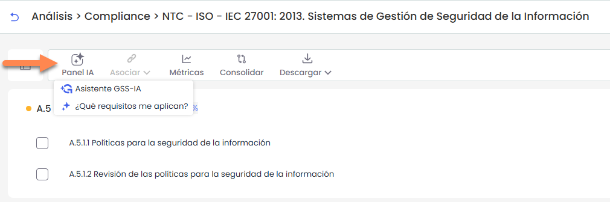
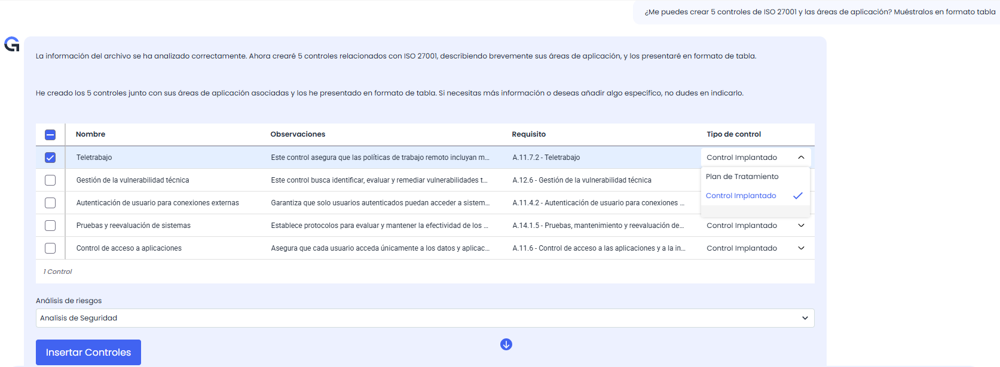

# Asistente IA (Compliance)

La opción **Panel IA** reúne las herramientas de inteligencia artificial de GlobalSuite® orientadas a facilitar el análisis y la gestión de normativas.

Su objetivo es apoyar al usuario en la evaluación del cumplimiento, la identificación de brechas y la definición de acciones de mejora.

El panel dispone de las siguientes funcionalidades:

## Asistente GSS-IA

Permite analizar el catálogo de Compliance mediante inteligencia artificial para facilitar su evaluación.

El asistente permite:

* **Analizar y resumir requisitos** de una normativa, destacando aquellos con mayor relevancia o menor nivel de cumplimiento.
* **Evaluar el nivel de cumplimiento**, tanto de forma global como por categorías.
* **Determinar la aplicabilidad** de los requisitos, diferenciando entre obligatorios y opcionales.
* **Identificar brechas**, comparando el grado de implantación con la aplicabilidad de los requisitos.
* **Detectar acciones pendientes**, incluyendo planes de acción y requerimientos de auditoría.
* **Comparar normativas**, identificando sinergias y controles equivalentes.
* **Proponer controles y evidencias** para mejorar el nivel de cumplimiento.
* **Analizar la evolución del cumplimiento**, utilizando información histórica.

### Automatización de propuestas y controles

El asistente permite incorporar automáticamente las propuestas generadas dentro de GlobalSuite®.

* Las **acciones propuestas** se muestran en formato tabla y pueden seleccionarse para incluirlas en el análisis de riesgos, como plan de tratamiento o como control implantado.
* Los **controles generados** pueden asociarse directamente a los requisitos de la normativa.

## ¿Qué requisitos me aplican?
