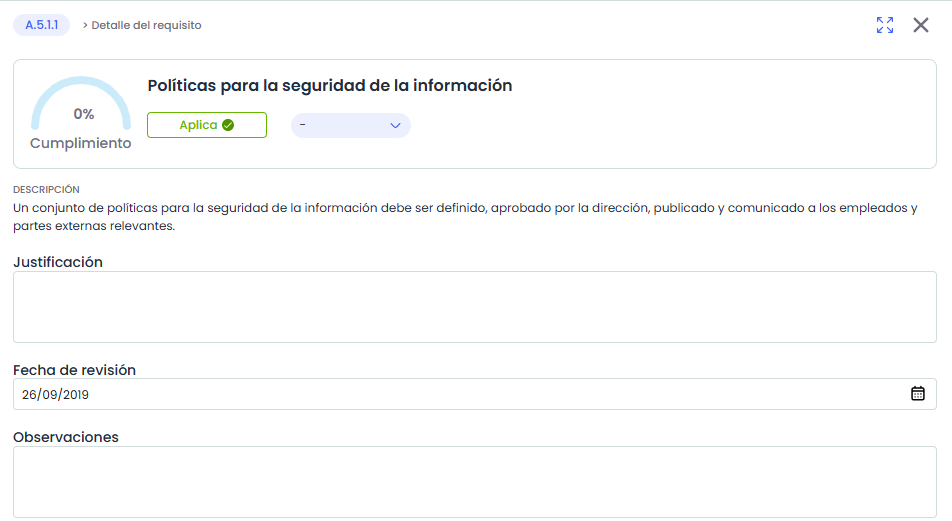
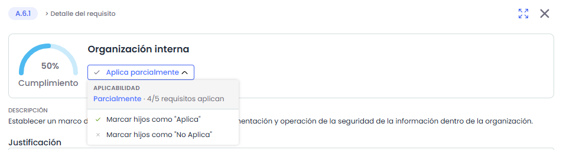
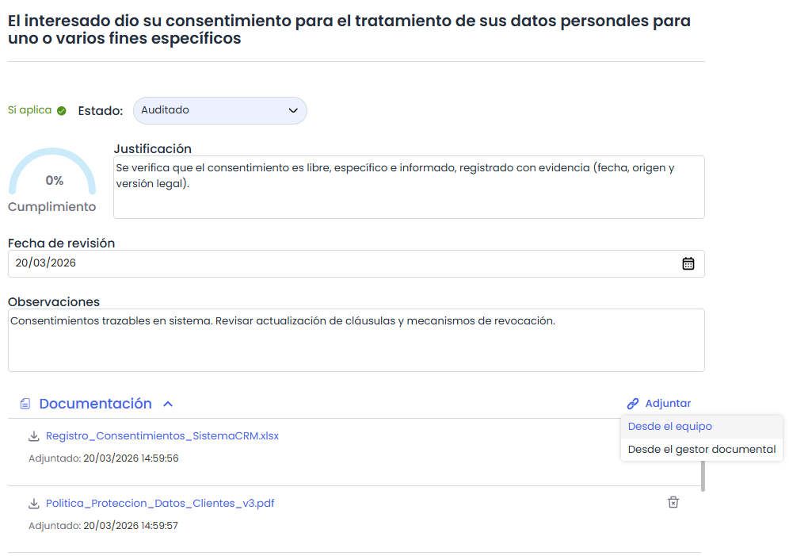
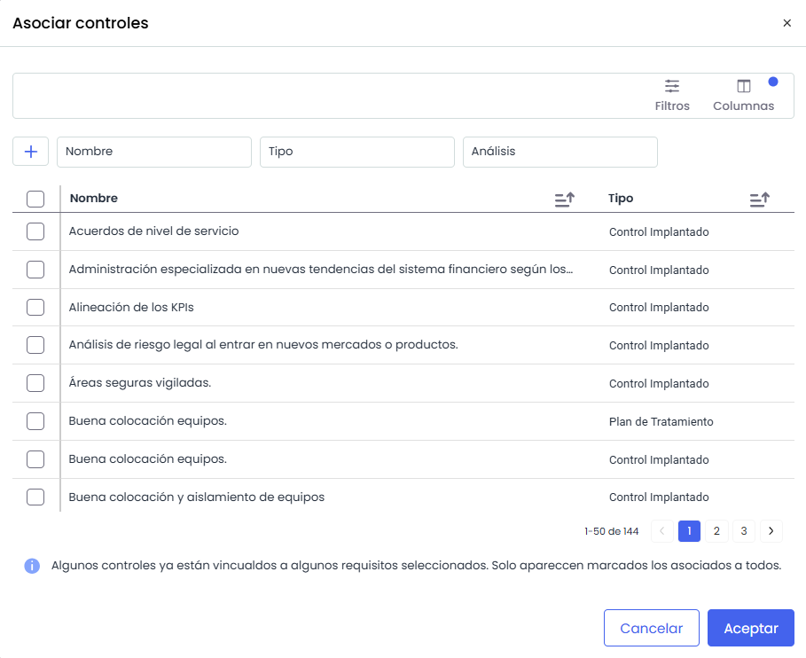

# Detalle de un requisito

La pantalla de **Detalle del requisito** permite consultar y gestionar la información de un requisito dentro del catálogo de Compliance.

Este detalle aplica tanto a requisitos finales como a niveles intermedios (capítulos, secciones u otros), aunque algunas funcionalidades varían según el tipo.

## Detalle del requisito

El panel de detalle se abre al seleccionar un requisito (o un nodo) en el catálogo y se organiza de la siguiente forma:

* **Cabecera:** muestra el código o la sección del requisito como etiqueta (por ejemplo, "A.5.1.1") junto al título *Detalle del requisito*. A la derecha se sitúan los controles para ampliar y cerrar el panel.
* **Datos principales:** un único recuadro reúne el nombre del requisito junto con su **% de cumplimiento**, su **aplicabilidad** y su **estado**.

  * **Nivel de cumplimiento y estado:** el **estado** indica el grado de implantación del requisito y determina automáticamente su **% de cumplimiento**. Ambos se gestionan únicamente en los requisitos finales. Los nodos intermedios (capítulos o secciones) agrupan requisitos: su porcentaje se calcula de forma agregada a partir de ellos, sin evaluación directa. Los requisitos que no aplican muestran **N/A** en lugar de porcentaje.
* **Descripción:** muestra, en modo solo lectura, el texto descriptivo del requisito definido en el catálogo (con la opción *Ver todo* cuando es extenso).   
  Está disponible tanto para requisitos como para nodos.

* **Justificación:** Permite indicar una justificación de aplicabilidad o no aplicabilidad del control.
* **Fecha de revisión:** Permite establecer una fecha para el requisito o control. Esta fecha se puede utilizar, por ejemplo, para identificar la fecha de la evaluación del requisito o la fecha de implantación del mismo (según se desee).
* **Observaciones:** Permite incluir las observaciones y datos relevantes para justificar el estado del control.

## Acciones

* **Aplicabilidad:** permite identificar si un requisito o control **aplica** o **no aplica** dentro de la organización. Puede configurarse a nivel individual, sobre cada requisito o control, o a nivel de bloque, desde el encabezado del capítulo o sección. En los **bloques** (capítulos o secciones, es decir, nodos con requisitos por debajo), el selector refleja tres estados: **Aplica**, **Aplica parcialmente** y **No aplica**. Al establecer **Aplica** o **No aplica** sobre un bloque, el valor se hereda automáticamente a todos los requisitos que contiene. **Aplica parcialmente** no se asigna de forma manual: la herramienta lo muestra automáticamente cuando en la rama conviven requisitos que aplican y otros que no, e indica cuántos aplican sobre el total (X/Y), con un icono de medio relleno.

  

  En los **requisitos finales**, la aplicabilidad es directa: **aplica** o **no aplica**. Al marcar un bloque o un requisito como **No aplica** se solicita confirmación; la documentación, los controles, los tickets y las observaciones asociados se conservan.
* **Estado:** Permite indicar el estado de implantación del requisito o el control dentro de la organización. Se desplegarán las opciones para definir el estado según los configurados en el catálogo compliance. La herramienta ofrece una serie de estados por defecto para los catálogos, pero estos estados son configurables tanto en la opción Ajustes> [**Catálogos Compliance**](../../../ajustes/catalogos-compliance.md) como en el propio catálogo *Ver mas información en* [**Configuración de estados**](../configuracion-de-estados.md). Disponible únicamente en requisitos finales.
* **Documentación:** Permite asociar documentos al requisito.   
  Desde este apartado es posible:

  * **Añadir documentos:** Se pueden añadir documentos desde el equipo (hasta 10 documentos a la vez) o desde el gestor documental.
  * **Eliminar** documentos mediante el icono de papelera.

    
* **Controles:** Permite asociar uno o varios controles, registrados en la opción "Gestión de Controles", a los requisitos del catálogo compliance.   
    
  Para ello se debe pulsar sobre el botón 'Asociar' en donde se muestra el listado de controles definidos en el apartado **Análisis>** [**Gestión de Controles**](../../gestion-de-controles/README.md).

  

* **Tickets:** Permite asociar uno o varios tickets a los requisitos del catálogo compliance.
