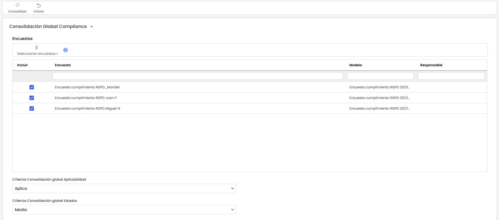
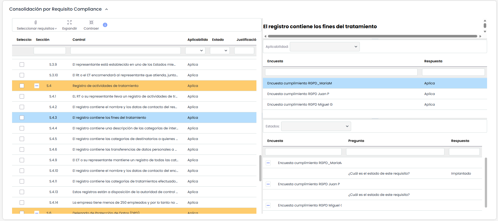

# Resultado de Encuestas (Compliance)

La ventana de Consolidación de Encuestas de Compliance se compone principalmente de dos paneles, uno que permite realizar una consolidación con criterios globales para todos los requisitos o controles del catálogo de cumplimiento, y otra que permite realizar la consolidación particularizando el criterio de consolidación por cada uno de los requisitos o controles del catálogo.

## Consolidación Global Compliance

En el apartado de "Consolidación Global Compliance" se permite realizar una consolidación con el mismo criterio para todos los requisitos o controles. En este tipo de consolidación se encuentran las siguientes opciones:

* **Encuestas:** Permite seleccionar las encuestas que se van a consolidar.
* **Criterios Consolidación global Aplicabilidad:** Permite definir el criterio de consolidación tomando en consideración el campo Aplicabilidad de los controles o requisitos de las encuestas de compliance. Se podrá tomar en consideración solo los controles que Aplican, solo los que No aplican o ambos con la opción de "No Consolida".
* **Criterios Consolidación global Estados:** Permite seleccionar el cálculo del estado final de la consolidación tomando el valor mínimo de todas las encuestas, tomando el valor máximo de todas las encuestas o bien realizando el cálculo de la media de estados entre todas las encuestas.

## Consolidación por Requisito de Compliance

En el apartado de "Consolidación por Requisito de Compliance”, se permite realizar la consolidación particularizando por requisito o control, en vez de realizar una consolidación global igual para todos los requisitos. En este tipo de consolidación se encuentran las siguientes opciones:

* **Controles:** Se muestra una tabla en la parte izquierda de este panel con el listado de los controles del catálogo así como Aplicabilidad, Estado y Justificación. Pulsando en cualquiera de las filas de la tabla, se podrá personalizar el tipo de consolidación a realizar sobre el control o requisito seleccionado, mostrándose en la parte derecha de este panel la siguiente información y opciones:

  * **Resumen:** Muestra la información completa sobre el control seleccionado.
  * **Aplicabilidad:** Permite definir el criterio de consolidación del campo "Aplicabilidad" de las encuestas para el control seleccionado. Los criterios son los mismos que en la consolidación global, pero en este caso solo aplicarán al control seleccionado.
  * **Estados:** permite definir el criterio de consolidación del campo "Estado" de las encuestas para el control seleccionado. Los criterios son los mismo que en la consolidación global, pero en este caso solo aplicarán al control seleccionado.

Una vez establecidos los criterios Globales y/o los criterios personalizados por Control, deberá pulsar sobre el botón "Consolidar" para que comience la consolidación.
