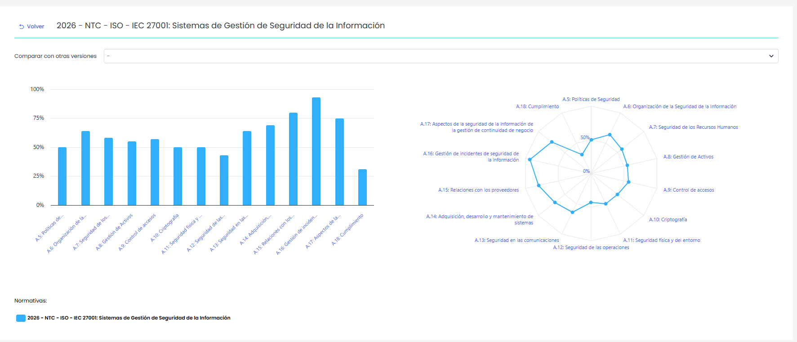
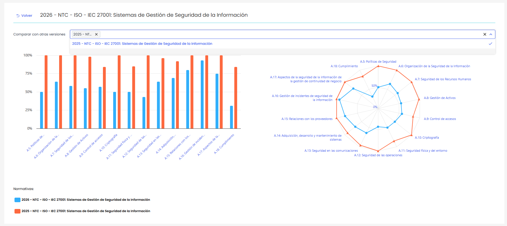

# Gráficas y comparativas

Esta opción permite visualizar gráficas del estado de cumplimiento de un catálogo, así como realizar comparativas entre distintas versiones del mismo.

Al acceder a un catálogo, la pantalla muestra:

* Un gráfico de barras con el porcentaje de avance por cada apartado del catálogo.
* Un gráfico radial que representa visualmente el nivel de cumplimiento global por dominio.

Al situar el cursor sobre las barras o los puntos de las gráficas, se muestra el porcentaje de cumplimiento correspondiente a cada apartado o dominio. En caso de comparativa, se visualizarán los valores de cada una de las versiones seleccionadas.

**Comparar versiones**

Adicionalmente, es posible comparar el estado del catálogo con otras versiones mediante el selector **“Comparar con otras versiones”**, situado en la parte superior.

Al seleccionar una o varias versiones:

* Se actualizan las gráficas mostrando los valores comparativos entre los distintos catálogos.
* Cada versión se representa con un color diferente para facilitar la comparación.

Si no se selecciona ninguna versión adicional, se visualizarán únicamente las gráficas correspondientes al catálogo actual.
