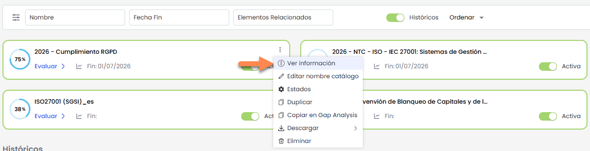
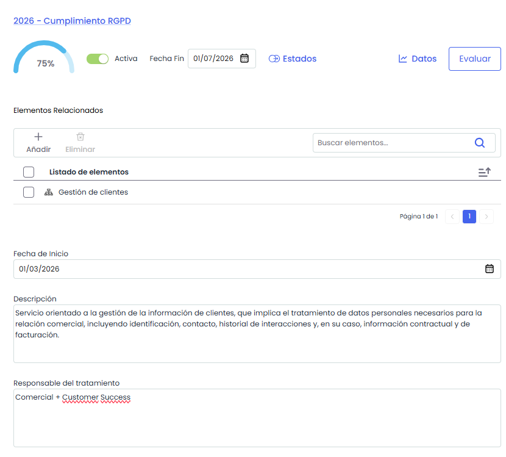

# Información de un compliance

Desde el panel principal, al acceder al menú contextual de cada evaluación, la opción **“Ver información”** permite consultar el detalle del catálogo de Compliance.

En esta vista se muestran los datos generales del Compliance, incluyendo los campos configurados en **Ajustes > Configuración > Compliance**.

#### **Elementos relacionados**

Dentro del detalle del Compliance existe un apartado denominado **Elementos relacionados**, que permite asociar los elementos sobre los que se realizará la evaluación.

* **Añadir**: Al presionar Añadir que abre una ventana donde se pueden seleccionar los elementos a asociar.
* **Eliminar:** Seleccionar uno varios Elementos seleccionados tanto desde la tabla y presionar Eliminar.

## **Acciones**

* **Establecer Fecha de Fin**
* **Activar / Histórico:** El estado del catálogo se gestiona mediante un **switch**:

  * Al desactivarlo, el catálogo pasa a estado **Histórico**, quedando no editable.
  * Para volver a activarlo, basta con volver a activar el switch, recuperando su estado editable.
* **Estados:** Permite configurar los estados del catálogo. Más información en[**Configurar Estados**](configuracion-de-estados.md)
* **Datos:** Esta opción permite obtener gráficas comparativas del estado de diferentes compliance de un mismo catálogo. Mas información en [**Graficas y comparativas**](graficas-y-comparativas.md)
* **Evaluar:** Permite acceder a la evaluación del Compliance. Más información en [**Gestión de Requisitos**](gestion-de-requisitos/README.md)
