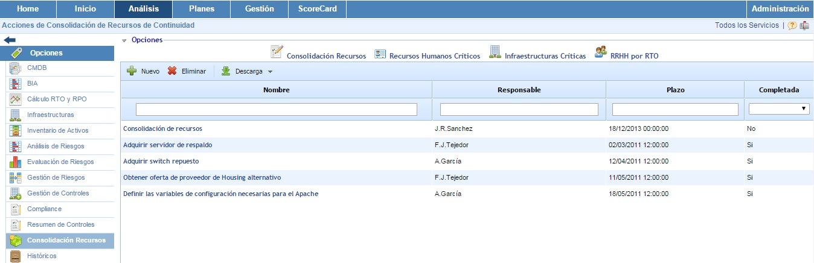

# Consolidación de Recursos

La opción de consolidación de recursos contiene diferentes opciones que permiten identificar los recursos o acciones necesarias para la recuperación de los procesos cumpliendo los valores de MTPD y RTO obtenidos en la realización del BIA.

* [Recursos Humanos Críticos](recursos-humanos-criticos.md)
* [Infraestructuras Críticas](infraestructuras-criticas.md)
* [RRHH por RTO](rrhh-por-rto.md)
* [Consolidación Recursos](consolidacion-recursos.md)
