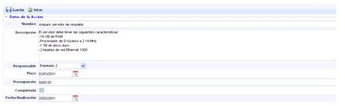
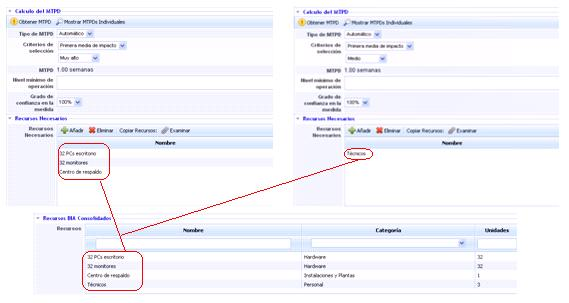
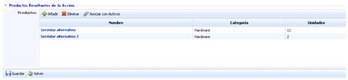
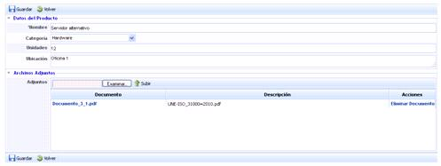

# Consolidación Recursos

Al acceder a la opción de consolidación, la herramienta muestra una tabla con el listado de acciones o recursos definidos por parte del usuario. La plataforma permite realizar las siguientes acciones sobre la tabla:

* **Nuevo:** Permite insertar una nueva entrada en la tabla.

* **Eliminar:** Permite eliminar un recurso de la tabla. Para ello se ha de seleccionar la fila o filas deseadas y pulsar sobre el botón ‘Eliminar’.

* **Descarga:** Ofrece la posibilidad de descargar el listado de recursos en un formato editable (.docx) o en formato .PDF.

Una vez hemos seleccionado el recurso o acción deseada, la herramienta muestra un formulario que permite definir los parámetros necesarios del mismo.

**Datos de la acción**

Los puntos que se pueden definir son los siguientes:

* **Nombre:** Identifica el nombre de los recursos a acciones. Este nombre aparecerá en el listado inicial de consolidación de recursos.

* **Descripción:** Permite identificar las características que deben cumplir los recursos a adquirir o información adicional sobre las acciones necesarias a llevar a cabo para recuperar los servicios dentro del MTPD.

* **Responsable:** Posibilita identificar el responsable de la gestión de los recursos o acciones.

**NOTA:** El listado de empleados se define en el apartado ‘Gestión/Empleados’.

* **Plazo:** Fija el plazo por el cual los recursos o acciones definidas deben estar implantadas en la organización.

* **Presupuesto:** Permite identificar el presupuesto para adquirir los recursos o implantar las acciones necesarias en la organización.

* **Completada:** Ofrece la posibilidad de indicar si la acción ha sido o no completada.

* **Fecha finalización:** Fija la fecha final de implantación de la acción o la adquisición de los recursos definidos en la organización.

**Recursos BIA consolidados**

Este opción muestra todos los recursos, identificados en el apartado de Recursos Necesarios de los BIAs Consolidados, necesarios para recuperar los servicios dentro del tiempo máximo tolerable de interrupción o MTPD.

**Productos Resultantes de la Acción**

Esta opción permite definir los recursos o acciones finalmente realizadas para la correcta recuperación de los servicios dentro del MTPD.

La herramienta permite realizar las siguientes acciones:

* **Añadir:** Permite añadir una nueva entrada en la tabla pulsando sobre el botón.

* **Eliminar:** Permite eliminar recursos o acciones definidas en la tabla. Para ello se ha de seleccionar la fila o filas deseadas y pulsar el botón ‘Eliminar’.

* **Asociar con Activos:** Permite asociar los diferentes recursos adquiridos a los activos identificados en el apartado ‘Análisis/Inventario de Activos’.

Al pulsar sobre el enlace, la herramienta permite realizar una definición más detallada del recurso adquirido o de la acción realizada, ofreciendo la posibilidad de completar los siguientes campos:

* **Nombre:** Identifica el nombre del recurso o acción realizada. Este nombre se mostrará en el listado de productos resultantes.

* **Categoría:** En el caso de los recursos, permite identificar la categoría a la que pertenece la adquisición.

* **Unidades:** Posibilita indicar el numero de recursos adquiridos.

* **Ubicación**: Permite identificar donde se encuentran alojados los recursos en la organización.

* **Adjuntos:** Ofrece la posibilidad de adjuntar cualquier archivo con información adicional sobre el recurso o acción realizada.
