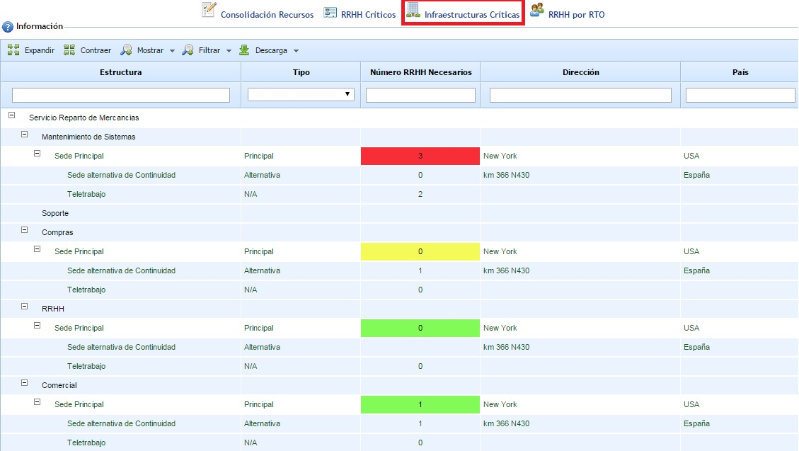
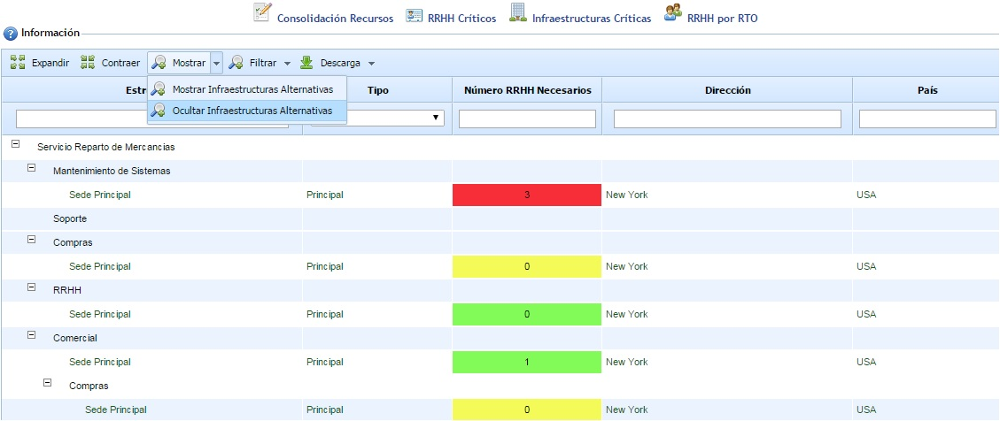
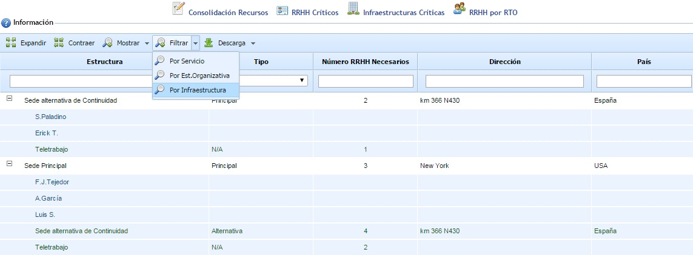

# Infraestructuras Críticas

Esta opción permite mostrar las infraestructuras de la organización asociadas a cada uno de los procesos de negocio, identificando el número de personas necesario que se debe trasladar a una ubicación alternativa o realizar labores de teletrabajo en caso de contingencia de la infraestructura dónde realizan su trabajo habitualmente.

Al ingresar en la opción se muestra el árbol de servicios y procesos de la organización. Asociado a cada proceso aparecen las infraestructuras (sedes o centros de trabajo) que están relacionadas con cada proceso, tanto las principales como las alternativas, además de la opción de Teletrabajo.

Pulsando el botón "Mostrar - Ocultar Infraestructuras Alternativas" se muestran únicamente las infraestructuras principales asociadas a cada proceso.

Las infraestructuras principales tienen asociado un número que representa el número de personas críticas que se deben trasladar a una ubicación alternativa o realizar labores de teletrabajo en caso de una contingencia de la infraestructura. Asociado a cada infraestructura principal se muestran las infraestructuras alternativas y la opción de Teletrabajo, permitiéndose definir para cada infraestructura alternativa el número de personas que se desplazarán a ella. Para el caso de Teletrabajo, el número que aparece es automático calculándose en función de las personas asociadas a la infraestructura principal que tienen definido como opción de trabajo en continuidad el teletrabajo.

Las celdas numéricas de las infraestructuras principales pueden tener 3 colores diferentes. Cada color tiene el siguiente significado:

* Rojo: Las celdas en color rojo indican que la suma de personas indicadas para teletrabajo e infraestructuras alternativas es menor que el número de personas de la infraestructura principal.
* Verde: Las celdas en color verde indican que la suma de personas indicadas para teletrabajo e infraestructuras alternativas es igual que el número de personas de la infraestructura principal.
* Amarillo: Las celdas en color amarillo indican que la suma de personas indicadas para teletrabajo e infraestructuras alternativas es mayor que el número de personas de la infraestructura principal.

La opción "Filtrar" permite obtener diferentes vistas de la misma información. Aparte de la vista por defecto con el árbol de servicios y procesos, se permite visualizar la información teniendo en cuenta la Estructura Organizativa definida en el menú de Inicio o directamente el listado de infraestructuras de la organización con los empleados que se encuentran asociados a cada una. En la siguiente imagen se puede observar el resultado si seleccionarmos la opción "Filtrar - Por Infraestructura":

Por último, indicar que esta opción dispone de los botones 'Expandir' y 'Contraer' para manejar la estructura completa (por defecto, se muestra expandido), además de permitir la descarga del resultado en un documento en formato editable (.xlsx) y formato .pdf.
