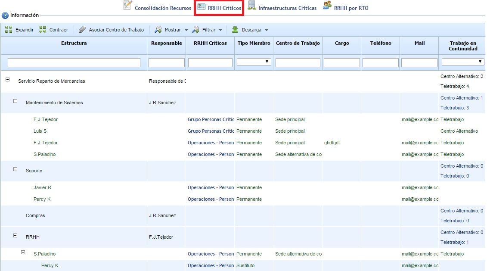
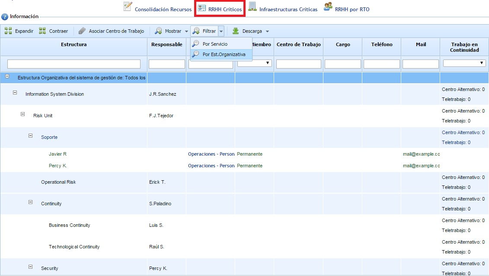

# Recursos Humanos Críticos

Esta opción permite mostrar los recursos humanos críticos identificados en los diferentes grupos RRHH Críticos creados en la opción "RRHH Críticos" del menú de Análisis.

Al ingresar en la opción se muestra el árbol de servicios y procesos de la organización. Asociado a cada proceso aparecen las personas que están relacionadas en función de los grupos de recursos humanos críticos generados. Por defecto se muestran las personas principales, pero se permite mostrar los sustitutos a través de la opción "Mostrar Sustitutos". Se permite consultar el detalle del grupo de recursos humanos críticos al que pertenece un empleado pulsando sobre el enlace existente en la propia tabla.

La opción "Filtrar - Por Est.Organizativa" permite mostrar los RRHH Críticos asociados a los procesos, ubicando además cada proceso dentro de la Estructura Organizativa (Departamento, Área, Gerencia, etc.) de la organización que ha sido definida en la opción "Estructura Organizativa" del menú "Inicio".

A través del botón "Asociar Centro de Trabajo" se permite asignar un centro de trabajo a cada uno de los empleados que aparecen como críticos. Para ello, hay que seleccionar un empleado y pulsar sobre el botón indicado; tras realizar esto, aparece una ventana que permite asignar una infraestructura al empleado. Esta información es utilizada por la herramienta para determinar cuantas personas se necesitan trasladar a una infraestructura alternativa en caso de una una infraestructura principal (o Centro de Trabajo) tenga una contingencia.

Nota: Los Centros de Trabajo que aparecen en la ventana se generan en la opción "Infraestructuras" ubicada en el menú "Análisis".

Por último, indicar que esta opción dispone de los botones 'Expandir' y 'Contraer' para manejar la estructura completa (por defecto, se muestra expandido), además de permitir la descarga del resultado en un documento en formato editable (.xlsx) y formato .pdf.
