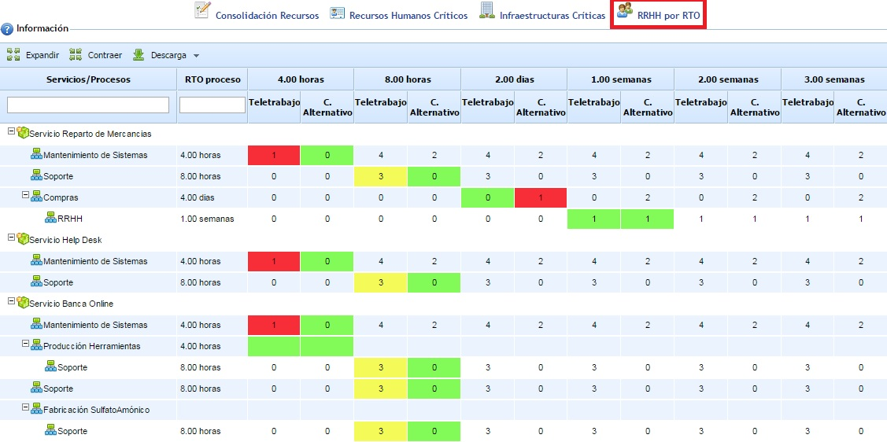

# RRHH por RTO

Esta opción permite indicar el número de personas necesario para cada uno de los procesos en caso de producirse una contingencia.

Al ingresar en la opción se muestra el árbol de servicios y procesos de la entidad, junto al valor de RTO identificado en el BIA y las escalas temporales utilizadas. Para cada una de las escalas temporales se puede definir el número de personas necesario que deben realizar teletrabajo y el número de personas necesario que se deben ubicar en el centro alternativo.

Para cada proceso se marca una escala temporal en color. Ésta corresponde con la escala temporal igual o menor que el RTO del BIA del proceso. En caso de no existir una escala temporal menor al RTO del proceso, no se marca ninguna escala temporal en color. Cada color tiene el siguiente significado:

* Rojo: Las celdas en color rojo indican que el número de personas registrado es menor respecto al número de personas mínimo identificado en la opción "Recursos Humanos Críticos".
* Verde: Las celdas en color verde indican que el número de personas registrado es igual respecto al número de personas mínimo identificado en la opción "Recursos Humanos Críticos".
* Amarillo: Las celdas en color amarillo indican que el número de personas registrado es mayor respecto al número de personas mínimo identificado en la opción "Recursos Humanos Críticos".

Por último, indicar que esta opción dispone de los botones 'Expandir' y 'Contraer' para manejar la estructura completa (por defecto, se muestra expandido), además de permitir la descarga del resultado en un documento en formato editable (.xlsx) y formato .pdf.
