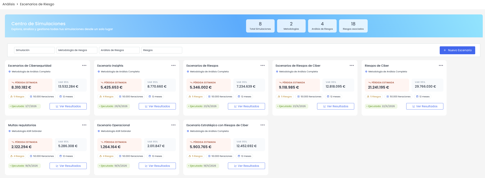
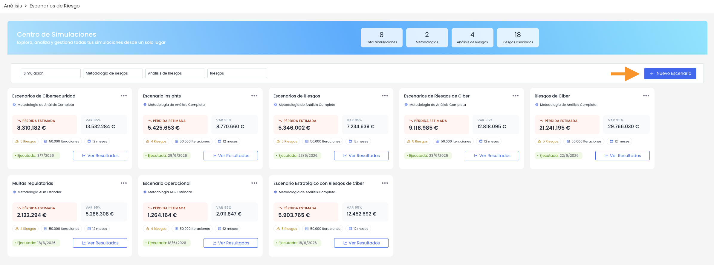
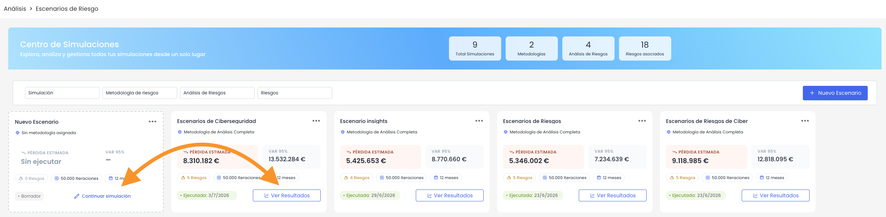
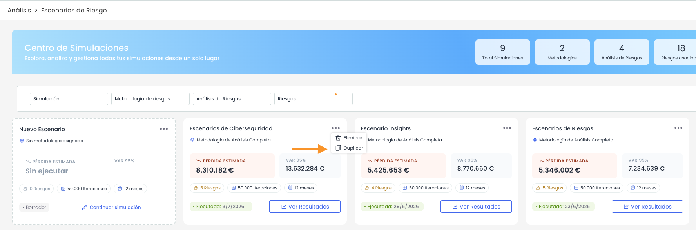
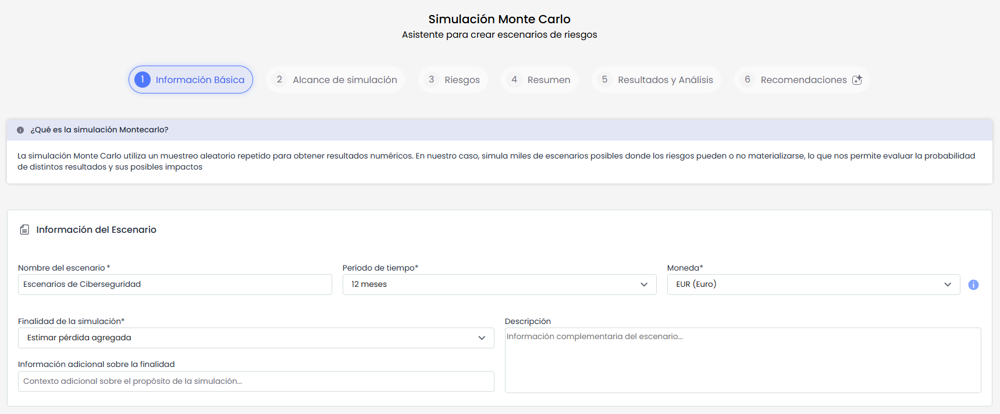
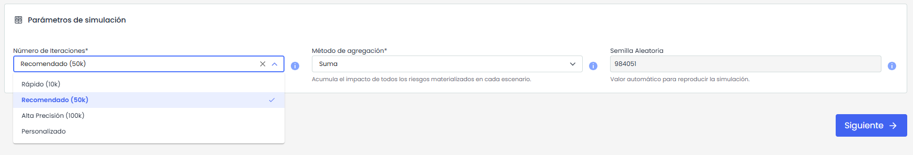
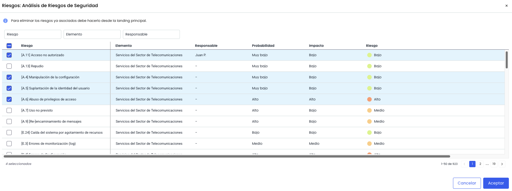

# Escenarios de riesgos

## Escenarios de Riesgo


Esta funcionalidad permite crear y analizar escenarios cuantitativos de riesgo mediante simulaciones Monte Carlo, a partir de los riesgos ya identificados en un análisis de riesgos de GlobalSuite®.
Al acceder al módulo se muestra el \*\*Centro de Simulaciones\*\*, que centraliza los escenarios creados y permite consultar su estado, principales métricas y resultados. La funcionalidad permite trabajar con simulaciones basadas en Monte Carlo para estimar la exposición económica asociada a los riesgos seleccionados.


Para acceder a la funcionalidad, entra en:

**Análisis > Escenarios de Riesgo**

### Centro de Simulaciones

El **Centro de Simulaciones** muestra una visión general de los escenarios de riesgo registrados y permite acceder a sus principales acciones.

En la parte superior se incluye un panel resumen con los siguientes indicadores:

* **Total Simulaciones**: número total de escenarios registrados.
* **Metodologías**: número de metodologías utilizadas en los escenarios.
* **Análisis de Riesgos**: número de análisis de riesgos asociados.
* **Riesgos asociados**: número total de riesgos incluidos en los escenarios.

Los escenarios se presentan en formato tarjeta. Cada tarjeta muestra la información principal del escenario, como el nombre, metodología asociada, número de riesgos incluidos, método de agregación, número de iteraciones, periodo temporal, precisión, pérdida esperada, VaR 95 % y fecha de ejecución, si el escenario ya ha sido ejecutado.

### Acciones principales

La pantalla dispone de acciones principales para trabajar con los escenarios de riesgo.

* **Crear escenario**: abre el asistente de creación de escenarios. Desde este asistente se define la información básica, parámetros de simulación, alcance, riesgos incluidos y resumen previo a la ejecución.

* **Abrir / Consultar escenario**: permite acceder al detalle de un escenario existente.  
  Si el escenario todavía no ha sido ejecutado, se podrá continuar con la edición de su configuración y avanzar en el asistente hasta ejecutar la simulación.  
  Si el escenario ya ha sido ejecutado, el acceso será de consulta, permitiendo revisar la configuración, resultados y recomendaciones generadas, pero sin modificar los datos utilizados para el cálculo.

  

* **Duplicar escenario:** permite copiar un escenario de riesgo existente para crear uno nuevo a partir de su configuración. Esta acción facilita reutilizar escenarios ya configurados, evitando tener que volver a introducir manualmente la misma información de base. El escenario duplicado podrá revisarse y ajustarse antes de ejecutar una nueva simulación.

* **Eliminar**: permite eliminar un escenario de riesgo existente.

#### Filtros

Los filtros permiten localizar escenarios concretos a partir de los datos disponibles en la tabla.

Pueden utilizarse filtros sobre campos como:

* Simulación
* Metodología de riesgos.
* Análisis de riesgos.
* Riesgos

### Crear un nuevo escenario

Para crear un nuevo escenario, pulsa el botón **Nuevo Escenario**.

Al hacerlo, se abre un asistente guiado que permite configurar el escenario de forma progresiva. El asistente se estructura en los siguientes pasos:

1. **Información Básica**
2. **Alcance de simulación**
3. **Riesgos**
4. **Resumen**
5. **Resultados y Análisis**
6. **Recomendaciones**

#### Información Básica

En este paso se define la información general del escenario y los parámetros principales de la simulación.

##### Información general

Los campos disponibles son los siguientes:

* Nombre del escenario: Nombre identificativo del escenario. Permite diferenciarlo del resto de simulaciones creadas.
* Descripción: Campo de texto para describir el objetivo o contexto del escenario.
* Finalidad de la simulación: Permite indicar el propósito del escenario, por ejemplo análisis económico, priorización de mitigaciones o evaluación de exposición.
* Periodo temporal: Periodo sobre el que se simulará la materialización de los riesgos.
* Moneda: Moneda utilizada para representar los impactos económicos y resultados de la simulación.

##### Parámetros de simulación

Los parámetros de simulación determinan cómo se ejecutará el cálculo y cómo se representarán los escenarios posibles de materialización de los riesgos.

* **Número de iteraciones**: Número de simulaciones que ejecutará el modelo Monte Carlo. A mayor número de iteraciones, mayor será el volumen de escenarios simulados para realizar el cálculo.. El sistema propone tres opciones por defecto:

  * 10.000 iteraciones.
  * 50.000 iteraciones.
  * 100.000 iteraciones.

También es posible personalizar el número de iteraciones, indicando un valor entre 1.000 y 1.000.000.

* **Método de agregación**: Define cómo se combinarán los resultados de los riesgos seleccionados para obtener el resultado final del escenario. Los métodos de agregación disponibles son:

  * Suma
  * Promedio
  * Promedio ponderado
  * Máximo
* **Semilla aleatoria**: Valor utilizado para reproducir los resultados de la simulación bajo una misma configuración.

Una vez completada la información, se puede avanzar al siguiente paso del asistente.

#### Alcance de simulación

En este paso se selecciona la metodología y el análisis de riesgos que servirán como base para el escenario.

Los análisis de riesgos seleccionados serán la base del escenario. A partir de este análisis, el sistema recuperará los riesgos disponibles y permitirá configurar posteriormente sus parámetros de frecuencia e impacto.

En primer lugar, se selecciona la metodología de riesgos que se utilizará para la simulación. La metodología determina qué dimensiones están disponibles y cómo deben interpretarse los valores de frecuencia e impacto.

Los campos y bloques principales son:

* **Metodología de riesgos**: permite seleccionar la metodología que se utilizará como base para interpretar los riesgos incluidos en la simulación. La metodología seleccionada determina qué dimensiones están disponibles y cómo se interpretarán los valores de frecuencia e impacto de los riesgos.
* **Frecuencia:** permite indicar qué dimensión de la metodología representa la frecuencia o probabilidad de ocurrencia del riesgo.  
  Si la dimensión de frecuencia es **cualitativa**, será necesario definir su equivalencia para la simulación, indicando el número estimado de eventos que suceden al año para cada valor cualitativo. Por ejemplo, si la frecuencia se expresa como Baja, Media o Alta, cada valor deberá asociarse a una estimación anual de ocurrencia.  
  Si la dimensión de frecuencia ya es **cuantitativa**, no será necesario realizar este mapeo, ya que el valor podrá utilizarse directamente en el cálculo.
* **Impacto**: permite indicar qué dimensión de la metodología representa el impacto económico o severidad del riesgo.  
  Si la dimensión de impacto es **cualitativa**, será necesario definir su equivalencia para la simulación, indicando el valor económico que representará cada nivel de impacto. Por ejemplo, si el impacto se expresa como Bajo, Medio, Alto o Muy Alto, cada valor deberá asociarse a un importe económico.  
  Si la dimensión de impacto ya es **cuantitativa**, no será necesario realizar este mapeo, ya que el valor económico podrá utilizarse directamente en el cálculo.
* **Análisis de riesgos**: permite seleccionar uno o varios análisis de riesgos sobre los que se realizará la simulación. Los análisis seleccionados serán la base del escenario y permitirán recuperar los riesgos disponibles para el siguiente paso del asistente.

#### Riesgos

En este paso se seleccionan los riesgos que formarán parte del escenario y se revisan sus parámetros de cálculo.

La pantalla muestra el listado de riesgos disponibles según la metodología y el análisis de riesgos seleccionados en el paso anterior.

La selección de riesgos define el alcance final del escenario. Los riesgos no seleccionados no se tendrán en cuenta en los resultados de la simulación.

Una vez seleccionados los riesgos, se muestra la información necesaria para configurar cómo se comportará cada riesgo durante la simulación Monte Carlo.

Para cada riesgo seleccionado se muestra la siguiente información:

* **Riesgo**: muestra el nombre del riesgo seleccionado.
* **Análisis de riesgos**: indica el análisis de riesgos del que procede el riesgo.
* **Elemento asociado**: muestra el elemento sobre el que está identificado el riesgo, cuando aplique.
* **Distribución de frecuencia**: permite seleccionar la distribución que se utilizará para calcular el comportamiento de la frecuencia durante la simulación.
* **Distribución de impacto**: permite seleccionar la distribución que se utilizará para calcular el comportamiento del impacto durante la simulación.
* **Frecuencia mínima**: valor mínimo estimado para la frecuencia del riesgo.
* **Frecuencia probable**: valor probable de frecuencia.
* **Frecuencia máxima**: valor máximo estimado para la frecuencia del riesgo.
* **Impacto mínimo**: valor mínimo estimado para el impacto económico del riesgo.
* **Impacto probable**: valor probable de impacto. Proviene del análisis de riesgos.
* **Impacto máximo**: valor máximo estimado para el impacto económico del riesgo.

El sistema puede proponer valores por defecto para las distribuciones y para los valores mínimo y máximo. Estos valores podrán modificarse antes de ejecutar la simulación.

#### Resumen

La pestaña Resumen permite revisar la configuración completa del escenario antes de ejecutar la simulación.

Desde esta vista se puede ejecutar la simulación cuando la configuración sea correcta.

Si se detecta algún dato incorrecto o incompleto, el usuario podrá volver a la pestaña correspondiente para realizar los ajustes necesarios, siempre que el escenario todavía no haya sido ejecutado.

#### Resultados

La pestaña Resultados se habilita una vez ejecutada la simulación.

Desde esta pestaña se pueden consultar las vistas de análisis generadas por la simulación Monte Carlo.

Las vistas disponibles son:

* **Distribución de pérdidas**: muestra la distribución de las pérdidas simuladas y métricas como pérdida esperada, VaR 95 %, escenario mínimo y escenario máximo.
* **Probabilidad de excedencia**: permite analizar la probabilidad de superar un determinado umbral de pérdida. Por defecto, el sistema utiliza el VaR 95 % como umbral, aunque este valor puede editarse.
* **Riesgos más influyentes**: permite identificar los riesgos que más contribuyen a la pérdida total esperada.
* **Pérdida en escenarios extremos**: permite analizar los escenarios de mayor severidad y los riesgos dominantes en dichos escenarios.

Esta pestaña es de consulta y permite interpretar la exposición económica del escenario desde diferentes perspectivas.

#### Recomendaciones

La pestaña Recomendaciones se habilita una vez ejecutada la simulación y permite consultar propuestas de mitigación y analizar su impacto.

Esta pestaña se divide en tres bloques:

* **Controles recomendados**: muestra controles propuestos mediante IA para los riesgos simulados, tomando como referencia los controles ya existentes en los análisis de riesgos seleccionados. Desde este bloque se pueden seleccionar controles, utilizar la opción **Marcar todos** y pulsar **Añadir controles** para incorporarlos al análisis de riesgos como controles de tipo Plan de tratamiento.
* **Simulador What-if**: permite analizar el impacto esperado de implantar los controles propuestos. El usuario puede indicar presupuesto disponible, inversión estimada por control y ajustar las reducciones de frecuencia e impacto para simular diferentes escenarios.
* **Comparativa**: muestra la diferencia entre el escenario actual y el escenario mejorado, considerando los controles seleccionados en el simulador What-if. Desde este bloque se puede descargar el informe ejecutivo, cuando existan resultados suficientes para generarlo.

La pestaña Recomendaciones permite evaluar posibles medidas de mitigación antes de incorporarlas definitivamente al análisis de riesgos.

### Recursos relacionados


Para mas información sobre esta funcionalidad, puedes consultar el tutorial [¿Cómo crear y analizar escenarios de riesgos con simulación Monte Carlo en GlobalSuite®? - Documentación GlobalSuite® - Confluence](https://globalsuitesolutions.atlassian.net/wiki/spaces/GlobalSUITEes/pages/1943142428/C+mo+crear+y+analizar+escenarios+de+riesgos+con+simulaci+n+Monte+Carlo+en+GlobalSuite)

