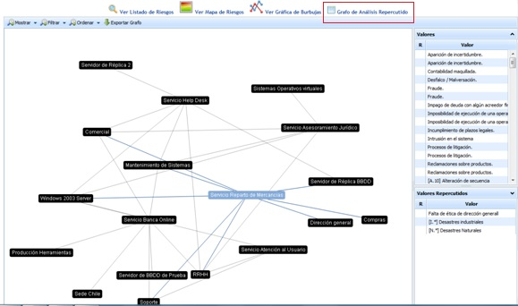

# Grafo de Análisis Repercutido

Esta opción sólo estará disponible si se tiene activado en el apartado 'Ajustes/Metodología Análisis' el check de visibilidad para **Mapa de Riesgos Repercutidos**.

La opción ‘Grafo de Amenazas’ muestra de manera gráfica la relación de dependencia entre los distintos elementos definidos en el apartado ‘Análisis/Inventario’.

Una vez seleccionado el elemento deseado, la herramienta muestra dos listados con la siguiente información:

* **Amenazas:** Muestra el listado de amenazas propias del elemento seleccionado. Los colores indican el nivel de riesgo de la amenaza.

**NOTA:** Los colores asociados al nivel de riesgo se pueden parametrizar en el apartado ‘Ajustes’.

* **Amenazas Repercutidas:** Muestra el listado de amenazas de aquellos elementos que dependen de elemento seleccionado. Los colores indican el nivel de riesgo de la amenaza.

**NOTA:** Los colores asociados al nivel de riesgo se pueden parametrizar en el apartado ‘Ajustes’.

Las opciones que permite realizar la herramienta sobre el grafo de dependencias son las siguientes:

* **Mostrar:** Permite filtrar el listado de elementos y mostrar los elementos por servicios.

* **Filtrar:** Permite realizar un filtro de elementos por niveles.

* **Ordenar:** Ofrece la posibilidad de ordenar el grafo de dos maneras:

  * *Automático:* Al desplazar cada uno de los nodos en la pantalla, el grafo tendrá a juntarse en el centro de manera automática.
  * *Manual:* Al desplazar cada uno de los nodos en la pantalla, estos se quedan fijos en la posición marcada.

* **Exportar grafo:** Permite descargar el grafo de dependencias en formato .png
