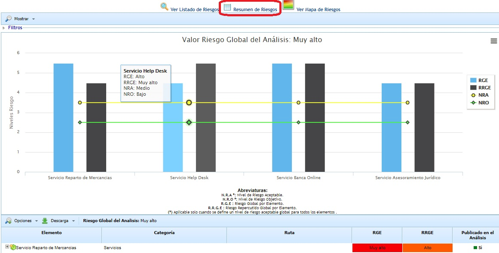
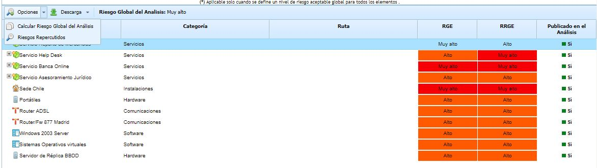
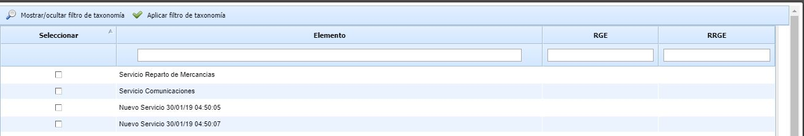
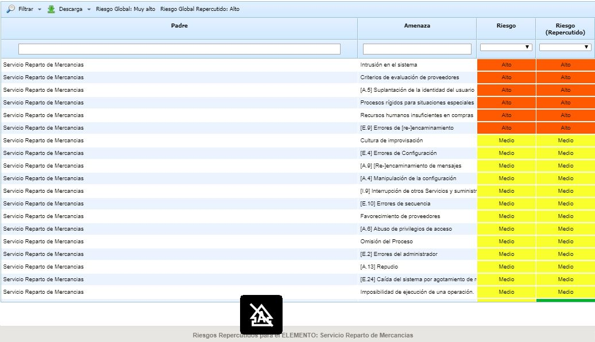

# Resumen de Riesgos

Al pulsar sobre esta opción la herramienta muestra una vista resumen de los riesgos obtenidos en la opción 'Análisis de Riesgos'.

La gráfica que aparece en la parte superior muestra los valores de Riesgo Global por Elemento (RGE) y Riesgo Repercutido Global por Elemento (RRGE) de cada uno de los servicios definidos. Estos valores se pueden comparar con los valores de Nivel de Riesgo Aceptable (NRA) y Nivel de Riesgo Objetivo (NRO) definidos para el Análisis de Riesgos. Se permite seleccionar los servicios que queremos que aparezcan en la gráfica.

De igual forma, en la parte superior de la gráfica se muestra el Valor del Riesgo Global del Análisis de Riesgos, el cual es calculado en función del criterio definido para el Análisis de Riesgos.

**NOTA:** Todos los valores de riesgos que aparecen en la gráfica (RGE, RRGE, NRA, NRO y Riesgo Global del Análisis) se establecen en función de los criterios definidos en la opción 'Análisis de Riesgos - Información General'.

En la parte inferior, debajo de la gráfica, se muestra el listado de elementos junto a los valores de RGE y RRGE calculados para cada uno de ellos.

Cuando en el análisis hay más de 15 elementos de primer nivel (servicios) asociados, no se muestra la gráfica, se muestra el siguiente mensaje: "Para visualizar la gráfica seleccione los elementos deseados en la opción Seleccionar Elementos"

Por lo tanto hay que seleccionar en el botón "Mostrar" la opción de "Seleccionar elementos" para marcar cuáles se quieren mostrar. En la ventana emergente se puede filtrar por la taxonomía, para obtener los servicios que cumplan que alguna de sus amenazas tenga alguno de esos riesgos asociado.

Esta tabla permite las siguientes opciones:

* **Opciones - Calcular Riesgo Global del Análisis:** Realiza el cálculo del Riesgo Global para el análisis de riesgos. El criterio que se utiliza para obtener el Riesgo Global por Análisis se define en el apartado 'Análisis de Riesgos - Información General' explicado en secciones anteriores.

* **Opciones - Riesgos Repercutidos:** Permite visualizar las amenazas repercutidas de un elemento concreto. Las amenazas repercutidas están formadas por las amenazas del propio elemento más las amenazas de los elementos dependientes (en función de las dependencias establecidas en el apartado 'Inventario').

* **Descarga:** Permite la descarga del listado de elementos junto a los valores de RGE y RRGE en formato editable (.xlsx) o en formato .PDF.
