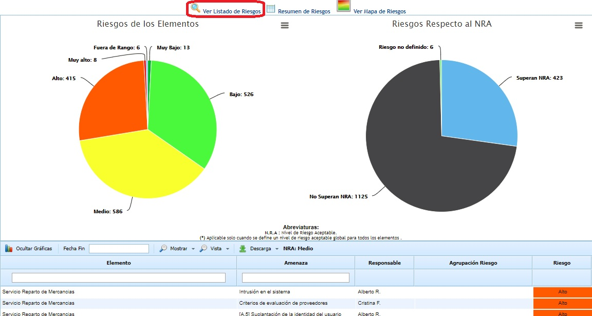
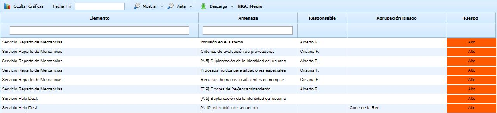
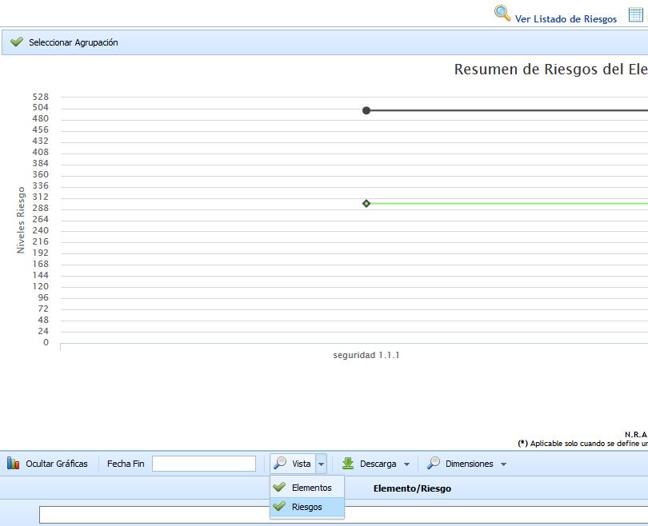
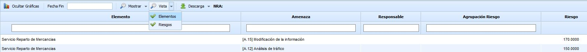

# Ver Listado de Riesgos

Al pulsar sobre esta opción la herramienta muestra la siguiente información:

Las gráficas muestran la información específica del análisis seleccionado, indicando:

* **Riesgos de los elementos:** Muestra el número de riesgos obtenidos.

* **Riesgos respecto al NRA:** Muestra el número de riesgos que superan el NRA y aquellos que están por debajo.

Por otro lado, se muestra el listado de elementos y riesgos que han sido analizados, cuya información es la siguiente:

* **Elemento:** Indica el nombre del elemento evaluado.

* **Amenaza:** Indica el nombre de la amenaza valorada y asociada al elemento.

* **Responsable:** Indica el responsable asociado al riesgo.

* **Agrupación Riesgo:** Muestra el listado de tipos de riesgos que se han definido en el apartado 'Ajustes /Catálogos Análisis'.

* **Riesgo:** Indica el valor de riesgo que se ha obtenido en base a las valoraciones realizadas en el apartado ‘Análisis/Análisis de Riesgos’. Este valor puede ser cualitativo o cuantitativo en función de la valoración definida en el apartado 'Ajustes/Metodologías de Análisis' para la dimensión del riesgo.

Para una mejor gestión de la tabla, la herramienta permite realizar las siguientes acciones:

* **Ocultar gráficas:** Permite al usuario ocultar las gráficas del apartado superior.

* **Fecha Fin:** Posibilita el usuario definir la fecha en la cual ha finalizado el análisis y evaluación de riesgos.

* **Mostrar:** Permite filtrar el listado de elementos mostrando aquellos que únicamente superan el NRA (Superan el NRA), mostrando el listado con todos los elementos y riesgos valorados (Todos) o filtar por el porcentaje identificado en el apartado de 'Ajustes /Metodologías Análisis'.

**NOTA:** El filtrado de amenazas por porcentaje muestra, del total de amenazas valoradas, únicamente el porcentaje definido partiendo desde las más críticas o muy altas hasta que cubra el porcentaje establecido.

* **Vista:** Permite filtrar la visualización de los riesgos por elemento o por riesgo.

Si se selecciona la opción de riesgos, en la gráfica no aparecerán todos los riesgos, ya que únicamente se muestran los de primer nivel. Si se quieren mostrar más riesgos, se tendrán que escoger en el botón "Seleccionar agrupación" donde se puede ver todo el árbol.

Si se selecciona la opción de Elementos, se han añadido dos nuevos filtros en las columnas "Responsable" y "Agrupación Riesgo" para que se pueda filtrar directamente por estos dos campos.

* **Descarga:** Permite la descarga del listado de elementos/riesgos en formato editable (.xlsx) o en formato .PDF. Esta opción también permite descargar un informe específico en formato xls que contiene, para cada servicio/producto de la organización, los valores consolidados de cada una de las categorías de riesgos de la organización. Se calculan los valores cuantitativos tanto de la dimensión del riesgo como de las dimensiones que se utilizan para calcular el riesgo en la metodología (por ejemplo, las típicas probabilidad e impacto), utilizando para ello el tipo de cálculo denominado "Cálculo de Riesgo por Agrupación de Riesgos" configurado en la opción "Análisis de Riesgos - Información General".

* **Dimensiones:** Permite filtrar la información de la evaluación de Riesgos cuando previamente ha sido pulsado el botón "Vista" y la opción "Riesgos", ya que si no el botón "Dimensiones" no estará disponible. El filtro se realiza sobre las dimensiones de la metodología. Una vez pulsada la dimensión deseada, la información de la gráfica y de la tabla, es actualizada.
