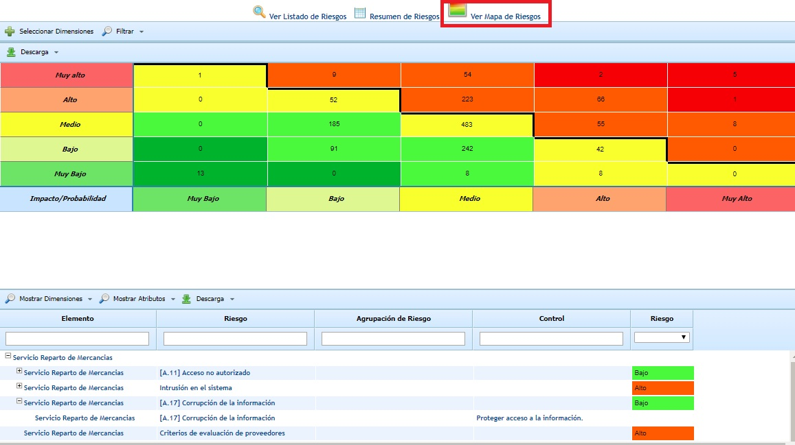
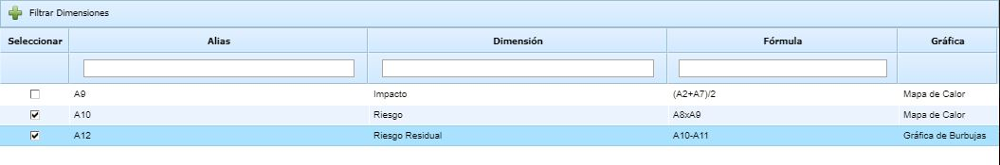
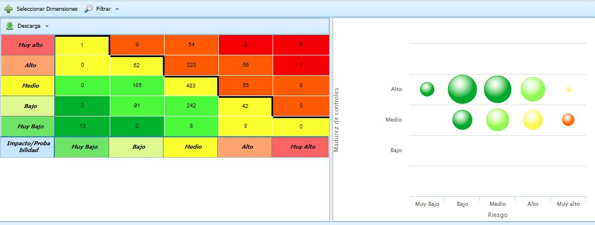
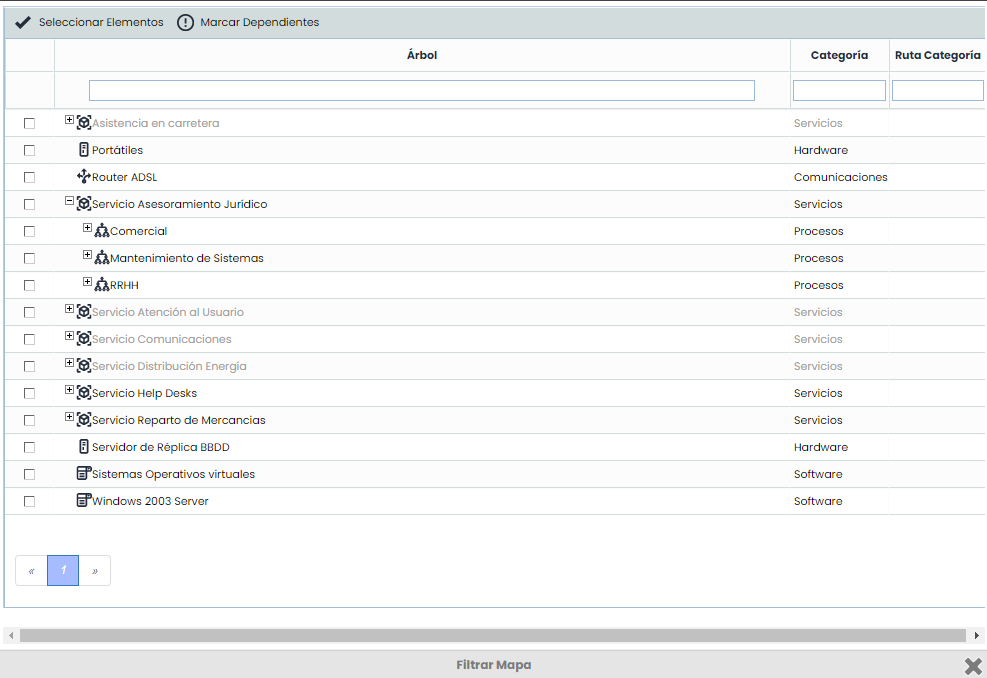
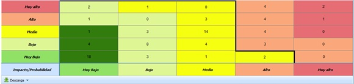
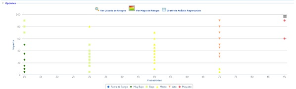
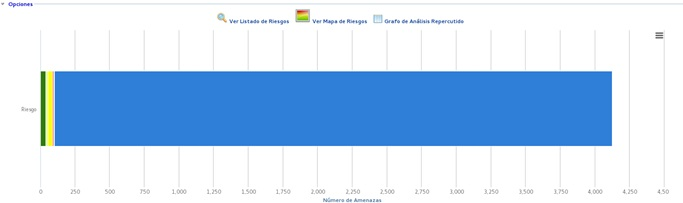
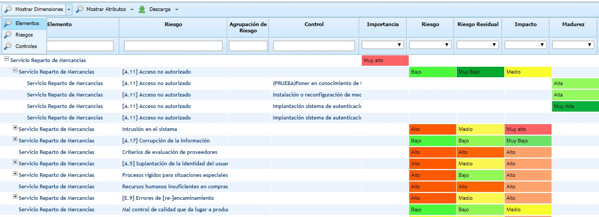
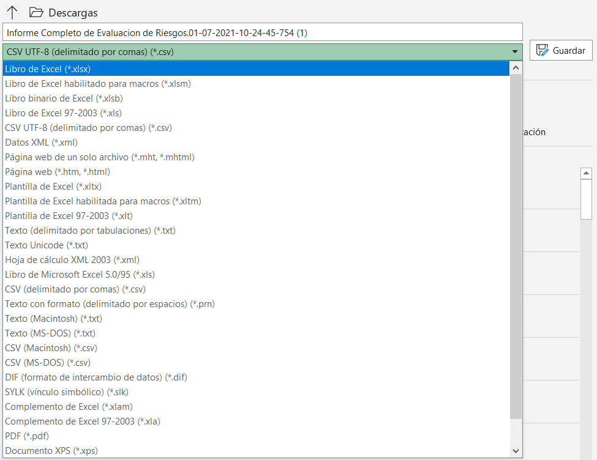

# Ver Mapa de Riesgos

Al seleccionar un análisis de riesgos de la tabla inicial se accede a la siguiente información:

La herramienta muestra el Mapa de Riesgos (o mapa de calor) con los riesgos identificados en la opción 'Análisis de Riesgos'.

En el apartado superior se muestra una matriz de las dimensiones que se han definido para calcular el riesgo, en función de la metodología de análisis definida en el aparatado de 'Ajustes/Metodologías de Análisis'.

En la parte superior del Mapa de Riesgos existen varias opciones que permiten configurar la información a mostrar en el Mapa de Riesgos:

* **Seleccionar Dimensiones:** Permite seleccionar **varias dimensiones** automáticas que estén definidas en base a otras dos dimensiones, para poder tener varios mapas de calor simultáneamente. Además, permite seleccionar si alguna de las gráficas se quiere representar como *Mapa de Calor* o como *Gráfica de Burbujas*.

Una vez seleccionados las dimensiones a mostrar, se representan todas las gráficas:

* **Filtrar Mapa:** Permite seleccionar los elementos que formarán parte del Mapa de Riesgos. Esto permite obtener un Mapa de Riesgos con únicamente los riesgos asociados a los elementos seleccionados.

* **Mostrar Todo:** Permite mostrar el Mapa de Riesgos completo del Análisis de Riesgos. Es la opción que se ejecuta por defecto al ingresar en la opción.

En función de los tipos de dimensiones utilizadas en la metodología para el cálculo del riesgo (cualitativa o cuantitativa), las gráficas que muestra la herramienta para representar el Mapa de Riesgos son diferentes:

* **Dimensiones CUALITATIVAS y valor de riesgo CUALITATIVO o CUANTITATIVO**

* **Dimensiones CUALITATIVAS o una dimensión CUALITATIVA y otra CUANTITATIVA y valor de riesgo CUANTITATIVO**

* **Dimensiones CUANTITATIVAS o una dimensión CUALITATIVA y otra CUANTITATIVA y valor de riesgo CUANTITATIVO**

**NOTA:** La opción Mapa de Riesgos sólo se muestra cuando se ha configurado el nivel de riesgo en función de dos dimensiones.

Por otra parte, en la pantalla inferior se muestra el listado de elementos, riesgos y controles que forman parte del Mapa de Riesgos superior. Esta tabla contiene los siguientes botones:

* **Mostrar Dimensiones:** Permite seleccionar que dimensiones (cuantitativas o cualitativas) de los **Elementos**, **Riesgos**, o **Controles** van a aparecer en el listado. Por defecto aparecen visibles las dimensiones configuradas en el apartado de Ajustes.

* **Mostrar Atributos:** Permite seleccionar que dimensiones textuales (atributos) de los **Elementos**, **Riesgos**, o **Controles** van a aparecer en el listado.

**NOTA:** Los Mapas de Calor pueden descargarse en formato Excel.

El listado de Elementos-Riesgos-Controles, puede ser descargado en formato CSV. Existen dos opciones de Descarga:

* Tabla CSV: Descarga en un archivo csv las columnas con las dimensiones y atributos que estén visibles en ese momento
* Tabla Completa CSV: Genera un informe con todas las dimensiones y atributos configurados, aunque no estén visibles en este momento.

Este formato CSV es un estándar que permite la explotación y volcado de la información de riesgos en otros sistemas, facilitando la interconexión y explotación de las mismas.

En próximas versiones se incorporarán nuevos informes en este formato estándar CSV

Si se quiere convertir el informe descargado en formato Excel, se puede realizar siguiendo estos pasos:

1. Abra el archivo .csv descargado de GlobalSUITE® que desee convertir.
2. Haga clic en **Archivo** > **Guardar como**.

   
3. En **Sitios**, seleccione el lugar donde desea guardar el archivo.

   
4. En el cuadro de diálogo **Guardar como**, vaya a la ubicación deseada.

   
5. En la lista **Guardar como tipo**, haga clic en el formato de archivo "*Libro de Excel (\*.xlsx)*". Haga clic en las flechas para desplazarse a los formatos de archivo que no se vean en la lista.  
   
