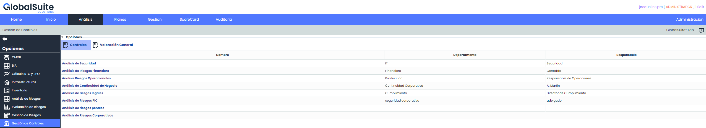
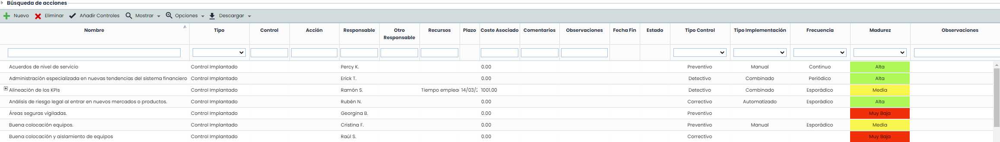
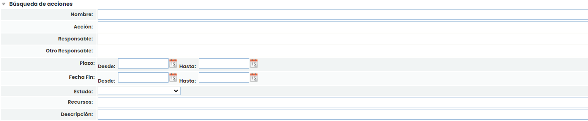
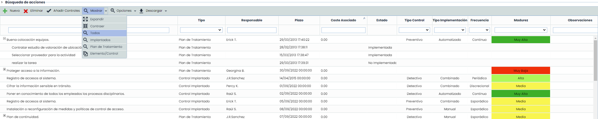
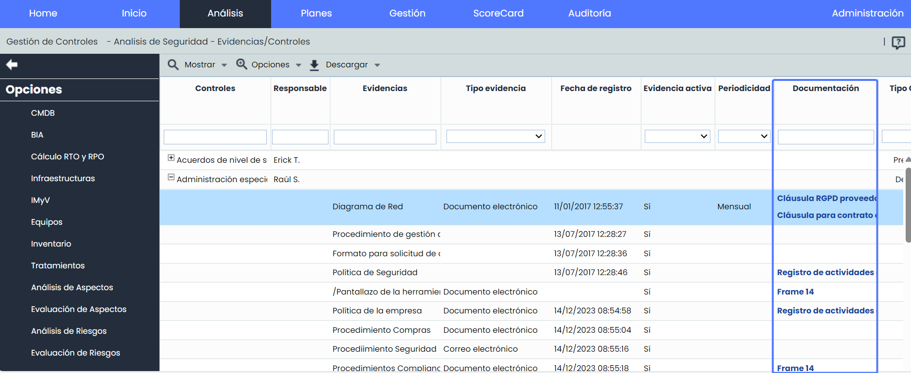

# Gestión de Controles

La gestión de controles permite al usuario valorar las dimensiones establecidas en el apartado de Ajustes > Metodologías > [Controles](https://help.globalsuitesolutions.com/es/globalsuite/v1/metodologias-controles), de los controles implantados en la organización.

Una vez se accede a la opción lo primero de todo es seleccionar el análisis de riesgos sobre el que evaluar el estado de los controles. Al seleccionar el análisis requerido se accede a la siguiente pantalla:

La información que aporta la tabla de controles es la siguiente:

* **Búsqueda de acciones:**Permite realizar filtros y búsquedas sobre todos los campos de las acciones que componen los controles ya implantados o los planes de tratamiento. También permite cruzarlos con los filtros ya existentes de controles que están en la tabla.

* **Nombre:** Indica el nombre del control y de las acciones asociadas al mismo. Para modificarlo se ha de pulsar dos veces sobre la celda o bien seleccionando el registro Opciones > Detalles.
* **Tipo:** Informa de la tipología del control, es decir, si el control está ya implantado o se ha definido en el plan de tratamiento del apartado de 'Análisis/Gestión de Riesgos'
* **Responsable:** Permite identificar el responsable del control y de las acciones asociadas.
* **Recursos:** Ofrece la posibilidad de identificar los recursos (Técnicos y/o Humanos) con los que se ha contado para la implantación del control.
* **Plazo:** Establece el plazo de implantación definitiva del control en la organización.
* **Coste:** Ofrece la posibilidad de identificar la cuantía económica que ha supuesto la implantación del control en la organización.
* **Fecha Fin:** Permite asignar un estado en base a los campos definidos en Ajustes > Metodologías > [Elementos](https://help.globalsuite.es/pages/viewpage.action?pageId=78808136).
* **Estado:**Permite seleccionar el estado de las acciones.

**NOTA**: Las columnas pueden ocultarse o añadirse según se requiera, haciendo click derecho en la cabecera de la tabla.

Las acciones que permite realizar la tabla de controles es la siguiente:

* **Nuevo**: Permite insertar un nuevo control en la tabla. Para ello se ha de pulsar el botón ‘Nuevo’ y se creará una nueva entrada.
* **Eliminar:** Permite eliminar controles del listado. Para ello se ha de seleccionar la fila o filas deseadas y pulsar el botón ‘Eliminar’.
* **Añadir Controles:** Permite importar los controles definidos en el catalogo de análisis seleccionado, si el control ya existe en Gestión de Controles, no lo duplicará.
* **Mostrar:** Ofrece la posibilidad de filtrar el listado de controles, pudiendo optar entre visualizar Todos (Implantados y Plan de Tratamiento) o específicos, ya sean sólo los controles implantados o los definidos en el plan de tratamiento.

  * **Expandir:** Permite expandir el listado de acciones.
  * **Contraer:** Permite contraer el listado de acciones.
  * **Todos:**Muestra todos los controles definidos.
  * **Implantados:** Permite filtrar el listado por los controles Implantados.
  * **Plan de Tratamiento:** Permite filtrar el listado por los controles de tipo Plan de Tratamiento.
  * **Elemento/Control:** Si se tiene una metodología de controles "Por Elemento", aparecerá la información de los controles en forma de árbol en la que las raíces serán los elementos, y los hijos los controles asignados a alguna riesgo de ese elemento, con la valoración de ese control para cada elemento. Desde está vista podremos modificar la valoración de cada dimensión para cada para elemento-control.

* **Vista Evidencias/Controles:** Si se tiene acceso a [Evidencias](https://help.globalsuitesolutions.com/es/globalsuite/v1/gestion-de-evidencias), esta opción permitirá visualizar las evidencias asociadas a cada control, sin necesidad de ingresar al detalle de cada control individualmente. De esta manera, los usuarios pueden obtener rápidamente una visión general de las evidencias disponibles asociadas a cada control. Además, brinda la posibilidad de descargar los documentos asociados a cada evidencia directamente desde el campo “Documentación”.

* **Opciones - Restaurar Valoración:** Permite, en el caso de que la valoración de los controles implantados sea especifica por amenaza, restaurar de manera general todas las valoraciones efectuadas en cada uno de los controles, sustituyendo los valores por los determinados en el presente apartado de Gestión de Controles.
* **Opciones - Detalles:** Ofrece la posibilidad de visualizar y/o definir detalles más específicos del control. En el siguiente subapartado se detalla el formulario que se muestra al pulsar sobre el botón.
* **Opciones - Importar Datos:** Permite importar controles que se encuentran registrados en un archivo Excel. La importación permite cargar tanto información descriptiva del control (Nombre, Responsable, etc.) como información de sus dimensiones (aquellas que estén configuradas en la metodología de controles).Entre las propiedades a importar de los controles existe un ID para el control que se almacenará internamente con la finalidad de que en futuras importaciones de los mismos controles, no se dupliquen los mismos.
* **Opciones - Calcular EC:** Permite al usuario volver a calcular la valoración de los controles. Si se producen cambios en la metodología de controles, pulsando sobre este botón se recalcula el valor de las dimensiones automáticas.
* **Opciones - Resultados de Encuestas:** Permite acceder a una pantalla que muestra el resultado de las encuestas de controles, dónde se puede revisar y consolidar la información obtenida.
* **Descargar:** Ofrece la posibilidad de descargar el listado de controles y las acciones en formato CSV.  El Informe estará disponible en la opción [Descargas Pendientes](https://help.globalsuite.es/display/GlobalSUITEes/.Descargas+Pendientes+vv6.23).

**NOTA:** Si se quiere convertir el informe descargado, en formato Excel, se puede realizar siguiendo los pasos explicados en la sección [Descargas Pendientes.](https://help.globalsuite.es/display/GlobalSUITEes/.Descargas+Pendientes+vv6.23)

* [Resultados de Encuestas](resultados-de-encuestas.md)
* [Valoración General del Control](valoracion-general-del-control.md)
* [Detalles de un control](detalles-de-un-control.md)
