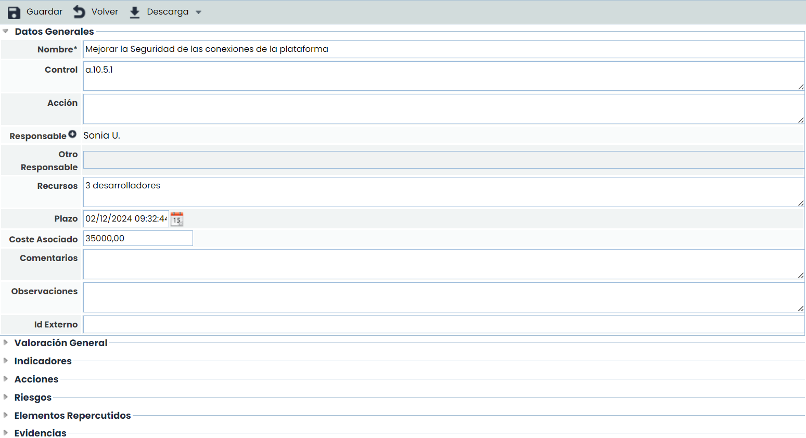
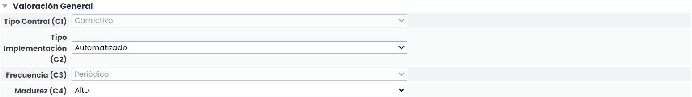
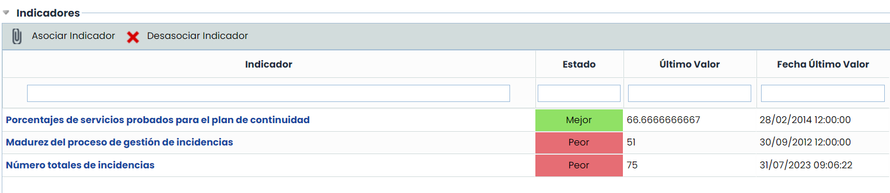
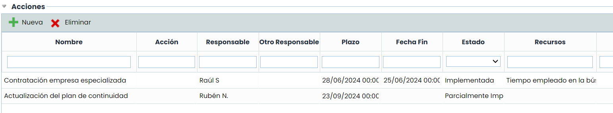
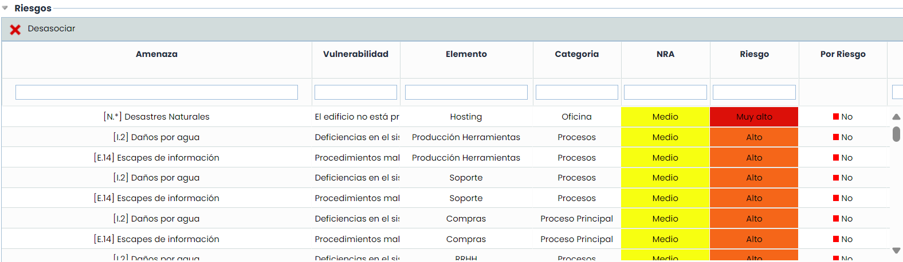
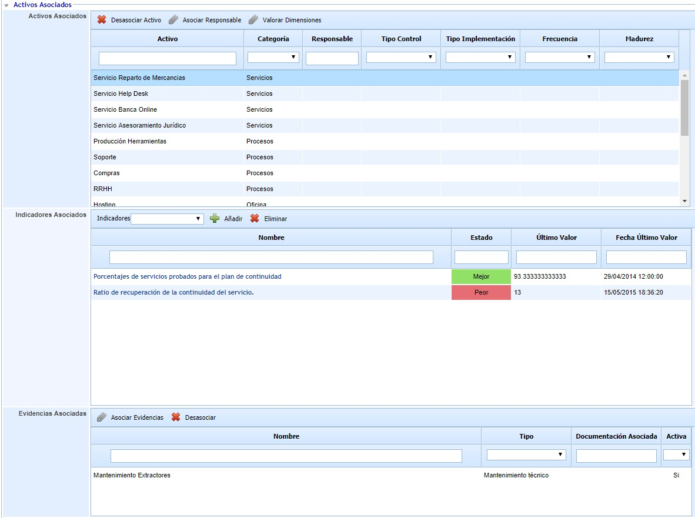
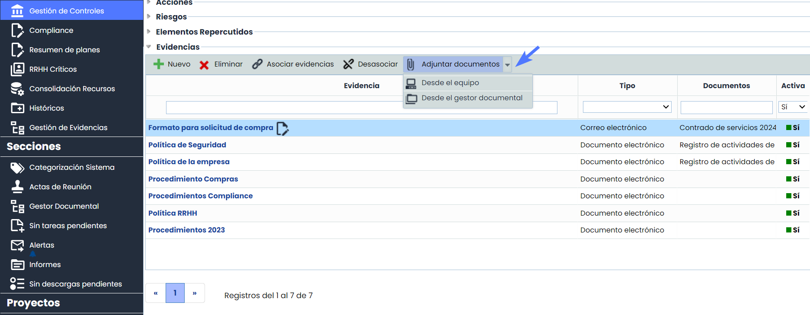
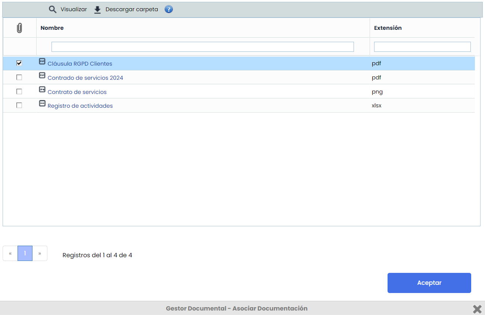
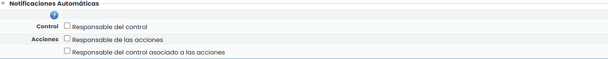
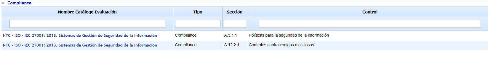

# Detalles de un control

El formulario se divide en varios apartados, permitiendo definir los siguientes campos:

## Datos Generales

* **Nombre:** Identifica el nombre del control que se mostrara en la tabla inferior.
* **Control:** Permite identificar el control de la Declaración de Aplicabilidad (SOA) al que está asociado.
* **Responsable:** Identifica el responsable dentro de la organización de verificar la implantación del control en los plazos definidos. Este responsable se puede seleccionar del conjunto de Empleados (ver apartado en pestaña Gestión).
* **Otro Responsable:** Identifica el responsable dentro de la organización de verificar la implantación del control en los plazos definidos, pudiendo definirlo de manera textual.
* **Recursos:** Permite identificar los recursos o departamentos de la organización que van a estar implicados en la implantación del control.
* **Plazo:** Identifica el plazo en el cual el control debe estar implantado en la organización.
* **Coste Asociado**: Posibilita definir el coste que tiene para la organización la implantación del control.
* **Comentarios:** Permite incorporar aclaraciones específicas sobre la implantación del control.
* **Observaciones:**Permite indicar cualquier anotación adicional asociada al control.

## Valoración General Control

Permite valorar las dimensiones del control que se han configurado para mostrarse en la Ficha de Control. Ver Metodología de Controles.

## Indicadores del Control

Permite asociar uno o varios indicadores definidos en el apartado ScoreCard > [Indicadores](https://help.globalsuitesolutions.com/es/globalsuite/v1/indicadores).

## Acciones asociadas al control

Permite definir las acciones necesarias para la implantación del control pulsando sobre el botón ‘Nueva’. Esto genera una nueva entrada en la tabla que permite definir los siguientes parámetros:

* **Nombre:** Permite identificar el nombre de la acciones pulsando dos veces sobre la celda.
* **Responsable:** Identifica el responsable o departamento dentro de la organización encargado de verificar la finalización de la acción en el plazo definido.
* **Recursos:** Permite identificar el/los recursos o departamentos implicados en la realización de la acción.
* **Plazo:** Identifica el plazo en el cual la acción debe estar completada. Este plazo no debe ser superior al plazo de implantación definitivo del control.

En caso de querer eliminar una acción, se ha de seleccionar la fila o filas deseadas y pulsar el botón ‘Eliminar’.

## Riesgos con el control asociado

Muestra el listado de riesgos de la tabla superior a las que está asociado el control, incluyendo el nivel de riesgo y su tipo. Para desasociar la amenaza al control se ha de seleccionar la fila o filas deseadas y pulsar el botón “Desasociar”.

En caso de que la metodología de controles utilizada sea de tipo "Por Riesgo", para cada riesgo se podrá revisar y modificar la evaluación de eficacia que tiene el control, así como modificarla. El check "Por Riesgo" estará puesto a Sí cuando la evaluación sea específica para ese riesgo, o por el contrario aparecerá como No los riesgos que no tengan valoración específica y a los que se les aplicará la valoración general del control.

## Elementos Asociados

Este apartado se muestra en caso de que la metodología de controles esté definida de tipo “Por Elemento”. Ver Metodologías > [Metodologías de Controles](https://help.globalsuitesolutions.com/es/globalsuite/v1/metodologias-controles).

En la tabla principal de “Elementos Asociados” se muestra los activos sobre los que está aplicado el control. Si se quiere desasociar el control de alguno de los activos, se puede hacer seleccionándolo en la tabla y pulsando el botón “Desasociar Elemento”.

También se puede asignar un responsable del control para cada activo, seleccionándolo y pulsando “Asociar Responsable”. En ese caso se abrirá una ventana para elegir el Empleado que se quiere asignar.

De igual manera, también se puede valorar la madurez o eficacia del control para cada activo de manera específica.

Por último, cuando seleccionamos un activo, las tablas siguientes de “Indicadores Asociados” y “Evidencias Asociadas” se cargan con los indicadores y evidencias del control para cada elemento, que son independientes de los indicadores y evidencias generales del control.

## Elementos repercutidos

Muestra el listado de elementos que se van a ver afectados de manera indirecta por el control. Los elementos mostrados son aquellos de los que depende el/los elementos identificados en el apartado anterior “Riesgos con el control asociado”. Las dependencias se definen en el apartado Análisis > [Inventario](https://help.globalsuitesolutions.com/es/globalsuite/v1/inventario)

## Evidencias asociadas al control

Permite asociar evidencias al plan de tratamiento (o control) que se está definiendo. Para ello, a través del botón "Asociar Evidencias" se accede a una ventana emergente que contiene todas las evidencias registradas en la opción Análisis > [Gestión de Evidencias](https://help.globalsuitesolutions.com/es/globalsuite/v1/gestion-de-evidencias). Se permite asociar una o varias evidencias del listado.

Además, se podrán realizar las siguientes acciones:

* **Adjuntar Documentos**: Es posible adjuntar documentación a las evidencias desde dos fuentes:

  * Desde Gestor Documental: Se podrán asociar los documentos previamente almacenados en el [Gestor Documental](https://help.globalsuitesolutions.com/es/globalsuite/v1/gestor-documental), así como desasociarlos de la evidencia cuando sea necesario.
  * Desde el Equipo Local: Se podrán subir archivos directamente desde el equipo del usuario.


\*\*Nota\*\*
Al modificar el nombre de un archivo o carpeta en esta ventana, los cambios también se reflejarán en el [Gestor Documental](https://help.globalsuitesolutions.com/es/globalsuite/v1/gestor-documental).


* **Creación y Eliminación de Evidencias**:

  * Se podrán crear y eliminar evidencias.

Al eliminar la evidencia, ésta se eliminará para todos los controles a los que esté asociada. Si sólo desea eliminarla de un control en particular, deberá realizar la acción de desasociar la evidencia de ese control específico.

* **Acceso y Edición de Evidencias:**

  * Se podrá acceder a la evidencia mediante un enlace directo, facilitando la navegación y el acceso rápido a la información necesaria.
  * Se podrá editar el nombre de la evidencia al pulsar el icono que se muestra a continuación del nombre de la evidencia.

## Notificaciones Automáticas

Permite habilitar el envío de notificaciones al responsable del control, o a los responsables de las acciones del control, en función de qué campos se marquen.

Las alertas se envían cuando:

* Se asigna un empleado como responsable del control o de una acción
* Una semana antes del cumplimiento del plazo
* Cuando se cumpla el plazo
* Semanas sucesivas de que se cumpla el plazo

Estas alertas se enviarán siempre y cuando las acciones no se encuentren en un estado completado al 100%, de entre los estados definidos en Configuración > [Metodología Elementos](../../ajustes/metodologias/metodologia-elementos.md) (Niveles Controles Gestión de Riesgos / Plan de adecuación).

## Compliance

En esta tabla, se pueden consultar qué requisitos de cumplimiento están relacionados con el control. Además, es posible acceder a la evaluación de [Compliance](../compliance/README.md) enlazada a través del link.

