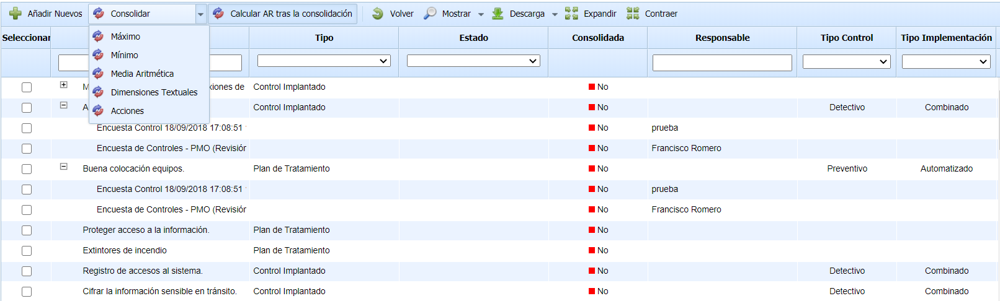
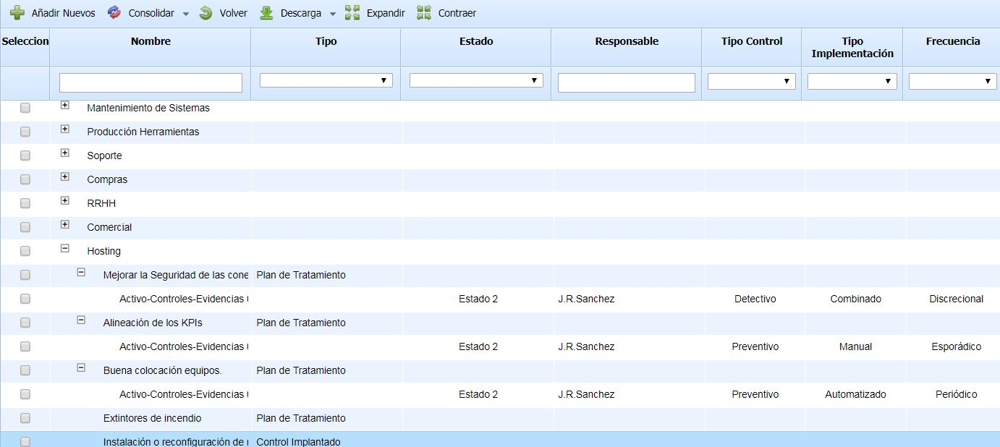
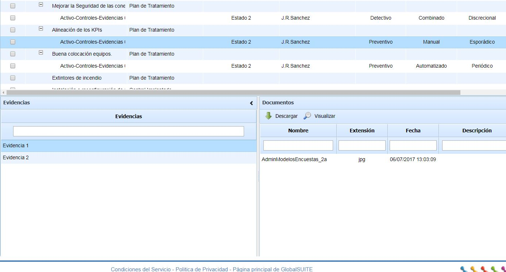

# Resultados de Encuestas

## Resultados de Encuestas de Controles

La presente opción permite visualizar la valoración de los controles que se ha realizado en las diferentes encuestas de tipo 'Controles'. Para acceder a la opción es necesario pulsar sobre la opción "Resultados de Encuestas".

Una vez se ha accedido a la opción, se muestra una tabla que contiene los controles registrados con la información obtenida en las diferentes encuestas. Las opciones que permite la herramienta sobre la tabla son las siguientes:

* **Añadir Nuevos:** Permite insertar los controles nuevos que se han identificado en las encuestas de controles. Los controles nuevos identificados se muestran resaltados en verde, y la herramienta permite seleccionar qué controles añadir y qué controles no añadir.

* **Consolidar:** Permite la consolidación de las distintas valoraciones efectuadas sobre un mismo control en diferentes encuestas, pudiendo utilizar varias opciones de consolidación: Máximo (registro de la valoración más alta), Mínimo (registro de la valoración más baja) y Media Aritmética (registro del promedio entre las diferentes valoraciones). Esta opción modifica las valoraciones de los controles. También se puede consolidar las Dimensiones Textuales y las acciones de los controles.
* **Calcular AR tras consolidación**: Este campo sirve para seleccionar si se quiere que, tras la consolidación de las encuestas seleccionadas, se recalculen todas las dimensiones automáticas del análisis, por defecto aparece marcado. Como este proceso puede tardar varios minutos, es posible desmarcarlo para realizar varias consolidaciones y recalcular los riesgos al final.

* **Volver:** Permite regresar al listado de controles.
* **Mostrar**: Permite mostrar todas las encuestas de controles, o únicamente las que están pendiente de consolidación.

* **Descarga:** Permite la descarga de la información que se muestra en la tabla de gestión de encuestas en un archivo editable (.xlsx) o en formato .PDF

## Resultados de Encuestas Activo-Control

La presente opción permite visualizar la valoración de los controles que se ha realizado en las diferentes encuestas de tipo 'Activos-Controles'. Para acceder a la opción es necesario pulsar sobre la opción "Resultados de Encuestas Activo-Control".

Una vez se ha accedido a la opción, se muestra un árbol que contiene como raices los activos y como hijos los controles registrados con la información obtenida en las diferentes encuestas. Las opciones que permite la herramienta sobre la tabla son las siguientes:

* **Añadir Nuevos:** Permite insertar los controles nuevos que se han identificado en las encuestas de controles. Los controles nuevos identificados se muestran resaltados en verde, y la herramienta permite seleccionar qué controles añadir y qué controles no añadir.

* **Consolidar:** Permite la consolidación de las distintas valoraciones efectuadas sobre un mismo control en diferentes encuestas, pudiendo utilizar varias opciones de consolidación: Máximo (registro de la valoración más alta), Mínimo (registro de la valoración más baja) y Media Aritmética (registro del promedio entre las diferentes valoraciones). Esta opción modifica las valoraciones de los controles.

* **Volver:** Permite regresar al listado de controles.

* **Descarga:** Permite la descarga de la información que se muestra en la tabla de gestión de encuestas en un archivo editable (.xlsx) o en formato .PDF

En el caso que la encuesta también tenga Evidencias, se incluirán las asociaciones definidas en las encuestas, así como los documentos subidos a cada evidencia, de cada control.

