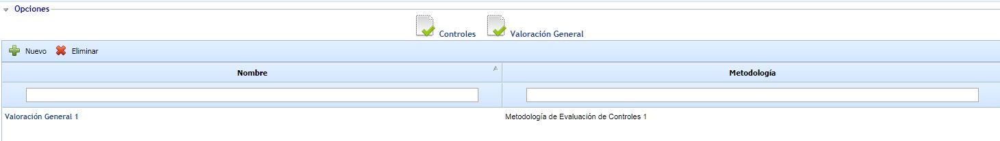
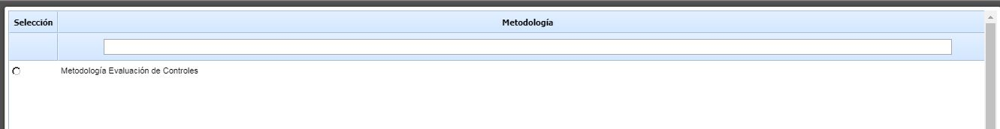
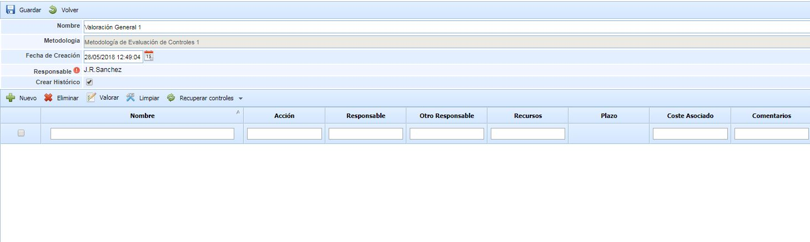
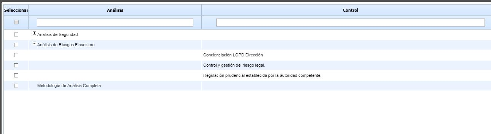
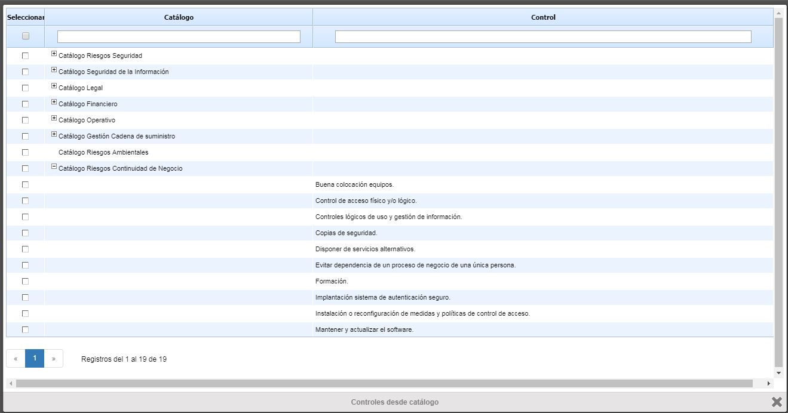
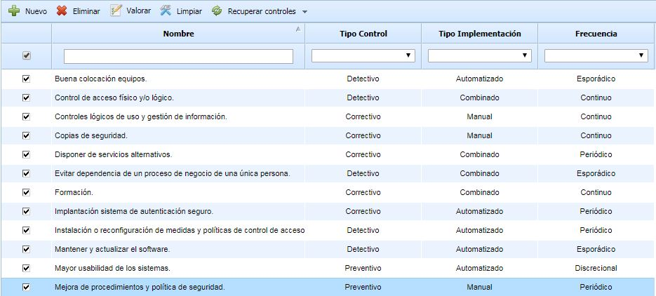
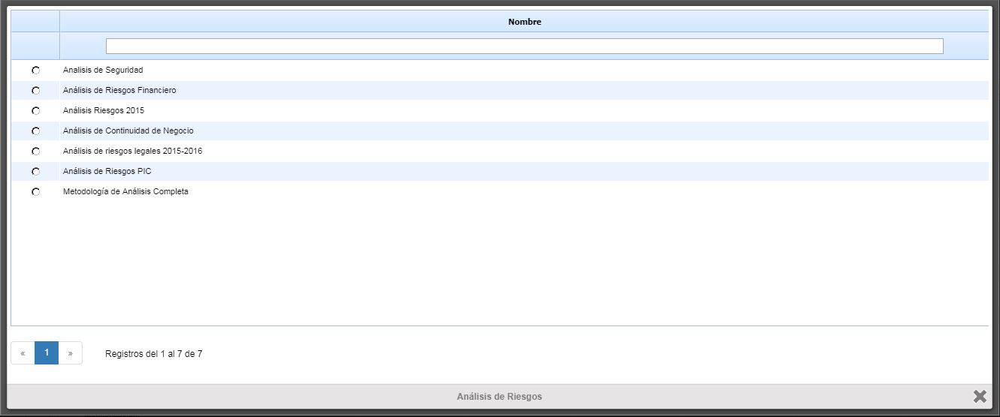
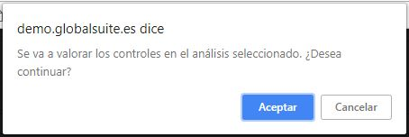
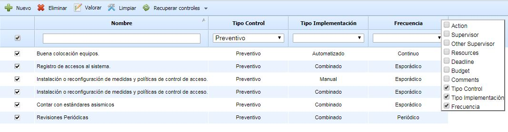

# Valoración General del Control

Esta opción permite tener una valoración general de controles dentro del sistema de gestión. Esta valoración puede ser usada y copiada en todos los análisis de riesgos que se tengan configurados. De esta forma, las organizaciones podrían tener un repositorio central de controles y se podrían asociar a los diferentes análisis de diferentes áreas sin necesidad de volver otra vez a valorar.

Para acceder a ella, cuando se pulsa en la opción Gestión de Controles, se habilita un menú superior con dos opciones, pulsando en la opción Valoración General se accederá al listado de valoraciones de controles de la organización. Con esta opción se podrá tener un repositorio de controles común, pero distintas valoraciones de esta forma cada valoración puede ser asociada al análisis de riesgos donde se necesite.

Las acciones de esta opción son:

* Nuevo: Crear nueva valoración para poder copiarla a los análisis de riesgos. Para crear valoraciones de riesgos es necesario elegir sobre que metodología realizar esta valoración, por esta razón, al pulsar el botón nuevo se abrirá una ventana emergente con las metodologías definidas en Ajustes - Metodología de Análisis - Metodología de Controles.

* Eliminar: Eliminar valoraciones de controles que ya no se utilicen.

Pulsando en el link del listado de Evaluaciones se accederá a la pantalla donde se valorarán los controles.

En la parte superior de la pantalla tenemos los siguientes campos:

* Nombre: Nombre que identifica a la valoración.
* Metodología: Etiqueta para mostrar la metodología de controles que se está usando.
* Fecha de Creación: Fecha de la valoración.
* Responsable: Responsable de la valoración. Pulsando en el botón rojo se abrirá una ventana emergente con los empleados definidos en la opción Gestión - Empleados.
* Crear Histórico: Si se marca está opción, siempre que se aplique la valoración establecida se creará un histórico para no perder los datos del análisis de riesgos.

Para empezar a crear controles para realizar la valoración se tienen las siguientes opciones:

* Botón Nuevo: Esta acción creará un botón manual para cambiarle el nombre y modificar la valoración.
* Recuperar Controles - Desde Análisis: Al pulsar este botón se abrirá una ventana con los análisis donde se utilice la metodología definida para la evaluación. Al abrirse se mostrarán los análisis y dentro del análisis los controles utilizados. Pulsando en la columna de la izquierda los controles se asociarán automáticamente. Si pulsa en el análisis se marcarán todos los controles que pertenecen al análisis, esto nos evita tener que ir de uno en uno.

* Recuperar Controles - Desde Catálogo: Al pulsar este botón se abrirá una ventana con los catálogos asociados al análisis donde se utiliza la metodología de controles. Al abrirse se mostrarán los catálogos y dentro de los catálogos los controles. Pulsando en la columna de la izquierda los controles se asociarán automáticamente. Si pulsa en el catálogo se marcarán todos los controles que pertenecen a dicho catálogo, esto nos evita tener que ir de uno en uno.

Una vez elegido los controles que van a estar asociados a la metodología, ya se puede valorar estos controles. La diferencia entre recuperar controles del análisis o controles del catálogo es que si ya tienes un análisis con los controles valorados, al relacionarlo desde el análisis estos controles se copiarán con la valoración que ya tienen. Si por el contrario se quiere empezar una valoración desde cero habría que importar controles desde el catálogo.

Una vez añadido los controles, se podrá modificar las dimensiones de controles pulsando dos veces en la celda que se quiere modificar.

Además de estas opciones de añadir controles tenemos las siguientes opciones:

* Eliminar: Si un control no es necesario en la valoración, se seleccionará en la tabla (pulsando sobre el control) y se pulsará el botón Eliminar.
* Limpiar: Si un control tiene una valoración y se quiere eliminar estas valoraciones sin eliminar el control, se seleccionará en la tabla (pulsando sobre el control) y se pulsará el botón, eliminará toda la información que contiene el control, menos la columna Nombre.
* Aplicar: Una vez valorados todos los controles se pulsará este botón para copiar los datos a los análisis. Pasando el ratón por este botón se abrirán dos opciones

  * Aplicar Todas las Dimensiones: Se copiará toda la información de los controles sin diferenciar si la celda está vacía o completa.

    * Sobre todos los controles: Se copiará la información en todos los controles elegidos, aunque estos controles ya tengan datos. En este caso, se reemplazarán estos datos por los nuevos.
    * Sobre controles sin valorar: Se copiará la información solo en los controles que no tengan datos y no realizará ninguna modificación en los controles que tengan alguna dimensión o atributo ya valorado.
  * Aplicar Dimensiones Valoradas: Se copiará solo las dimensiones de controles que contengan datos, obviando las dimensiones vacías.

    * Sobre todos los controles: Se copiará la información en todos los controles elegidos, aunque estos controles ya tengan datos. En este caso, se reemplazarán estos datos por los nuevos.
    * Sobre controles sin valorar: Se copiará la información solo en los controles que no tengan datos y no realizará ninguna modificación en los controles que tengan alguna dimensión o atributo ya valorado.

Para poder aplicar estas dimensiones se tendrán que seleccionar los controles que se quiere copiar seleccionándolos en la columna de la izquierda. La copia se realizará solo sobre los controles seleccionados. Si se quiere seleccionar todo se pulsar en la cabecera de la primera columna para evitar ir uno a uno.

Una vez que se pulse el botón de Aplicar teniendo en cuenta sobre que controles se quiere aplicar la valoración de esta evaluación, se abrirá una ventana emergente con los análisis donde se utiliza esta metodología, pulsando en la columna de la izquierda saldrá un mensaje de confirmación para poder modificar el análisis de riesgos. Los datos del análisis de riesgos se modificarán, si no se tiene seleccionado la opción de Crear Histórico los datos antiguos no se podrán visualizar.

***NOTA**: Para que GlobalSUITE identifique correctamente los controles, se realizará una comparación entre el nombre del control en la valoración y el nombre del control en el análisis. Por lo tanto, los nombres deben coincidir para poder realizar la copia de forma correcta.*

Por último, está tabla tendrá las mismas funcionalidades que el resto de tablas de GlobalSUITE, se podrá ocultar o mostrar columnas pulsando en la cabecera de la tabla con el botón derecho y podrá elegir estas columnas. Además, se podrá ordenar la información de la tabla por la columna seleccionada pulsando sobre la cabecera de la columna con el botón izquierdo del ratón. Si necesita identificar los controles con algún atributo común podrá utilizar el filtro de la tabla y se ocultarán el resto de controles que no cumplan con este atributo.

En la imagen se puede ver la tabla utilizando el filtro y con el menú de columnas abiertos para configurar la visualización.

