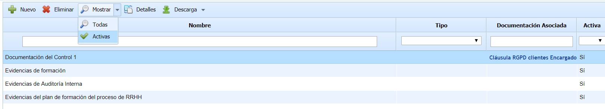
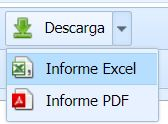
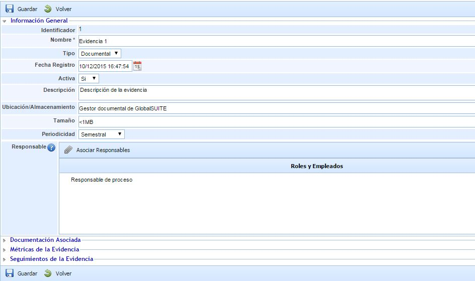
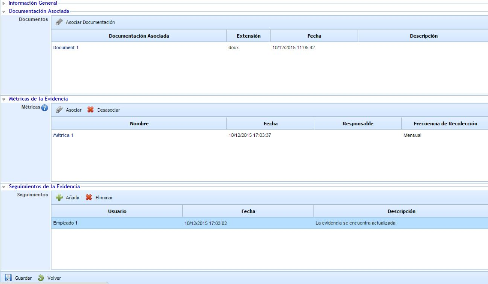

# Gestión de Evidencias

Esta opción permite al usuario registrar y gestionar las evidencias de la organización, pudiéndose relacionar posteriormente con los planes de tratamiento de riesgos y los controles implantados que se encuentra registrados en la opción "Gestión de Controles".

Al acceder a la opción se muestra una tabla que contiene todas las evidencias de la organización. Por defecto, aparecen únicamente las evidencias activas, aunque a través del botón "Mostrar" se puede acceder al listado de todas las evidencias.

La tabla muestra un resumen de la evidencia, a través de las columnas "Nombre", "Tipo", "Documentación Asociada" y "Activa". El resto de información de una evidencia se puede consultar directamente en la tabla utilizando el botón derecho del ratón, dónde aparecen todas las columnas que se pueden añadir.

Con el botón **Descarga** se ofrece la posibilidad de descargar el listado de Evidencias en un formato editable (xls) o en formato PDF.

Para acceder al detalle de una evidencia hay que seleccionar una fila de la tabla y pulsar sobre el botón "Detalles". Al pulsar sobre este botón aparece el siguiente formulario:

Dentro de la sección "Información General" existen diferentes campos para registrar información asociada a la evidencia, como el nombre, tipo, fecha, descripción, etc. El campo "Tipo" se trata de una lista desplegable que contiene los diferentes tipos de evidencia que han sido registrados en 'Ajustes', concretamente en la opción "General" de Configuración.

Debajo de la sección "Información General" existen otra secciones que se detallan a continuación:

* **Documentación Asociada:** Esta sección permite asociar documentación del gestor documental a la evidencia. A través del botón "Asociar Documentación" se abre una ventana emergente que contiene el árbol de carpetas y archivos del gestor documental, permitiendo la selección de uno o varios documentos.
* **Métricas de la Evidencia:** Esta sección permite asociar métricas que se encuentran registradas en el menú ScoreCard. A través del botón "Asociar" se abre una ventana emergente que contiene el listado de métricas registradas en el ScoreCard, permitiendo la selección de una o varias métricas.
* **Seguimientos de la Evidencia:** Esta sección permite registrar aquellos seguimientos que se consideren necesarios para el control de la evidencia. La tabla permite crear diferentes filas a través del botón "Añadir", pudiendo registrar para cada seguimiento el usuario (por defecto, se indica el nombre del usuario que crea el seguimiento), la fecha y la descripción.
