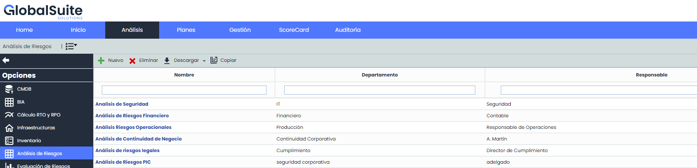

# Gestión de Riesgos

La opción de gestión de riesgos permite establecer un plan de tratamiento de riesgos sobre aquellos elementos que han sido valorados en el apartado de Análisis de Riesgos.

* [Proyección y Simulación](proyeccion-y-simulacion.md)
* [Seguimiento del Plan de Tratamiento](seguimiento-del-plan-de-tratamiento.md)
* [Planificación de la gestión de riesgos](planificacion-de-la-gestion-de-riesgos.md)
