# Planificación de la gestión de riesgos

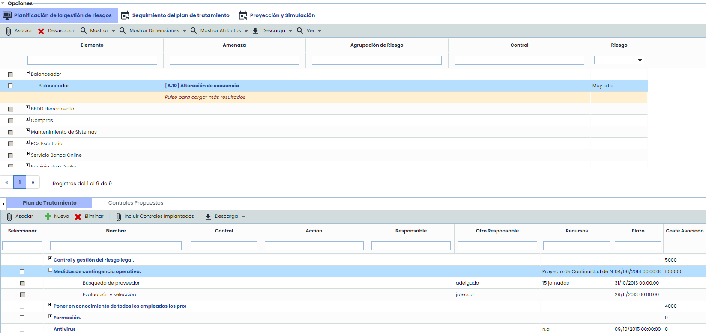

Una vez seleccionado el Análisis de Riesgos a tratar en el listado inicial, se accede a la opción ‘Planificación de la gestión de riesgos’.

La opción se divide en dos tablas, que muestran la siguiente información:

### Listado de elementos, riesgos y controles

Muestra ‘por defecto’ el listado de elementos, riesgos que superan el NRA definido y controles asociados. Las tareas que se pueden realizar sobre la tabla son las siguientes:

* **Asociar/Desasociar:** Permite asociar/desasociar uno o varios controles de la tabla inferior a los riesgos deseados. Para ello se he de seleccionar el checkbox del riesgo, seleccionar el checkbox del control de la tabla inferior y pulsar ‘Asociar’/‘Desasociar’.

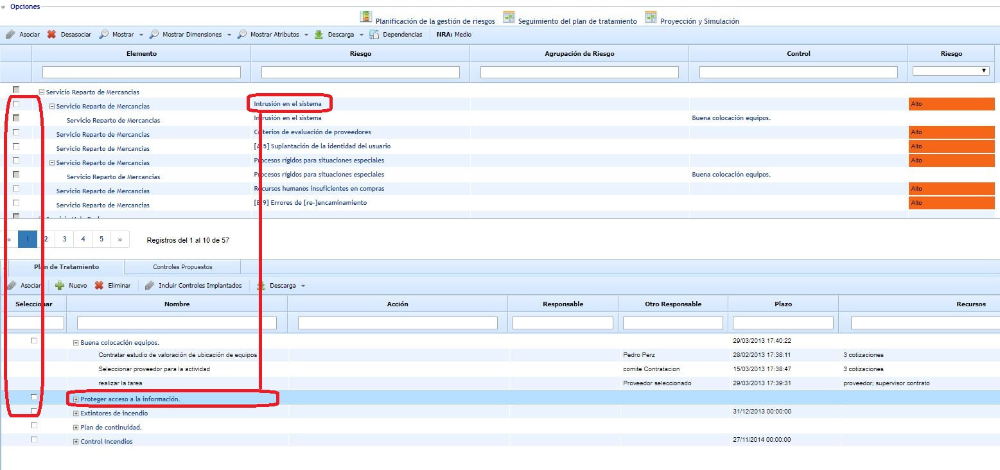

* **Mostrar:** Permite al usuario realizar un filtro de visualización del listado de elementos, riesgos y controles. Las opciones posibles son:

  * *Mostrar Todos:* Muestra el listado completo de elementos, riesgos y controles valorados en el apartado ‘Análisis de Riesgos’.
  * *Superan NRA:* Muestra el listado de elementos, riesgos y controles asociados que superan el NRA.
  * *Porcentaje Aceptable:* Muestra el porcentaje aceptable de riesgos que se aceptan en la organización. Este parámetro se configura en "Ajustes".
  * *Mostrar Todos (Sin Control):* Permite visualizar el listado completo de elementos, riesgos y controles, con independencia del NRA.
  * *Superan NRA (Sin Control):* Permite visualizar el listado de elementos, riesgos y controles asociados que superan el NRA.
  * *Porcentaje Aceptable (Sin Control):* Muestra el porcentaje aceptable de riesgos que se aceptan en la organización. Este parámetro se configura en "Ajustes".
* **Mostrar Dimensiones:** Permite seleccionar las dimensiones *cuantitativas/cualitativas* que se mostrarán en la tabla, tanto para los elementos, los riesgos o los controles.
* **Mostrar Atributos:** Permite seleccionar las dimensiones *textuales* que se mostrarán en la tabla, tanto para los elementos, los riesgos o los controles.
* **Descarga:** Posibilita descargar el listado de elementos, riesgos y controles asociados en un formato editable (.docx)
* **Ver:** Esta opción permite visualizar los riesgos de un elemento en vista de Árbol o Datos BIA.

  * **Árbol**: En caso de tener activado el uso de [Dependencias](https://help.globalsuite.es/pages/viewpage.action?pageId=52529148) en el Inventario, esta ventana emergente se ha optimizado para mostrar los elementos superiores e inferiores al elemento actual dentro de la estructura jerárquica, filtrando el árbol y resaltando en negrita su ubicación, para tener la información sin necesidad de acceder a otro apartado.

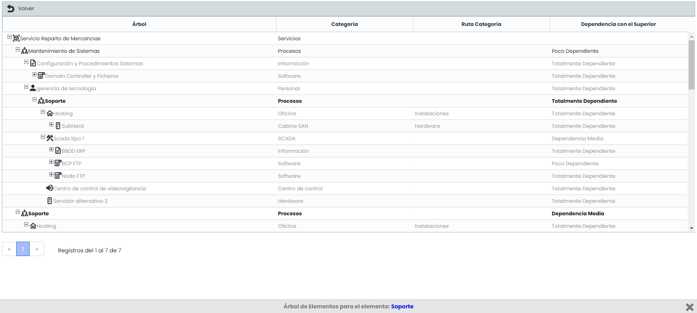

* **Datos BIA:**
* **NRA:** Informa sobre el Nivel de Riesgo Aceptable definido en el apartado ‘Evaluación de Riesgos’.

**NOTA :** En función de la metodología definida en el apartado 'Ajustes/Metodología Análisis', las valoraciones de riesgo pueden ser cualitativas o cuantitativas.

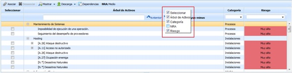

### Plan de Tratamiento

En la parte inferior se muestra el listado de acciones que se han definido para mitigar las amenazas que superan el NRA listadas en la tabla superior. Las opciones que su pueden realizar sobre la tabla son:

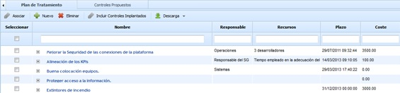

* **Asociar:** Permite asociar uno o varios controles a la amenaza/s listadas en la tabla superior. Para ello se he de seleccionar el checkbox de la amenaza en la tabla superior, seleccionar el checkbox del control y pulsar ‘Asociar’.
* **Eliminar:** Al pulsar el botón posibilita eliminar un control definido en la tabla del plan de tratamiento.
* **Descarga:** Posibilita descargar el listado de controles y acciones asociadas en un formato editable (.docx).
* **Incluir controles implantados:** Ofrece la posibilidad de insertar dentro del plan de tratamiento controles ya implantados en la organización.
* **Nuevo:** Al pulsar el botón permite insertar un nuevo control a la tabla. Para definir los parámetros del nuevo control se ha de pulsar sobre el mismo en la tabla, mostrándose el siguiente formulario.

### Edición de un plan de tratamiento

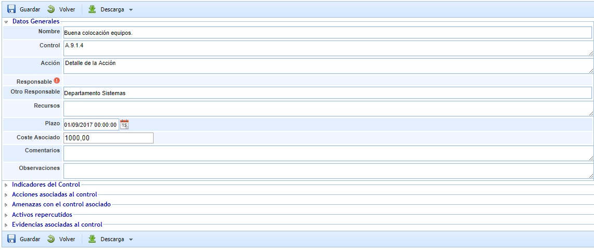

El formulario se divide en varios apartados, permitiendo definir los siguientes campos:

**Datos Generales**

* **Nombre:** Identifica el nombre del control que se mostrara en la tabla inferior.
* **Control:** Permite identificar el control de la Declaración de Aplicabilidad (SOA) al que está asociado.
* **Responsable:** Identifica el responsable dentro de la organización de verificar la implantación del control en los plazos definidos. Este responsable se puede seleccionar del conjunto de Empleados (ver apartado en pestaña Gestión).
* **Otro Responsable:** Identifica el responsable dentro de la organización de verificar la implantación del control en los plazos definidos, pudiendo definirlo de manera textual
* **Recursos:** Permite identificar los recursos o departamentos de la organización que van a estar implicados en la implantación del control.
* **Plazo:** Identifica el plazo en el cual el control debe estar implantado en la organización.
* **Coste Asociado**: Posibilita definir el coste que tiene para la organización la implantación del control.
* **Comentarios:** Permite incorporar aclaraciones específicas sobre la implantación del control.
* **Observaciones:**Permite indicar cualquier anotación adicional asociada al control.

**Valoración General Control**

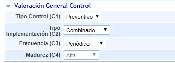

Permite valorar las dimensiones del control que se han configurado para mostrarse en la Ficha de Control. Ver Metodología de Controles.

**Indicadores del Control**

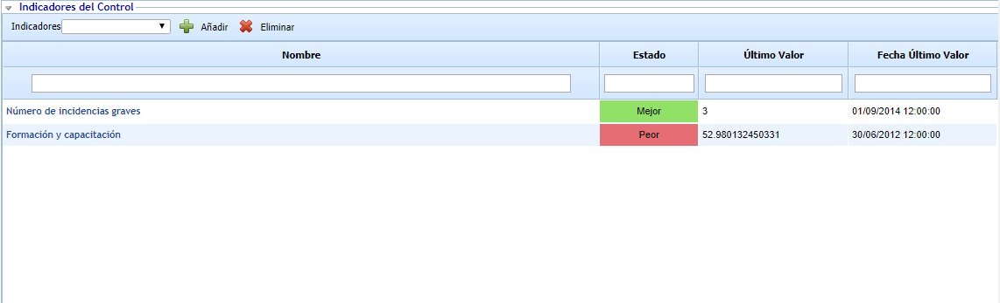

Permite asociar uno o varios indicadores definidos en el apartado ‘ScoreCard/Indicadores’.

**Acciones asociadas al control**

Permite definir las acciones necesarias para la implantación del control pulsando sobre el botón ‘Nueva’. Esto genera una nueva entrada en la tabla que permite definir los siguientes parámetros:

* **Nombre:** Permite identificar el nombre de la acciones pulsando dos veces sobre la celda.
* **Responsable:** Identifica el responsable o departamento dentro de la organización encargado de verificar la finalización de la acción en el plazo definido.
* **Recursos:** Permite identificar el/los recursos o departamentos implicados en la realización de la acción.
* **Plazo:** Identifica el plazo en el cual la acción debe estar completada. Este plazo no debe ser superior al plazo de implantación definitivo del control.

En caso de querer eliminar una acción, se ha de seleccionar la fila o filas deseadas y pulsar el botón ‘Eliminar’.

**Amenazas con el control asociado**

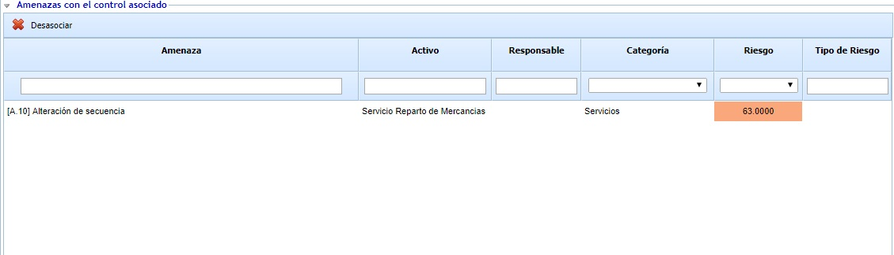

Muestra el listado de amenazas de la tabla superior a las que está asociado el control, incluyendo el nivel de riesgo y su tipo. Para desasociar la amenaza al control se ha de seleccionar la fila o filas deseadas y pulsar el botón ‘Desasociar’.

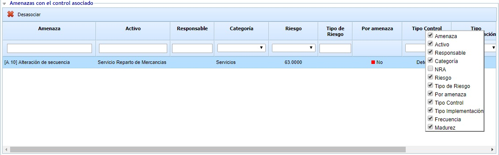

En caso de que la metodología de controles utilizada sea de tipo "Por Amenaza", para cada amenaza se podrá revisar y modificar la evaluación de eficacia que tiene el control, así como modificarla. El check "Por Amenaza" estará puesto a Sí cuando la evaluación sea específica para esa amenaza, o por el contrario aparecerá como No las amenazas que no tengan valoración específica y a las que se les aplicará la valoración general del control.

**Activos repercutidos**

Muestra el listado de activos que se van a ver afectados de manera indirecta por el control. Los activos mostrados son aquellos de los que depende el/los activos identificados en el apartado anterior ‘Amenazas con el control asociado’. Las dependencias se definen en el apartado ‘Análisis/Inventario de Activos’.

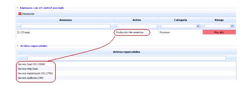

**Evidencias asociadas al control**

Permite asociar evidencias al plan de tratamiento (o control) que se está definiendo. Par ello, a través del botón "Asociar Evidencias" se accede a una ventana emergente que contiene todas las evidencias registradas en la opción "Gestión de Evidencias" del menú de Análisis. Se permite asociar una o varias evidencias del listado.

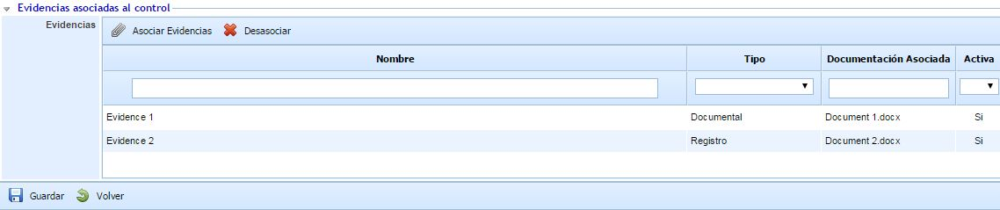

### Controles propuestos

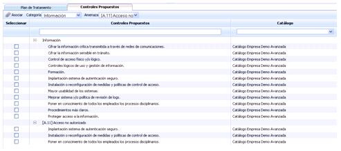

GlobalSUITE ofrece la posibilidad de contar con un catálogo de controles que asociar a las amenazas de la tabla superior, permitiendo realizar las siguientes acciones:

* **Asociar:** Permite asociar uno o varios controles propuestos a la amenaza/s listadas en la tabla superior. Para ello se he de seleccionar el checkbox de la amenaza en la tabla superior, seleccionar el checkbox del control y pulsar ‘Asociar’.

Al asociar el control este se mostrará en la tabla del plan de tratamiento.

* **Categoría:** Permite mostrar el listado de controles propuestos por categorías. El listado de controles puede definirse en ‘Ajustes/Catálogos Análisis’.
* **Amenaza:** Permite mostrar el listado de controles propuestos por amenazas. El listado de controles puede definirse en ‘Ajustes/Catálogos Análisis’.
