# Proyección y Simulación

La opción de proyección y simulación permite al usuario comprobar de manera inicial como afectaría la implantación de los controles definidos en el sistema (Proyección) o verificar de manera real, como han afectado una vez implantados (Simulación).

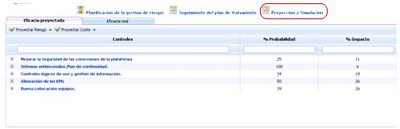

La opción se divide en dos pestañas, sobre las que se pueden realizar una serie de acciones que se desarrollan a continuación.

### Eficacia proyectada

La pestaña de eficacia proyectada muestra de manera inicial el listado de controles que se han definido en el apartado ‘Planificación de la gestión de riesgos’. Sobre estos controles se puede establecer cómo afectaría a la organización su implantación en base a las dimensiones que se hayan definido en las metodologías de riesgos y controles. Para ello se ha de pulsar dos veces sobre la celda e indicar el valor deseado en porcentaje de reducción.

En función de cómo se haya configurado el tipo de eficacia, el valor introducido podrá ser un valor numérico (Cuantitativa):

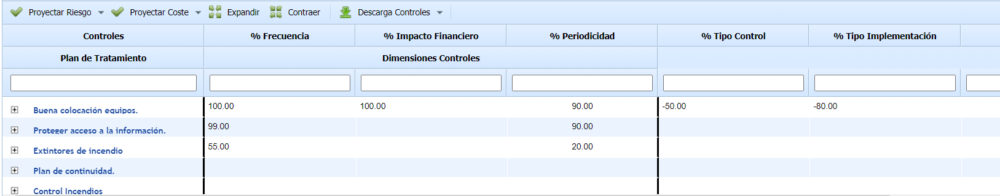

o un nivel de eficacia (Cualitativa):

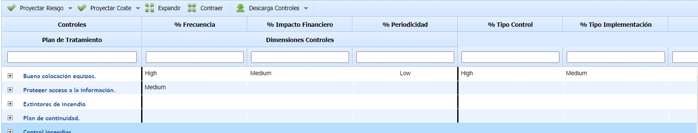

Para el caso de las dimensiones de controles, es posible configurar que en esta opción se defina la eficacia de los controles según la metodología (Controles):

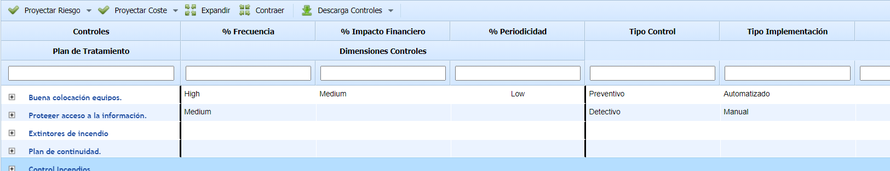

Una vez definidos los valores, la herramienta posibilita realizar las siguientes acciones:

* **Proyectar Riesgo:** Permite mostrar mediante una tabla de valores como afectaría la implantación de los controles en base al Análisis de Riesgos realizado. Para ello la herramienta permite realizar el cálculo según las siguientes opciones:

  * **Máximo:** Realiza el cálculo en base al valor máximo de porcentaje de las dimensiones definidas.
  * **Mínimo:** Realiza el cálculo en base al valor mínimo de porcentaje de las dimensiones definidas.
  * **Media:** Selecciona como valor porcentual la media de los valores de las dimensiones definidas.
  * **Acumulado:** Selecciona como valor porcentual la suma de los valores de las dimensiones definidas.

En función del modo de cálculo seleccionado, la herramienta muestra en una tabla de valores los niveles de riesgos resultantes tras la implantación de los controles.

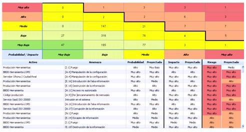

Adicionalmente, la tabla inferior detalla los valores mostrados en la tabla superior, indicando simultáneamente los valores obtenidos en el análisis de riesgos realizado y los valores resultantes tras la implantación de los controles.

* **Proyectar coste:** Permite comprobar el beneficio económico que tendría para la organización la implantación de los controles definidos en el plan de tratamiento de riesgos. Para ello la herramienta permite realizar el cálculo según las siguientes opciones:

  * **Máximo:** Realiza el cálculo en base al valor máximo de porcentaje de las dimensiones definidas.
  * **Mínimo:** Realiza el cálculo en base al valor mínimo de porcentaje de las dimensiones definidas.
  * **Media:** Selecciona como valor porcentual la media de los valores de las dimensiones definidas.
  * **Acumulado:** Selecciona como valor porcentual la suma de los valores de las dimensiones definidas.

En función del modo de cálculo seleccionado, la herramienta muestra la siguiente información:

**Tabla beneficios controles y amenazas asociadas**

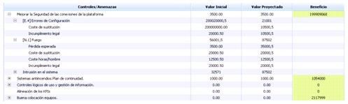

* **Controles/Amenazas:** De manera jerárquica muestra el listado de controles y aquellas amenazas asociadas por encima del NRA que mitigaría en caso de implantarse.
* **Valor Proyectado:** Muestra, en base al modo de cálculo seleccionado, el ahorro de costes en caso de materializarse una amenaza.

**NOTA:** El coste de implantación de los controles siempre será un valor fijo.

* **Beneficio:** Indica el beneficio total que aporta a la organización la implantación de los controles definidos.
* **Valor Inicial:** Muestra dos tipos de valores:

  * *Valor asociado al control:* Indica el coste económico que supone a la empresa la implantación del control. Este valor se define en el aparatado de ‘Planificación de la Gestión de Riesgos’

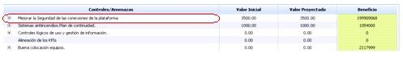

* *Valor asociado a la amenaza:* Indica el coste que supone a la empresa la materialización de dicha amenaza. Estos valores se definen en el apartado de ‘Análisis de Costes’.

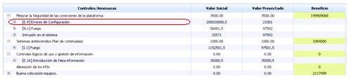

**Tabla costes controles y amenazas**

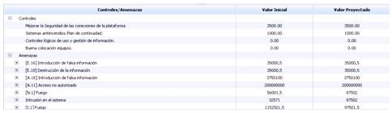

Muestra el coste de la implantación de los controles por un lado y el coste económico en caso de materialización de las amenazas (Valor Inicial) y su coste estimado en caso de implantar los controles (Valor Proyectado).

**Datos generales**

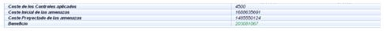

Muestra de manera global los siguientes datos:

* **Coste de los controles aplicados:** Coste económico total de implantación de los controles.
* **Coste inicial de las amenazas:** Coste total en caso de materialización de aquellas amenazas que superan el NRA.
* **Coste Proyectado de las amenazas:** Coste total en caso de materialización de aquellas amenazas que superan el NRA una vez implantados los controles.
* **Beneficio:** Muestra el ahorro económico que supondría para la organización la implantación de los controles.

### Eficacia Real

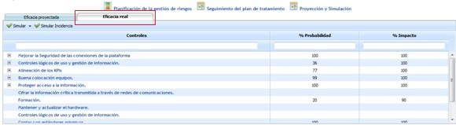

Al pulsar sobre la pestaña Eficacia real la herramienta solicita al usuario si desea copiar las estimaciones de reducción definidas en la pestaña Eficacia Proyectada.

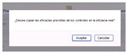

En caso de que las estimaciones (porcentajes de las dimensiones definidas) hayan sido reales tras la implantación de los controles, el usuario debe ‘Aceptar’ y automáticamente la herramienta copiará las valoraciones en la pestaña Eficacia real. Por el contrario, si una vez implantados los controles, los valores estimados no son los esperados, el usuario debe ‘Cancelar’ la copia de valores.

Una vez respondida la solicitud de copiado de valores estimados se accede a la siguiente pantalla. En caso de aceptar la copia de valores, la tabla mostrará los mismos valores definidos en la pestaña Eficacia Proyectada.

En caso de cancelación, la tabla aparecerá sin valores, siendo tarea del usuario definir los porcentajes de mejora real de la probabilidad e impacto tras la implantación de los controles.

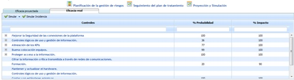

Una vez definidos los porcentajes de mejora la herramienta permite realizar la siguiente acción:

* **Simular:** Permite mostrar, mediante una tabla de valores, como los niveles de riesgo han sido reducidos tras la implantación de los controles. Para ello la herramienta permite realizar el cálculo según las siguientes opciones:

  * **Máximo:** Realiza el cálculo en base al valor máximo de porcentaje de las dimensiones definidas.
  * **Mínimo:** Realiza el cálculo en base al valor mínimo de porcentaje de las dimensiones definidas.
  * **Media:** Selecciona como valor porcentual la media de los valores de las dimensiones definidas.
  * **Acumulado:** Selecciona como valor porcentual la suma de los valores de las dimensiones definidas.

En función del modo de cálculo seleccionado, la herramienta muestra en una tabla de valores los niveles de riesgos resultantes tras la implantación de los controles.

Adicionalmente, la tabla inferior detalla los valores definitivos tras la implantación de controles.

Al pulsar sobre el botón ‘Aplicar’ la herramienta genera un histórico en el apartado ‘Análisis/Históricos’ del Análisis de Riesgos realizado y realiza una copia de los valores obtenidos en la simulación en el apartado de ‘Análisis/Análisis de Riesgos’.

* **Simular Incidencia:** En función de las modificaciones realizadas en el apartado de 'Gestión' sobre la opción de 'Riesgos', la herramienta permite simular como afectaría el suceso a la organización.
