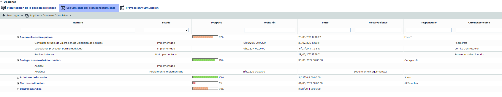

# Seguimiento del Plan de Tratamiento

La opción permite realizar un seguimiento del grado de avance de implantación de los controles definido en el apartado desarrollado en el punto anterior.

La opción de seguimiento de plan de tratamiento muestra una tabla que permite visualizar el listado de controles que forman parte del plan de tratamiento, que fueron definidos en el punto anterior (Planificación de la gestión de riesgo).

**Acciones de un control**

Al expandir un control, se muestra información de las acciones del plan de tratamiento,

* **Nombre:** Identifica el nombre del control y acciones asociadas al mismo.

* **Estado:** Permite definir el grado de implantación de la acción asociada. Para ello se ha de pulsar dos veces sobre la celda y seleccionar la opción deseada en el desplegable.

**NOTA:** Los tipos de estado pueden definirse en el apartado de ‘Ajustes’.

* **Progreso:** Muestra de manera gráfica el grado de implantación del control. La barra de progreso depende de los estados definidos en la columna anterior.
* **Fecha Fin:** permite definir la fecha real en la que se han completado las acciones y los planes de tratamiento.
* **Plazo:** Permite establecer la fecha de finalización del control o de la acción asociada. Es decir, la fecha de finalización prevista  para completar una acción o un plan de tratamiento. También es la fecha utilizada para el envío de Alertas.
* **Descripción:** Posibilita realizar cualquier anotación adicional sobre la acción deseada.
* **Responsable:** Identifica el responsable dentro de la organización de verificar la realización de una acción en el plazo definido. Este responsable se puede seleccionar del conjunto de Empleados (ver apartado en pestaña Gestión).
* **Otro Responsable:** Identifica el responsable dentro de la organización de verificar la realización de una acción en el plazo definido, pudiendo definirlo de manera textual.

Al seleccionar/pinchar sobre un control se muestra el formulario detallado del mismo definido en el punto anterior de ‘Planificación de la gestión de riesgo’. El formulario no puede ser modificado desde esta opción.

La acciones que se pueden realizar sobre la tabla son las siguientes:

* **Descargar:** Ofrece la posibilidad de descargar el listado de controles en formato editable (.docx) pulsando sobre el botón ‘Descarga’

* **Implantar controles completos:** Permite al usuario, una vez el control esta implantado el 100%, eliminar del listado del plan de tratamiento los controles asociados e incluirlos en el listado de controles ya implantados, dentro de la opción  Análisis > [Gestión de Controles](https://help.globalsuite.es/pages/viewpage.action?pageId=78808228), con opción de eliminar o conservar las acciones.

  * **Conservar acciones:**Permite mantener las acciones asociadas a los Planes de Tratamiento al implantarlos. Estos planes de tratamiento pasarán a gestionares como controles implantados desde Análisis > [Gestión de Controles](https://help.globalsuite.es/pages/viewpage.action?pageId=78808228), conservando las acciones realizadas.
  * **Eliminar acciones:**Permite eliminar las acciones asociadas a los Planes de Tratamiento al implantarlos. Estos planes de tratamiento pasarán a gestionares como controles implantados desde Análisis > [Gestión de Controles](https://help.globalsuite.es/pages/viewpage.action?pageId=78808228), eliminando las acciones realizadas.
