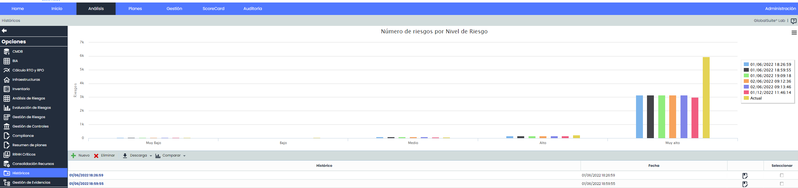
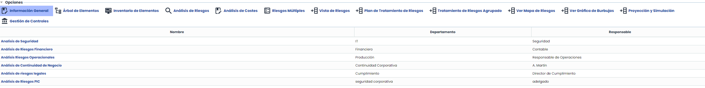

# Históricos

La opción facilitada por la plataforma permite al usuario almacenar históricos de los análisis de riesgos definidos en el apartado ‘Análisis/Análisis de Riesgos’.

Al acceder lo primero que se puede visualizar es una gráfica de barras que muestra, separado por históricos, el número de amenazas por cada uno de los niveles de riesgos definidos (Muy Alto, Alto, Medio, Bajo, Muy Bajo). Esto permite ver la evolución de los distintos análisis realizados por parte de la organización y verificar gráficamente la tendencia que se pretende conseguir con la realización de los mismos.

La tabla situada en la parte inferior permite realizar las siguientes acciones:

* **Nuevo:** Permite crear un nuevo histórico del análisis de riesgos. Para ello se ha de pulsar sobre el botón ‘Nuevo’ lo que genera una nueva entrada en la tabla.
* **Eliminar:** Posibilita eliminar un histórico establecido. Para ello se ha de seleccionar la fila o filas deseadas y pulsar el botón ‘Eliminar’.
* **Descarga:** Ofrece la posibilidad de descargar el listado de históricos en un formato editable (.xlsx) o en formato .PDF.

Al pulsar en el enlace de la tabla inferior, se muestra la información específica del análisis de riesgos en el momento de creación del histórico.

**NOTA:** La información que se muestra en la opción de históricos (Información general, Inventario de activos, Análisis de Riesgos, Análisis de Costes, etc.), ha sido desarrollada en su apartado correspondiente del presente Manual.
